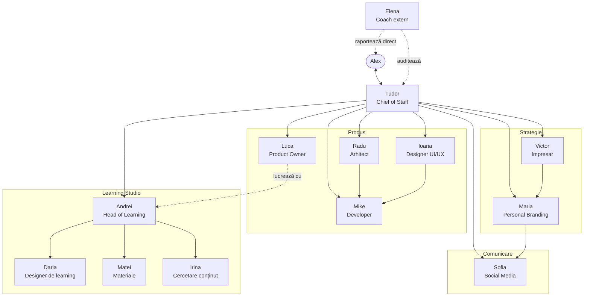

# Echipa lui Alex

> Pagina internă a sistemului. Versiunea web, cu organigramă și ultimele noutăți: https://claude.ai/artifact/C1JTTZXjf92TTuyt6fjzhs (privată). Se regenerează cu `node scripts/build-echipa.mjs`.
> O vedem doar noi (repo privat). Aici luăm decizii despre cum îmbunătățim echipa.
> Owner: Tudor. Ultima actualizare: 2026-11-15.

## Organigrama

## Roluri
| Agent | Categorie | Rol | Scop în o propoziție | Status | Profil | Scorecard |
|---|---|---|---|---|---|---|
| Tudor | Coordonare | Chief of Staff | Proiectul își atinge scopul și Alex e mulțumit. | Activ | [profil](team/tudor/profil.md) | [scorecard](team/tudor/scorecard.md) |
| Radu* | Produs | Arhitect | Structură simplă, navigare pe intenții. | Activ | [profil](team/radu/profil.md) | [scorecard](team/radu/scorecard.md) |
| Ioana* | Produs | Designer UI/UX | Liquid Glass, actual, lizibil, ușor de folosit. | Activ | [profil](team/ioana/profil.md) | [scorecard](team/ioana/scorecard.md) |
| Mike | Produs | Developer | Site rapid, accesibil, ușor de actualizat. | Activ | [profil](team/mike/profil.md) | [scorecard](team/mike/scorecard.md) |
| Maria | Strategie | Personal Branding | Brand coerent, relevant, recognoscibil. | Activ | [profil](team/maria/profil.md) | [scorecard](team/maria/scorecard.md) |
| Sofia | Comunicare | Social Media | Prezență constantă și autentică. | Probă 30 zile | [profil](team/sofia/profil.md) | [scorecard](team/sofia/scorecard.md) |
| Victor* | Strategie | Impresar | Alex în contextele potrivite. | Activ | [profil](team/victor/profil.md) | [scorecard](team/victor/scorecard.md) |
| Ana* | Business | Ofertare și clienți | Oferte relevante și follow-up, doar privat. | Activ | [profil](team/ana/profil.md) | [scorecard](team/ana/scorecard.md) |
| Luca* | Produs | Product Owner | Simulări și ateliere interactive: viziune, backlog, „gata” clar. | Activ (2026-11-22, D-083) | [profil](team/luca/profil.md) | [scorecard](team/luca/scorecard.md) |
| Elena* | Calitate | Coach extern | Sistemul se îmbunătățește lunar. | Activ | [profil](team/elena/profil.md) | [scorecard](team/elena/scorecard.md) |
| Andrei | Learning Studio | Head of Learning | Strategia și portofoliul de cursuri; conduce Learning Studio. | Activ (2026-11-17, D-052) | [profil](team/andrei/profil.md) | [scorecard](team/andrei/scorecard.md) |
| Daria | Learning Studio | Designer de learning | Brief → obiective, flow Excel, ghidul facilitatorului. | Activ (2026-11-17, D-045) | [profil](team/daria/profil.md) | [scorecard](team/daria/scorecard.md) |
| Matei | Learning Studio | Producător de materiale | Deck, worksheet-uri, printabile în brandul ales. | Activ (2026-11-17, D-045) | [profil](team/matei/profil.md) | [scorecard](team/matei/scorecard.md) |
| Irina | Learning Studio | Cercetare de conținut | Conținut solid și actual, cu surse. | Activ (2026-11-17, D-045) | [profil](team/irina/profil.md) | [scorecard](team/irina/scorecard.md) |

\* Nume propuse de Tudor. Alex le poate schimba (vezi „Cum redenumim un agent”).

## Unde găsești ce
- **Cine răspunde de ce:** [docs/aor.md](docs/aor.md)
- **Lista de idei:** [docs/idei.md](docs/idei.md)
- **Procesele:** [docs/procese/](docs/procese/)
- **Documentele fiecărui agent:** `team/<nume>/documente/`

## Fluxurile principale
| Flux | Cine | Ritm |
|---|---|---|
| Cerere nouă de la Alex | Alex → Tudor → agent(ți) → Tudor → Alex | la cerere |
| Schimbare pe site | Radu (structură) → Ioana (design) → Mike (cod) → Alex aprobă → deploy | la cerere |
| Conținut social | Maria (mesaj) → Sofia (draft) → Ioana (vizual) → Alex aprobă → Alex publică | săptămânal |
| Oportunități | Victor (pipeline) → Alex decide → Maria (materiale) | lunar |
| Raport Tudor | Tudor → Alex | săptămânal |
| Retrospectivă | Elena → Alex | lunar |
| Review echipă | Tudor + Elena → Alex decide | lunar |

## Cum evoluează echipa
1. **Fiecare agent își notează munca** în scorecard după fiecare sarcină.
2. **Lunar, Tudor și Elena fac review-ul**: pentru fiecare agent, verdictul e *păstrăm*, *ajustăm* sau *renunțăm*.
3. **Semnale că lipsește un rol:** un proces care se repetă cel puțin lunar și nu are un agent care să-l ducă cap-coadă (`docs/procese/automatizare.md`).
3b. **Semnale că un rol nu merge:** e chemat de mai puțin de 2 ori pe lună, Alex rescrie majoritatea rezultatelor, sau munca lui se suprapune cu a altui agent.
4. **Tudor propune, Alex decide.** Propunerile intră în tabelul de mai jos. Nimic nu se schimbă fără „da” de la Alex.
5. **Când renunțăm la un agent**, mutăm fișierul în `.claude/agents/_arhiva/`, păstrăm profilul și memoria pentru istoric și notăm lecția în `team/elena/documente/lectii.md`.

### Propuneri deschise
| Dată | Propunere | De ce | Propus de | Decizia lui Alex |
|---|---|---|---|---|
| 2026-11-15 | Rol viitor: **Editor de carte** (structură, ritm de scriere, redactare) | Cartea e un proiect de luni de zile, cu nevoi diferite de social media | Tudor | în așteptare |
| 2026-11-15 | Rol viitor: **Product manager pentru tool-uri** (dacă tool-urile devin multe) | Lansarea și întreținerea aplicațiilor e o muncă separată de site | Tudor | acoperit 2026-11-22: Luca, Product Owner (D-083) |
| 2026-11-17 | Rol nou: **Head of Learning** (D-052), strategia și portofoliul de cursuri, șeful echipei Learning Studio | Cererea lui Alex: cursuri noi constant, cursurile vechi transformate în materiale care rămân și se vând, inovație, renunțări după trenduri | Alex, Tudor | aprobat 2026-11-17: Andrei creat |
| 2026-11-17 | Rol nou: **Ofertare și clienți** (account manager). Ține evidența clienților și a discuțiilor, pregătește oferte din istoricul de email și din tarifele lui Alex, urmărește follow-up-ul. Lucrează doar privat: datele clienților nu intră în repo-ul public (depinde de D-043). Nu trimite nimic: Alex trimite (nivelul 3) | Alex a întrebat „Cine lucrează cu clienții?”. Azi nimeni din echipă; ofertele le face Tudor ad-hoc, iar contractele și facturile le face Roxana (BEMORE) | Tudor | aprobat 2026-11-18: Ana creată (Alex: „Aș vrea să învețe agentul care se ocupă de asta cum să facă oferte relevante”) |

## Cum adăugăm un agent nou
1. Copiază un fișier din `.claude/agents/` și schimbă `name`, `description` și misiunea.
2. Copiază un folder din `team/` și completează `profil.md` (inclusiv **Categorie** și **Jobs to be done**). Golește `scorecard.md` și `documente/`.
3. Dă-i cel puțin o arie în `docs/aor.md`.
4. Creează `.claude/agent-memory/<nume>/MEMORY.md`.
5. Adaugă rândul în tabelele de mai sus și în `CLAUDE.md`.

## Cum redenumim un agent
Spune-i lui Tudor „redenumește-l pe Radu în X”. El schimbă numele în `.claude/agents/`, `team/`, `.claude/agent-memory/`, `CLAUDE.md` și această pagină.
