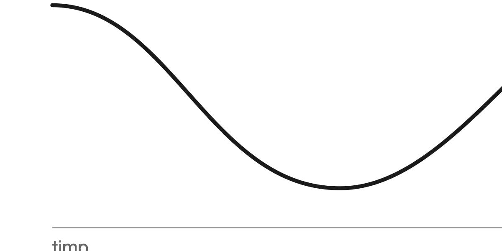

:::sala-si-curs
Ce simți în prima săptămână după o schimbare pe care n-ai ales-o?
:::

## Ideea
Orice schimbare trece printr-o scădere înainte de o creștere. Nu e un semn că
ceva merge prost. E drumul obișnuit.

:::sala-si-curs

:::

:::trainer
**Deschidere (5 min).** Întreabă: „Cine a trecut anul ăsta printr-o schimbare
pe care n-a ales-o?” Lasă mâinile să se ridice. Nu cere povești încă.

**Desenul (15 min).** Desenează curba pe flipchart, fără nume de etape la început.
Cere grupului să numească etapele.

**Dacă grupul tace:** spune un exemplu personal, scurt, apoi întreabă din nou.

**Tranziția spre exercițiu:** „Acum, fiecare își pune un post-it acolo unde e azi.”
:::

## Exercițiul
Unde ești tu acum pe curbă, pentru schimbarea cea mai mare din viața ta de lucru?

:::sala cronometru=10
**În perechi, 10 minute**
1. Pune un post-it pe curbă, unde ești azi.
2. Spune-i colegului de ce acolo.
3. Ascultă. Nu dai sfaturi.
:::

:::participant
Scrie în worksheet-ul „Curba mea” (pagina 2) unde erai acum o lună și unde ești azi.
:::

## Ce iei cu tine
O schimbare nu se judecă după prima lună.
