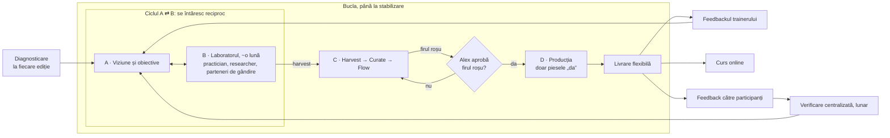

# Proces: curs nou

**DRI:** Andrei. **Echipa:** Learning Studio (Daria, Matei, Irina), plus Mike pentru generator și Alex în sală.
**Scop:** un flow simplu de care ne ținem la fiecare curs, de la prima idee până la concluziile din feedback (Alex, 2026-11-17).
**Vizual:** pagina `docs/procese/curs-nou-vizual.html`, publicată la https://claude.ai/artifact/26Jm98isMEfzt5khrN5qU3. Sursa rămâne acest fișier: când procesul se schimbă, se schimbă întâi aici, apoi pagina.
**Unde stă cursul:** sursa în repo-ul privat BEMORE-STUDIO, clonat în `privat/cursuri/<curs>/` (D-050). Generatorul e în `curs/` (`curs/README.md`). În repo-ul public intră doar procesul.

## Etapele (Alex, 2026-11-18)
**A · Viziune și obiective ⇄ B · Laboratorul → C · Harvest, Curate, Flow → poarta → D · Producția.**
- **B se termină cu harvest-ul:** tot ce a ieșit din Laborator.
- **C se termină cu firul roșu.**

### Ciclul A ⇄ B: se întăresc reciproc
- A și B nu sunt pași unul după altul, ci un ciclu. Merg în paralel și se hrănesc reciproc.
- **Viziunea dă direcție Laboratorului:** ce căutăm, ce observăm, ce dezbatem.
- **Laboratorul clarifică viziunea:** ce descoperă practicianul o face mai clară și mai simplă și poate schimba obiectivele.
- Ciclul se oprește când viziunea e clară, obiectivele stau pe loc, iar harvest-ul are piese pentru fiecare obiectiv.

### Etapa A · Viziune și obiective
- **Viziunea:** transformarea dorită, într-o propoziție clară și simplă.
- **Obiectivele:** cel mult 4, scurte, care duc spre viziune.
- Ambele stau în `curs.yml`.

### Etapa B · Laboratorul
- **Ce e:** aproximativ o lună de imersie în subiect. Învățăm, observăm, pornim dezbateri. **Scopul:** piese de conținut diverse, valoroase, relevante și gata de folosit.
- **Cine intră în Laborator:**
  - **Practicianul**, adică trainerul care își asumă subiectul și îl va livra. **Esențial:** cel care livrează trebuie să fie la nivel de practician, nu doar curios.
  - **Researcherul** (Irina): modele, studii, exemple, cu surse.
  - **Partenerii de gândire:** un AI, plus mai mulți oameni reprezentativi pentru publicul țintă sau colegi (peers).
- **Ce câștigă practicianul din Laborator:**
  - se simte conectat la subiect;
  - poate intra în conversații profunde cu publicul țintă și îi poate provoca pe teme concrete din activitatea lor;
  - are exemple și povești din practica lui personală, din luna în care și-a adus atenția mai conștient pe subiect.
- **Finalul etapei: harvest-ul.** Tot ce iese din Laborator, în trei feluri de piese:
  - **exerciții**;
  - **knowledge bites**: bucăți scurte de cunoaștere, de exemplu un model, un studiu, o idee;
  - **experiences**: experiențe și povești din practica practicianului și din dezbateri.
- Fiecare piesă e o linie în `privat/cursuri/<curs>/harvest.yml`, cu verdict „nou”. Le adaugă practicianul, Irina (din research, plus nota de surse `research.md`) și Daria (din obiective și diagnostic).

### Etapa C · Harvest, Curate, Flow
Panoul acestei etape e vederea **Harvest** din materialul trainerului (fostă „Masa”; fișierul `harvest.yml`, fost `masa.yml`).
1. **Harvest:** toate piesele din Laborator, dintr-o privire.
2. **Curate:** alegem ce e suficient de actual și cu sens ca să rămână în Bibliotecă. Alex dă Da / Poate / Nu.
3. **Flow:** începem firul roșu. Piesele „da” se așază în cele 4 blocuri ale zilei, fiecare bloc după structura D-079 (nuggets → awareness → micro-comportament → aplicare). Daria verifică timpii (fiecare bloc încape) și că fiecare obiectiv are cel puțin o piesă. Andrei verifică firul înainte să ajungă la Alex.
- **Finalul etapei: firul roșu.**
- **O piesă = o singură linie:** `id`, `titlu`, `scop`, `durata`, `tip`, `sursa`, `verdict` (nou / da / poate / nu), `bloc` (1–4), `ordine`. Fără text de slide, fără desene, fără ecrane. Așa consumăm puțini tokeni și Alex vede tot dintr-o privire.
- **Fișa piesei:** detaliile stau în `harvest/<id>.md`, lângă rând. Se deschide din Harvest cu butonul „Fișa”.

#### Harvest pas cu pas (Alex, 2026-11-19; formatul fișei, D-078)
**Fișa unei piese de conținut, în ordinea asta (Alex, D-078):**
1. **Input-ul lui Alex:** textul lui, exact, plus comentariile ulterioare, cu dată (Tudor).
2. **Pe scurt:** interpretarea colegilor AI, aproape de viziunea lui Alex, fără artificii teoretice (Irina). Din el se fac ecranele.
3. **Obiectivul piesei:** ce pleacă omul cu el, într-o propoziție.
4. **Knowledge:** ce trebuie să știe participanții ca să înțeleagă și să-și dezvolte mindset-ul. Fiecare idee e formulată la fel:
   - **Statement principal:** un mesaj cheie catchy, contraintuitiv sau construit după principiile din *Made to Stick* (Heath & Heath: simplu, neașteptat, concret, credibil, emoțional, cu poveste);
   - **Explicație = argumentele care susțin statement-ul** (Alex, 2026-11-22): de ce e adevărat (mecanismul, studiul, logica, observația din practică), nu o descriere a ce spune trainerul sau a ce conține piesa. Test: un sceptic din sală întreabă „de ce aș crede asta?”, iar explicația îi răspunde. Argumentele cu studiu au sursa la Research.
   - **Exemple:** situații concrete, pe care publicul le recunoaște din viața lui, cu o miză reală și un detaliu specific. Nu o poveste construită ca să bifeze fiecare concept („…(toleranță) …(sensemaking)”), care sună a vorbe puse ca să fie puse. Mai bine un exemplu bun decât trei generice.
   - **Impact = ce se întâmplă pe termen lung** (Alex, 2026-11-22): riscurile dacă omul nu aplică ideea și beneficiile dacă o aplică. Exemplul lui Alex: „Dacă înveți să lucrezi cu incertitudinea nu vei mai consuma timp și energie într-un mod inutil, devii o persoană mai eficace, care ajunge mai repede la obiective.” Nu un pas imediat („poți începe de azi”).
   - **Așa da / așa nu:** pattern-urile, unul lângă altul.
5. **Micro-comportamentul:** ce abilitate integrează participantul ca să dezvolte competența principală, sau dacă piesa creează mai degrabă awareness. În sistemul nostru, o piesă face una dintre trei:
   - **schimbă mindset-ul prin idei** diferite;
   - **schimbă mindset-ul prin experiență:** un micro-comportament care le arată ce alternative există de a se uita la viață;
   - **antrenează un micro-comportament**, ca să dezvolte o competență sau experiența care aduce self-awareness.
6. **Experiența:** cum simt, trăiesc și exersează participanții competența, ca să vadă AS IS față de TO BE. Instrucțiunile exacte, pas cu pas, cu timp și format (D-075).
7. **Integrarea:** întrebările de debriefing ale trainerului, pentru awareness suplimentar și asimilare.
8. **Materiale necesare:** ce printăm, cartonașe, framework-uri pe care lucrează oamenii.
9. **Research-ul pentru trainer:** ce susține și ce nuanțează, cu surse (Irina).
- La final, cel mult o **Întrebare pentru Alex**. Felul, durata și blocul propus stau sus, în antetul fișei.

- **Viziunea e a lui Alex** (D-077): el gândește ce trebuie să se întâmple, ca să-și poată asuma. Echipa clarifică și sprijină, nu schimbă viziunea. Unde research-ul o nuanțează, spune asta în „Pentru trainer” sau ca întrebare, nu rescrie „Pe scurt”.
- **Fără secțiune de ecran în Harvest.** Ecranele se fac după poartă, din „Pe scurt”.
- **Alex dă verdictul** în Harvest: Da / Poate / Nu.
- **Felurile de piese:** exercițiu, knowledge bite, experience, plus **challenge** (D-075): o întrebare care pune participantul față în față cu o situație reală a lui și cere un răspuns concret.
- **Exercițiile sunt instrucțiuni exacte** (D-075), un framework prin care trec participanții. **Folosim des interacțiunea**, ca oamenii să învețe unii de la alții, mult mai mult decât prin reflecție individuală.
- **În etapa C se actualizează doar Harvest-ul.** Restul se generează din el după poartă.
- **Biblioteca core** (Alex, 2026-11-20; spec Radu `biblioteca-de-baza.md`): piesele care se refolosesc între cursuri stau în `privat/biblioteca/`. Alex le trimite din editor (Fișa: „Trimite în core” sau bifa „Salvează și în core”) și le aduce în alt curs cu „Adaugă din core”. Cursul are mereu copia lui (`din: comun/<id>`, `baza`); nimic nu se sincronizează singur. Agenții nu scriu direct în core.

#### Ce am învățat din editările lui Alex (2026-11-20: contract, toleranță, de ce contează)
- **Obiectivul piesei spune ce se schimbă în om, nu ce face.** Ex.: „Să creeze conștientizare că există riscul ca unele schimbări să ne crească toleranța, nu neapărat capacitatea.” Nu „Fiecare se așază în colț și numește…”. La piesele de deschidere, obiectivul spune și **ce simte trainerul** când piesa a mers (ex. îi e clar ce înseamnă succesul pentru participanți, e în armonie cu asta, e atent la energia oamenilor).
- **Knowledge pornește de la felul nostru de a privi lucrurile**, spus participanților (ex. „Noi privim workshop-ul ca pe o colaborare între trainer și participanți”), apoi statement-ul. Statement-ul e o frază pe care Alex o poate spune ca a lui, nu un slogan.
- **Experiența e scrisă ca vorbește trainerul:** pași numerotați, scurți, cu întrebările exacte puse oamenilor, între ghilimele. Fără meta-comentarii (*„pașii din piesa produsă, neschimbați”*), fără „Produce: …”, fără trimiteri la ecrane sau taste, fără marcaje [DE PERSONALIZAT] acolo unde Alex poate scrie direct.
- **Întrebări bune, folosite de Alex:** proiecția în viitor („Imaginați-vă că este deja mâine și ziua de azi s-a dovedit o investiție foarte valoroasă. Cum ați recunoaște asta?”), sentimentul onest față de subiect, contribuția fiecăruia („Cum vă propuneți să contribuiți?”), nevoile practice („De ce mai aveți nevoie ca să fiți bine azi?”). Regulile vin cu motivul lui („Circularitate, pentru că cred în asta, fără să forțăm pe nimeni”).
- **Nu orice piesă are debriefing.** Dacă nu are sens, scrie simplu „Nu se face debriefing aici”. Nu umple secțiunea.
- **Integrarea poate fi o întrebare de nuanță, nu un rezumat:** „Când e potrivit să-ți crești toleranța? Când capacitatea? Poți să-ți crești toleranța și constructiv, și neconstructiv?” Alex nu vrea mesaje alb-negru (toleranța nu e rea; rezistența e un mecanism natural, homeostazia).
- **Mai puțin e mai bine.** Alex a tăiat explicațiile pentru trainer din Experiență și a scurtat fișa. Scriem doar ce folosește în sală.
- **Nu orice întrebare provocatoare e challenge** (Alex, 2026-11-20, la „Cum arată procesul tău intern de schimbare?”: „nu e challenge - este un exercițiu de awareness”). Challenge = cere un răspuns concret sau un angajament (un plan, un pas). Când scopul e ca omul să-și vadă propriul proces, piesa e **exercițiu de awareness** (`tip: exercitiu`), fără angajament la final.
- **Când Alex zice „piesă de teorie”, nu adăugăm exercițiu** (Alex, 2026-11-20, la „Creierul e un mecanism de predicție”: „este doar o piesă de teorie”). Rămâne explicația trainerului (Knowledge: statement, explicație, exemple, impact, așa da / așa nu). Fără demonstrație, fără perechi, fără post-it. Micro-comportamentul, Experiența și Integrarea primesc o linie: „Nu se aplică: piesă de teorie”. Durata e cea a unei explicații (~2 min pe idee).
- **Obiectivul cursului e o destinație, nu o acțiune** (Alex, despre harvest-ul de obiective). Spune starea finală la care ajunge omul: ce crede, de ce e conștient, ce știe sau poate. Modelul lui Alex: „Schimbarea convingerii că este normal să fim rezistenți la schimbare”, „Să devenim conștienți de capacitatea noastră de a ne reinventa și să știm cum ne-o putem rafina”. Nu descrie ce face omul în sală („Fiecare vede schimbările… și se uită la ele…”, „pleacă cu un pas mic…”): aceea e activitatea, nu destinația. Forma care merge: „Schimbarea convingerii că…”, „Să devenim conștienți că… și să știm cum…”, „Să înțelegem că…”. Scurt, o frază, fără listă de pași.
- **Fișa obiectivului are „Cum arată succesul”**, nu „Cum îl recunoaștem la final de zi”: rezultatul final, ca outcome comportamental observabil, 2–3 puncte concrete despre ce face sau spune omul diferit, la final de zi și după (la birou, la următoarea schimbare). E definiția succesului pe care trainerul o poate citi participanților, deci se scrie pe limba lor, fără numele pieselor.

### Poarta: Alex aprobă firul roșu
Fără ea nu se produce nimic.

### Etapa D · Producția
- **Ce include:** slide-uri, scheme, curs online, note de trainer, banca de exerciții.
- **Pentru ce piese:** numai pentru cele cu verdict „da”.
- Butonul „Trimite în agendă” face din firul roșu agenda ediției.
- **Schița** (D-051): ziua dintr-o privire, pe o pagină. Arată blocurile, piesele din firul roșu, orele și checklist-ul cu obiectivele de bifat pe parcursul zilei. Se generează din agendă, stă în materialul trainerului (vederea Schița, și în modul Prezintă) și se poate tipări. Designul final îl face Alex cu Ioana după primele livrări (T-023).

## Schema
Bucla mare (A ⇄ B → C → D → livrare → feedback → înapoi în A) se repetă la fiecare livrare, până cursul se stabilizează (Alex, 2026-11-17).

**Programul standard al zilei:** 9:30–17:30.
| Bloc | Interval | Durata |
|---|---|---|
| 1 | 9:30–11:00 | 90 min |
| pauză | 11:00–11:15 | 15 min |
| 2 | 11:15–12:45 | 90 min |
| prânz | 12:45–13:45 | 60 min |
| 3 | 13:45–15:15 | 90 min |
| pauză | 15:15–15:30 | 15 min |
| 4 | 15:30–17:30 | 120 min |

Blocurile 1–3 au câte 90 de minute, blocul 4 are 120 (Alex, 2026-11-18). Pauzele: 15 minute la 11:00 și la 15:15, prânzul 12:45–13:45.

## Pașii
| # | Pas | Ce iese | DRI | Alex |
|---|---|---|---|---|
| 1 | **Research** | modele, studii, exemple cu surse în `research.md` + piese candidate în `harvest.yml` | Irina | citește rezumatul de 5 rânduri |
| 2 | **Diagnosticare** (la fiecare ediție) | chestionar anonim de 3–5 întrebări înainte + o piesă de diagnostic la deschidere. Rezumatul, fără nume, în `editii/<data>.yml` (`nota_trainer`) | Daria | aprobă și **trimite** chestionarul |
| 2b | **Practicianul în Laborator** (~o lună, în paralel cu 1–5) | trainerul care va livra învață, observă și dezbate cu partenerii de gândire (AI, oameni din publicul țintă, peers); descoperirile, exemplele și poveștile din practica lui intră pe masă ca piese candidate (`sursa: practică` / `conversație`), fără nume | trainerul care livrează (azi Alex). Daria le notează pe masă | trăiește subiectul, spune ce a aflat |
| 3 | **Viziune și obiective** (A) | **Viziunea:** transformarea dorită, într-o propoziție clară și simplă (Alex, 2026-11-18). **Obiectivele:** cel mult 4, scurte, care duc spre viziune. Ambele în `curs.yml` (sau în ediție) | Daria | formulează viziunea, aprobă lista |
| 4 | **Harvest și Curate** (B → C) | piesele din Laborator în `harvest.yml`, apoi alese pentru Bibliotecă | Daria (Irina) | dă verdictele |
| 5 | **Flow: firul roșu** (C) | piesele „da” ordonate în cele 4 blocuri | Daria. Andrei verifică | ordonează și **aprobă firul roșu** |
| – | **Producția** (D) | `piese/<id>.md` cu ecrane (`:::sala`), scheme, note de trainer; „Trimite în agendă” face `agenda` din `editii/<data>.yml` | Matei (Daria, Irina) | Biblioteca de piese, vederile Ziua și Schița |
| 6 | **Livrare flexibilă** | ziua în sală; alternativele și Biblioteca permit schimbări | Alex. Mike pentru generator | – |
| 7 | **Feedbackul trainerului** | `editii/<data>-trainer.md`, în 10 minute, în aceeași zi | Alex sau co-trainerul. Andrei preia | îl scrie |
| 7b | **Lessons learned și flow-ul următor** (după prima livrare și după fiecare livrare până la stabilizare) | documentul de lessons learned (PDF) cu **concluziile din livrare**: ce a mers, ce n-a mers, de ce, ce schimbăm la ediția următoare, cât mai mult în cuvintele lui Alex. Ce vorbim între noi, în echipă, despre cum lucrăm rămâne intern, separat (Alex, 2026-11-25). Apoi Daria reface flow-ul (`flow/flow-vN.md`), Alex îl vede în aplicație, la Harvest, iar slide-urile noi se fac direct mock-up → slide (Irina verifică) | Elena (lessons learned). Daria (flow). Andrei verifică | dă lecțiile, aprobă flow-ul nou |
| 7c | **Pe site și mini-cursul** (după ce cursul e livrat; D-093) | (a) o pagină de descriere în Latest Workshops, ca să-l poată cumpăra și alți clienți: pentru cine e, ce se schimbă după el, cum arată ziua, format și durată, fără nume de clienți; (b) un mini-curs din el (formatul îl propune Andrei). Ambele pornesc din flow-ul livrat și din lessons learned | Andrei (DRI). Maria (textul), Ioana (compoziția), Mike (site) | aprobă textul și pagina |
| 8 | **Curs online** | exportul `<slug>-participanti.json`, fără note de trainer și fără nume; pe site prin PR | Matei. Mike pentru PR | aprobă PR-ul |
| 9 | **Feedback către participanți** | draft: mulțumire, linkul cursului online, formular de 3 întrebări (ce iei cu tine, ce vrei să încerci, ce ai schimba). Răspunsurile în `feedback/<data>.md` | Daria | **trimite**, în 1–3 zile |
| 9b | **Feedback către client** (Alex, 2026-11-25) | email scurt către client (organizatorul sau sponsorul) despre cum a fost interacțiunea cu oamenii: energia și implicarea grupului, temele care au ieșit, ce iau oamenii cu ei, una-două recomandări pentru pașii următori. Fără nume și fără ce au spus oamenii în încredere. Ciorna în folderul privat al Anei | Ana (relația cu clientul), cu Daria pe conținut | aprobă și **trimite**, în 3–5 zile |
| 10 | **Verificare centralizată**, lunar | concluziile în `privat/concluzii-feedback.md`; ce e general merge în `team/elena/documente/lectii.md`; harta cursurilor se actualizează | Andrei, cu Elena | în raportul lunar |

## Suprapunerile sunt nuanțe (Alex, 2026-11-22)
În Harvest, două piese care se suprapun nu sunt o problemă: lucrăm cu nuanțe, iar exercițiile diferite pot avea nuanțe diferite. Fișa leagă piesele înrudite la „Legată de” și spune care e nuanța ei. Nu punem suprapunerea ca întrebare pentru Alex și nu tăiem din cauza ei; alegerea se face la Flow.

## Structura unui bloc (D-079, Alex, 2026-11-21)
Orice bloc de conținut, în orice curs construit de la zero, are patru pași, în ordinea asta:
1. **Nuggets of knowledge.** Una sau două idei scurte, interesante, care stârnesc curiozitatea și motivația. Răspund la „De ce contează pentru tine ideea asta?” și „Cum arată succesul?”. Tip `teorie`, câteva minute fiecare.
2. **Exercițiu de awareness.** Omul vede cum face azi, **fără** modelul (nu i-l dăm încă). Ce scrie aici devine materialul pe care trainerul îl folosește la pasul 3. Tip `exercitiu`.
3. **Micro-comportamentul introdus.** Modelul sau comportamentul concret, explicat simplu (exemplu: strategia de învățare, cu cele patru mișcări). Trainerul se leagă de ce a ieșit la awareness. Tip `model`.
4. **Exercițiu de aplicare, ghidat.** Omul aplică micro-comportamentul pe cazul lui, pas cu pas după model. Tip `exercitiu` sau `challenge`.

Cum o folosim:
- **La Laborator și Harvest:** pentru fiecare bloc, Daria verifică dacă există câte o piesă pentru fiecare pas. Ce lipsește devine întrebare pentru Alex, nu piesă inventată.
- **La Flow:** ordinea din bloc urmează cei patru pași. Contractul și closing-ul stau în afara structurii.
- **Fișele:** puntea de la finalul fiecărei piese duce spre pasul următor (nugget → awareness → model → aplicare).
- **Exemplul de referință:** blocul 4 din Change Agility (Adaptare sau Learning Agility? · Viteza și efortul → Cum îți dezvolți AI Literacy? → Strategia de învățare → Care e planul tău pentru AI Literacy?).

## Două piese pe care le are orice curs
- **Contractul** (`contract`, tip `deschidere`): după un șablon comun, personalizat pe curs.
- **Closing-ul** (tip `inchidere`): ales dintr-un set predefinit; Daria adaptează întrebările la curs și la grup (Alex, 2026-11-17).
Pe masă intră ca orice piesă, cu `sursa: comun`.

## Ce e deja făcut în Change Agility
Modulul „Toleranță și capacitate”, contractul și closing-urile au fost produse înainte de regula din 2026-11-18. Rămân. La primul harvest intră și ele în `harvest.yml`, ca piese deja produse, și trec prin verdict și ordonare ca toate celelalte.

## După livrare: pe site și mini-curs (Alex, 2026-11-25, D-093)
> „Când am terminat și livrat un curs, îl punem și pe site ca descriere pentru a-l putea cumpăra și alți clienți și creăm și un mini curs din el.”

Pasul 7c din tabel. Pornește imediat după livrare, în paralel cu lessons learned (7b). Pagina de descriere folosește același șablon pentru toate cursurile.

**Ordinea și forma (D-094, D-097; primul model: Change Agility, 2026-11-26):** întâi materialul participantului (aprobat de Alex), apoi cursul online **din el**, fără text nou: aceleași idei, aceleași scheme din deck-ul lui Alex, câte una pe ecran. Interacțiunile sunt de reamintire, nu exerciții din sală: întrebarea vine înaintea ideii și a schemei care conține răspunsul (retrieval practice: Roediger și Karpicke, 2006, *Psychological Science* 17(3)), alegeri și note scurte care ajung în planul de la final. Fără personaje inventate. O pagină HTML simplă, care merge fără internet; ce scrie omul rămâne în browserul lui.

## Lessons learned după livrare (Alex, 2026-11-25)
> „În procesul nostru de training, inclusiv pe site, aș vrea să avem, că facem un document cu lessons learned după prima livrare, și ne întoarcem și îmbunătățim flow-ul.”

Modelul e Change Agility: livrat pe 23.11; lecțiile lui Alex pe 24.11 (`lessons-learnt.md`, de Elena); flow v2 pe 24.11; slide-urile v2 pe 25.11. Lecțiile generale (cele care țin de orice curs) trec în secțiunile de mai jos și în memoria Dariei și a lui Andrei.

## Feedbackul trainerului (`editii/<data>-trainer.md`)
1. Ce a mers? 2. Ce a lipsit sau a mers greu? 3. Ce piese schimb, scot sau adaug? 4. Ce obiective s-au atins? 5. Ce am aflat despre grup și n-am știut din diagnostic?

## Când e un curs stabilizat
2 livrări la rând fără schimbări mari în agendă (nicio piesă nouă de conținut, cel mult o piesă schimbată pe bloc) și cu obiectivele atinse. După aceea bucla se oprește: research doar la revizia trimestrială a hărții. Rămân diagnosticarea, ajustările de agendă și cele două feedbackuri. Bucla se redeschide dacă feedbackul scade două ediții la rând sau dacă harta schimbă eticheta cursului.

## Lecțiile după prima livrare Change Agility (Alex, 2026-11-24)
- **Mai personal, mai adânc, mai puțin general.** Oamenii au apreciat cel mai mult discuțiile oneste despre ei înșiși (exercițiul în perechi, detectivul de resurse). Ziua a părut „despre lucruri generale pe care le știu” și prea tehnică pentru soft skills. Forța lui Alex e coaching-ul: flow-ul îi face loc.
- **Teoria a fost apreciată; practica trebuie legată de realitatea lor.** Exercițiile care cer research serios (future thinking, AI) rămân la suprafață într-o zi de curs. Preferăm exerciții imaginative și personale (ex. o scrisoare structurată despre viitor) în locul celor de research în echipă.
- **Variază metoda.** Nu tot în echipe: perechi, individual, mindfulness, plen. Echipele mari au rămas superficiale.
- **Mai puțin, mai adânc.** Ziua s-a simțit prea intensă. Mai puține piese, mai mult timp pe fiecare.
- **Ce a prins:** bucla de feedback din strategia de învățare; partea de teorie de la început.
- **Formatul piesei (D-086):** input-ul lui Alex · exercițiu sau prezentare · ideea principală + research (prezentare) sau mecanica pe scurt (exercițiu) · întrebări de critical thinking sau de debriefing. Fără idei de design în fișă.
- **Cum face Alex slide-urile** (deck-ul final, `materiale/livrat-2026-11-23/`): etichete scurte de tip (REFLECȚIE, EXERCIȚIU, GOOD TO KNOW, IDEE, INSIGHT); întrebările de reflecție singure pe ecran; doar două blocuri mari în zi; a tăiat mult din ce i-am propus.

## Amintirea lui Alex înainte de fiecare training (Alex, 2026-11-25)
> „Să-mi amintiți vă rog la următoarele training să nu mă mai concentrez atât de mult pe informație și mai mult pe coaching și conversații autentice.”

Cine și când:
- **Daria**, când face flow-ul: verifică că ziua are mai mult timp pentru coaching, perechi și debriefing decât pentru prezentare. Dacă nu are, scurtează informația, nu conversațiile.
- **Andrei**, la poarta flow-ului: pune întrebarea „Unde e aici coaching-ul lui Alex?” înainte să treacă flow-ul mai departe.
- **Tudor**, cu o zi înainte de fiecare livrare: îi trimite lui Alex citatul de mai sus, plus momentele de coaching și de conversație din ziua respectivă.

## Reguli
- Nimic nu pleacă la participanți sau la client fără Alex. Echipa face doar draft-uri.
- Fără date personale și fără numele clientului în repo-ul public.
- Conversațiile practicianului rămân private: pe masă intră doar ideea, fără numele sau detaliile oamenilor.
- În Laborator agenții nu produc slide-uri, scheme sau ecrane.

## Ce mai trebuie ca procesul să meargă
1. Vederea „Harvest” (fostă „Masa”) și butonul „Trimite în agendă”. **DRI: Mike** (gata; redenumită Harvest, fișierul harvest.yml, 2026-11-18).
2. Formularul de feedback și chestionarul: unealta o alege Alex. **DRI: Daria**.
3. Șablonul `editii/<data>-trainer.md` și `privat/concluzii-feedback.md`. **DRI: Andrei**.
4. Primul test complet: harvest-ul și firul roșu pentru Change Agility, apoi ediția din 23 noiembrie. **DRI: Andrei**, cu Elena la retro.
