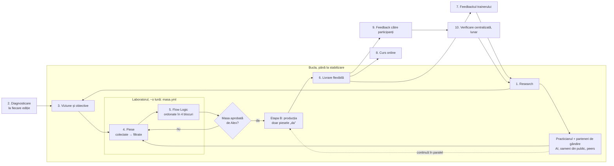

# Proces: curs nou

**DRI:** Andrei. **Echipa:** Learning Studio (Daria, Matei, Irina), plus Mike pentru generator și Alex în sală.
**Scop:** un flow simplu de care ne ținem la fiecare curs, de la prima idee până la concluziile din feedback (Alex, 2026-11-17).
**Vizual:** pagina `docs/procese/curs-nou-vizual.html`, publicată la https://claude.ai/artifact/26Jm98isMEfzt5khrN5qU3. Sursa rămâne acest fișier: când procesul se schimbă, se schimbă întâi aici, apoi pagina.
**Unde stă cursul:** sursa în repo-ul privat BEMORE-STUDIO, clonat în `privat/cursuri/<curs>/` (D-050). Generatorul e în `curs/` (`curs/README.md`). În repo-ul public intră doar procesul.

## Regula de bază: întâi Laboratorul, apoi producția (Alex, 2026-11-18)
- **Etapa A se numește Laboratorul.** Timp de aproximativ o lună, echipa se imersează în subiect: învață, observă, pornește dezbateri. **Scopul:** piese de conținut diverse, valoroase, relevante și gata de folosit.
- **Cine intră în Laborator:**
  - **Practicianul**, adică trainerul care își asumă subiectul și îl va livra. **Esențial:** cel care livrează trebuie să fie la nivel de practician, nu doar curios.
  - **Researcherul** (Irina): modele, studii, exemple, cu surse.
  - **Partenerii de gândire:** un AI, plus mai mulți oameni reprezentativi pentru publicul țintă sau colegi (peers).
- **Ce câștigă practicianul din Laborator:**
  - se simte conectat la subiect;
  - poate intra în conversații profunde cu publicul țintă și îi poate provoca pe teme concrete din activitatea lor;
  - are exemple și povești din practica lui personală, din luna în care și-a adus atenția mai conștient pe subiect.
- **Masa e panoul Laboratorului.** Fiecare piesă descoperită devine o linie în `privat/cursuri/<curs>/masa.yml`. Spre finalul Laboratorului, piesele trec prin trei pași: **colectate → filtrate → ordonate**. Fluxul: Masa → Biblioteca → Agenda. Ce primește „Da” ajunge în Bibliotecă; ce ordonăm în blocuri face agenda.
- **Poarta: masa aprobată de Alex.** Fără ea nu se produce nimic.
- **Laboratorul continuă în paralel cu etapa B** (Alex, 2026-11-18). Poarta deschide producția pentru piesele aprobate, dar practicianul rămâne în imersie: ce descoperă intră pe masă cu verdict „nou”, trece prin aceeași filtrare și, dacă primește „Da”, intră în producție pentru ediția curentă sau pentru următoarea.
- **Etapa B, producția.** Slide-uri, scheme, curs online, note de trainer, banca de exerciții, numai pentru piesele cu verdict „da”. Butonul „Trimite în agendă” face agenda ediției.

## Schema
Bucla Research → Viziune și obiective → Piese → Flow Logic → Livrare flexibilă se repetă la fiecare livrare, până cursul se stabilizează (Alex, 2026-11-17). Piese și Flow Logic se fac în Laborator (etapa A).

## Masa (`masa.yml`)
- **O piesă candidată = o singură linie:** `id`, `titlu`, `scop`, `durata`, `tip`, `sursa`, `verdict` (nou / da / poate / nu), `bloc` (1–4), `ordine`. Fără text de slide, fără desene, fără ecrane. Așa consumăm puțini tokeni și Alex vede tot dintr-o privire.
- **Colectate:** Irina (din research), Daria (din obiective și diagnostic) și Alex adaugă candidate cu verdict „nou”. Research-ul Irinei produce candidate în masă plus nota ei de surse (`research.md`), nu piese gata.
- **Filtrate:** Alex dă Da / Poate / Nu. Întrebarea lui: „are they good enough?”
- **Ordonate:** Alex trage piesele „da” în cele 4 blocuri ale zilei. Daria verifică timpii (fiecare bloc încape) și că fiecare obiectiv are cel puțin o piesă. Andrei verifică masa înainte să ajungă la Alex.
- **Vederea „Masa”** (Mike): în materialul trainerului și în editorul local.

**Programul standard al zilei:** 9:30–17:30.
| Bloc | Interval | Durata |
|---|---|---|
| 1 | 9:30–11:00 | 90 min |
| pauză | 11:00–11:15 | 15 min |
| 2 | 11:15–12:30 | 75 min |
| prânz | 12:30–13:30 | 60 min |
| 3 | 13:30–15:00 | 90 min |
| pauză | 15:00–15:15 | 15 min |
| 4 | 15:15–17:30 | 135 min |

Pauzele de 15 minute sunt presupunerea noastră; Alex le poate corecta.

## Pașii
| # | Pas | Ce iese | DRI | Alex |
|---|---|---|---|---|
| 1 | **Research** | modele, studii, exemple cu surse în `research.md` + piese candidate în `masa.yml` | Irina | citește rezumatul de 5 rânduri |
| 2 | **Diagnosticare** (la fiecare ediție) | chestionar anonim de 3–5 întrebări înainte + o piesă de diagnostic la deschidere. Rezumatul, fără nume, în `editii/<data>.yml` (`nota_trainer`) | Daria | aprobă și **trimite** chestionarul |
| 2b | **Practicianul în Laborator** (~o lună, în paralel cu 1–5) | trainerul care va livra învață, observă și dezbate cu partenerii de gândire (AI, oameni din publicul țintă, peers); descoperirile, exemplele și poveștile din practica lui intră pe masă ca piese candidate (`sursa: practică` / `conversație`), fără nume | trainerul care livrează (azi Alex). Daria le notează pe masă | trăiește subiectul, spune ce a aflat |
| 3 | **Viziune și obiective** | **Viziunea:** transformarea dorită, într-o propoziție clară și simplă (Alex, 2026-11-18). **Obiectivele:** cel mult 4, scurte, care duc spre viziune. Ambele în `curs.yml` (sau în ediție) | Daria | formulează viziunea, aprobă lista |
| 4 | **Piese** (Laborator) | candidate colectate și filtrate în `masa.yml` | Daria (Irina) | dă verdictele |
| 5 | **Flow Logic** (Laborator) | piesele „da” ordonate în cele 4 blocuri | Daria. Andrei verifică | ordonează și **aprobă masa** |
| – | **Producția** (etapa B) | `piese/<id>.md` cu ecrane (`:::sala`), scheme, note de trainer; „Trimite în agendă” face `agenda` din `editii/<data>.yml` | Matei (Daria, Irina) | Biblioteca de piese, vederile Ziua și Schița |
| 6 | **Livrare flexibilă** | ziua în sală; alternativele și Biblioteca permit schimbări | Alex. Mike pentru generator | – |
| 7 | **Feedbackul trainerului** | `editii/<data>-trainer.md`, în 10 minute, în aceeași zi | Alex sau co-trainerul. Andrei preia | îl scrie |
| 8 | **Curs online** | exportul `<slug>-participanti.json`, fără note de trainer și fără nume; pe site prin PR | Matei. Mike pentru PR | aprobă PR-ul |
| 9 | **Feedback către participanți** | draft: mulțumire, linkul cursului online, formular de 3 întrebări (ce iei cu tine, ce aplici luni, ce ai schimba). Răspunsurile în `feedback/<data>.md` | Daria | **trimite**, în 1–3 zile |
| 10 | **Verificare centralizată**, lunar | concluziile în `privat/concluzii-feedback.md`; ce e general merge în `team/elena/documente/lectii.md`; harta cursurilor se actualizează | Andrei, cu Elena | în raportul lunar |

## Două piese pe care le are orice curs
- **Contractul** (`contract`, tip `deschidere`): după un șablon comun, personalizat pe curs.
- **Closing-ul** (tip `inchidere`): ales dintr-un set predefinit; Daria adaptează întrebările la curs și la grup (Alex, 2026-11-17).
Pe masă intră ca orice piesă, cu `sursa: comun`.

## Ce e deja făcut în Change Agility
Modulul „Toleranță și capacitate”, contractul și closing-urile au fost produse înainte de regula din 2026-11-18. Rămân. La primul pas pe masă intră și ele în `masa.yml`, ca piese deja produse, și trec prin verdict și ordonare ca toate celelalte.

## Feedbackul trainerului (`editii/<data>-trainer.md`)
1. Ce a mers? 2. Ce a lipsit sau a mers greu? 3. Ce piese schimb, scot sau adaug? 4. Ce obiective s-au atins? 5. Ce am aflat despre grup și n-am știut din diagnostic?

## Când e un curs stabilizat
2 livrări la rând fără schimbări mari în agendă (nicio piesă nouă de conținut, cel mult o piesă schimbată pe bloc) și cu obiectivele atinse. După aceea bucla se oprește: research doar la revizia trimestrială a hărții. Rămân diagnosticarea, ajustările de agendă și cele două feedbackuri. Bucla se redeschide dacă feedbackul scade două ediții la rând sau dacă harta schimbă eticheta cursului.

## Reguli
- Nimic nu pleacă la participanți sau la client fără Alex. Echipa face doar draft-uri.
- Fără date personale și fără numele clientului în repo-ul public.
- Conversațiile practicianului rămân private: pe masă intră doar ideea, fără numele sau detaliile oamenilor.
- În Laborator agenții nu produc slide-uri, scheme sau ecrane.

## Ce mai trebuie ca procesul să meargă
1. Vederea „Masa” și butonul „Trimite în agendă”. **DRI: Mike** (în lucru).
2. Formularul de feedback și chestionarul: unealta o alege Alex. **DRI: Daria**.
3. Șablonul `editii/<data>-trainer.md` și `privat/concluzii-feedback.md`. **DRI: Andrei**.
4. Primul test complet: masa pentru Change Agility, apoi ediția din 23 noiembrie. **DRI: Andrei**, cu Elena la retro.
