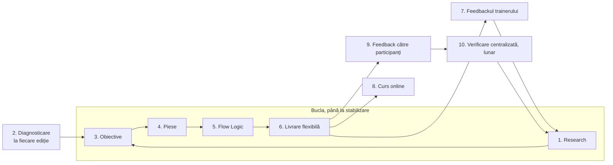

# Proces: curs nou

**DRI:** Andrei. **Echipa:** Studio (Daria, Matei, Irina), plus Mike pentru generator și Alex în sală.
**Scop:** un flow simplu de care ne ținem la fiecare curs, de la prima idee până la concluziile din feedback (Alex, 2026-11-17).
**Unde stă cursul:** sursa în repo-ul privat BEMORE-STUDIO, clonat în `privat/cursuri/<curs>/` (D-050). Generatorul e în `curs/` (`curs/README.md`). În repo-ul public intră doar procesul.

## Schema
Research, Obiective, Piese, Flow Logic și Livrare flexibilă se repetă la fiecare livrare, până cursul se stabilizează (Alex, 2026-11-17). Restul pașilor țin de fiecare ediție.

Varianta text: **Diagnosticare** (la fiecare ediție) → [ **Research → Obiective → Piese → Flow Logic → Livrare flexibilă** ] → **Feedbackul trainerului**, care se întoarce în Research. După livrare pleacă și **Cursul online** și **Feedbackul către participanți**. Lunar, **Verificarea centralizată** trimite concluziile tot în Research.

**De ce intră diagnosticarea acolo.** Research-ul ține de curs, iar diagnosticarea ține de grup. Ea nu schimbă cursul. Schimbă obiectivele și agenda unei ediții (ediția poate avea propriul `obiective`). De aceea intră la fiecare ediție, înainte de Obiective, și după stabilizare.

## Pașii
| # | Pas (numele lui Alex) | Ce intră | Ce iese (livrabilul) | DRI | Unde verifică Alex |
|---|---|---|---|---|---|
| 1 | **Research** | brief-ul, harta cursurilor, notele trainerului și concluziile din feedback de până acum | modele, studii și exemple cu surse, în `privat/cursuri/<curs>/research.md` | Irina | citește rezumatul de 5 rânduri din raport |
| 2 | **Diagnosticare** (pe unde sunt participanții) | brief-ul ediției | a) un chestionar scurt înainte, de 3–5 întrebări, anonim: experiența cu tema, ce așteaptă, o situație reală; b) o piesă de diagnostic în sală, la deschidere (de exemplu „ridică-te dacă…” sau o scală pe podea). Rezumatul, fără nume, intră în `editii/<data>.yml`, la `nota_trainer` | Daria | aprobă chestionarul. **Îl trimite Alex** |
| 3 | **Obiective** | research și diagnostic | câmpul `obiective` din `curs.yml` (sau din ediție), cel mult 4, scurte. Apar cu bife în Schiță | Daria | aprobă lista |
| 4 | **Piese** (fiecare cu scopul ei clar) | obiectivele | `piese/<id>.md`: titlu, durată, tip, scop (`obiectiv`) și `obiective: [..]` pe care le servește. Matei face ecranele (`:::sala`), Irina conținutul cu surse | Daria (Matei, Irina) | Biblioteca de piese din materialul trainerului |
| 5 | **Flow Logic** care livrează obiectivul | piesele | `agenda` din `editii/<data>.yml`. Totalul și depășirea zilei apar în material. Fiecare obiectiv are cel puțin o piesă | Daria. Andrei verifică | vederile Ziua și Schița |
| 6 | **Livrare flexibilă** | materialul trainerului (`node build.mjs …`) | ziua în sală. Alternativele din fiecare modul și Biblioteca de piese permit schimbări. Schimbi agenda și rulezi build-ul | Alex în sală. Mike pentru generator | – |
| 7 | **Feedbackul trainerului** (pas adăugat de Alex) | ziua livrată | `editii/<data>-trainer.md`, scris în 10 minute, în aceeași zi (șablonul e mai jos). Închide bucla: intră în următorul Research | Alex sau co-trainerul. Andrei îl preia | îl scrie chiar el |
| 8 | **Curs online** (servește și ca material pentru participanți) | ediția livrată | exportul `<slug>-participanti.json`, fără note de trainer și fără nume (build-ul verifică). Ajunge pe site prin PR | Matei. Mike pentru PR | aprobă PR-ul. **Nimic nu pleacă fără el** |
| 9 | **Plecare feedback-uri către participanți** | ediția livrată | un draft de mesaj: mulțumire, linkul spre cursul online și formularul de feedback (3 întrebări: ce iei cu tine, ce aplici luni, ce ai schimba). Pleacă în 1–3 zile. Răspunsurile stau în `privat/cursuri/<curs>/feedback/<data>.md` | Daria scrie draftul | **Trimite Alex** |
| 10 | **Verificare feedback**, centralizată | notele trainerului și feedbackul, din toate cursurile | concluziile, într-un singur loc: `privat/concluzii-feedback.md`. Ce e general, fără client, intră în `team/elena/documente/lectii.md`. Eticheta din harta cursurilor se actualizează | Andrei, cu Elena | în raportul lunar |

## Două piese pe care le are orice curs
- **Contractul.** E o piesă `contract` (tip `deschidere`), făcută după un șablon comun: de ce suntem aici, cum lucrăm, ce rămâne în sală, ce ne cerem unii altora. Se personalizează pentru fiecare curs.
- **Closing-ul.** Piesele de tip `inchidere` se aleg dintr-un set predefinit. Fiecare are ecranele gata, în `:::sala`, deci se pun direct în agendă.
  Întrebările de closing nu sunt fixe: Daria le adaptează la curs și la grup, pentru că nu au mereu sens așa cum sunt (Alex, 2026-11-17). Structura piesei rămâne, întrebările se potrivesc.
- Daria scrie acum primele piese: contractul și trei closing-uri. Ele sunt primii candidați pentru biblioteca comună `comun/`, după 25 noiembrie.

## Șablonul pentru feedbackul trainerului (`editii/<data>-trainer.md`)
1. Ce a mers? (una-două piese și de ce)
2. Ce a lipsit sau a mers greu? (unde a scăzut energia, unde n-a ajuns timpul)
3. Ce piese schimb, scot sau adaug data viitoare?
4. Ce obiective s-au atins? (bifele din Schiță: câte și care nu)
5. Ce am aflat despre grup și n-am știut din diagnostic?

## Când e un curs stabilizat
**Criteriul:** 2 livrări la rând fără schimbări mari în agendă (nicio piesă nouă de conținut, cel mult o piesă schimbată pe modul) și cu obiectivele atinse (bifate în Schiță și confirmate în feedback).
**Ce se schimbă după aceea:** bucla se oprește. Research-ul se face doar la revizia trimestrială a hărții cursurilor. La fiecare ediție rămân diagnosticarea, ajustările de agendă (alternative, piese din Bibliotecă), feedbackul trainerului și feedbackul participanților. Bucla se redeschide dacă feedbackul scade două ediții la rând sau dacă harta schimbă eticheta cursului.

## Reguli
- Nimic nu pleacă la participanți sau la client fără Alex: chestionarul, mesajul de feedback, cursul online. Echipa face doar draft-uri.
- Fără date personale și fără numele clientului în repo-ul public. Răspunsurile, notele și edițiile stau în `privat/`.

## Ce mai trebuie ca procesul să meargă
1. Șablonul contractului și primele trei closing-uri. **DRI: Daria** (în lucru).
2. Formularul de feedback și chestionarul de diagnostic: unde le facem (de exemplu Google Forms) și cum ajung răspunsurile în `privat/`, fără nume. **DRI: Daria**. Alegerea uneltei e a lui Alex.
3. Câmpul `scop` la piese: azi doar activitățile au `obiectiv` obligatoriu. Îl cerem la toate piesele? **DRI: Mike**, după acordul lui Alex.
4. Șablonul `editii/<data>-trainer.md` și `privat/concluzii-feedback.md`, create în repo-ul privat. **DRI: Andrei**.
5. Primul test complet pe ediția din 23 noiembrie, apoi corectăm procesul. **DRI: Andrei**, cu Elena la retro.
