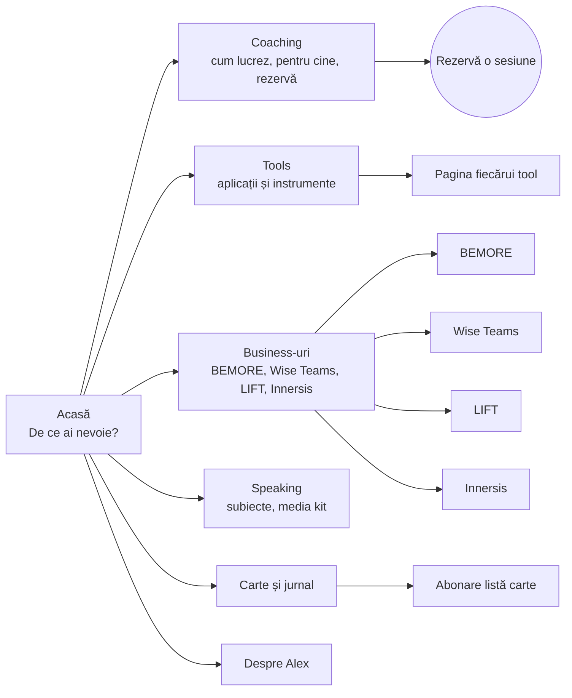

# Arhitectura site-ului — v0 (propunere)

> Autor: Radu (draft la kickoff, coordonat de Tudor). Status: **de aprobat de Alex**.

## Principiul
Vizitatorul nu vine să „vadă site-ul lui Alex”. Vine cu o nevoie. Prima întrebare a site-ului e: **„De ce ai nevoie?”**

## Pagina principală: alegătorul de intenții
Sub o introducere scurtă (cine e Alex, într-o propoziție), carduri mari, din sticlă:

| Card (pe limba vizitatorului) | Duce la | Pentru cine |
|---|---|---|
| **Vreau o sesiune de coaching** | `/coaching` → rezervare | persoane |
| **Vreau un tool care să mă ajute să cresc** | `/tools` | oricine |
| **Vreau să lucrăm împreună în compania mea** | `/business` | companii, HR, lideri |
| **Vreau să te invit să vorbești** | `/speaking` | organizatori, media |
| **Vreau să citesc ce scrii** | `/carte` și `/jurnal` | cititori |
| **Vreau să te cunosc** | `/despre` | toți |

## Harta site-ului


## Navigarea permanentă
- Bara de sus (sticlă, discretă): **Coaching · Tools · Business · Speaking · Carte · Despre**.
- Un singur buton evidențiat: **Rezervă o sesiune**.
- Pe mobil: aceleași 6 opțiuni, plus butonul de rezervare fix jos.

## Fluxuri cheie
1. **Client de coaching:** Acasă → „Vreau o sesiune” → Coaching (pentru cine e, cum arată, preț sau „discutăm”) → rezervare în calendar. Țintă: 2 click-uri.
2. **Companie:** Acasă → „În compania mea” → Business → alege business-ul potrivit după nevoie („echipa mea nu livrează” → Wise Teams, de confirmat) → contact.
3. **Căutător de tool-uri:** Acasă → Tools → filtru după nevoie (focus, obiceiuri, echipă, carieră) → tool.

## Modelul de conținut (ușor de actualizat)
Fiecare lucru e un fișier. Adăugarea a ceva nou înseamnă un fișier nou, fără cod.
```
content/
  despre.md              cine e Alex
  coaching.md            oferta de coaching + link rezervare
  business/<nume>.md     un fișier per business: nume, rol Alex, pentru cine, link, logo
  tools/<nume>.md        un fișier per tool: nume, nevoie, descriere, link, status
  carte.md               starea cărții, abonare
  jurnal/<data-titlu>.md articole
  speaking.md            subiecte, bio, media kit
  social/                calendar editorial și draft-uri (intern)
```

## Stack propus (de confirmat)
- **Astro**: site static, rapid, conținut în Markdown.
- **Vercel sau Netlify**: deploy automat la fiecare schimbare aprobată în GitHub.
- **Cal.com** (sau ce folosește Alex deja) pentru rezervări, integrat în pagină.
- Bilingv RO/EN: de decis. Recomandare: RO întâi, EN în etapa 5.

## Întrebări deschise
Vezi `docs/intrebari-pentru-alex.md`.
