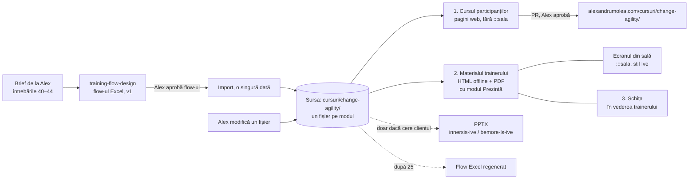

# Arhitectura unui curs: o sursă, trei ieșiri (v1.2)

**Autor:** Radu. **Data:** 2026-11-17. **Versiune:** v1.1. Față de v0: materialul trainerului e și prezentarea din sală (v1); banca de exerciții și agenda din ediție (v1.1, secțiunea 1.8, I-021, doar formatul); piesa de workshop ca unitate de bază (v1.2, secțiunea 1.9, propunere). **Status:** D-048–D-051 aprobate de Alex (2026-11-17); Mike construiește (T-022).
**Pentru:** workshop-ul Change Agility (o zi, 23 noiembrie, D-044, parte din I-018). Același model trebuie să meargă fără cod nou și pentru 25 noiembrie (Self-management în relația cu AI).
**Citit înainte:** `team/tudor/documente/echipa-workshopuri-v0.md`, `docs/procese/ce-iese-public.md`, `site/build.mjs`, `content/`, I-018, I-019, D-043–D-045, `arhitectura-v2.md`.

## Cererea lui Alex (2026-11-17)
> „Mi-ar plăcea ca acest proces să aibă 3 output-uri:
> 1. Un fel de curs online pe care participanții îl pot naviga foarte ușor, direct pe site-ul meu.
> 2. Un material al trainerului care să fie bine legat de informația de pe site, dacă modific ceva în materialul trainerului, să se modifice și în cursul online al participanților.
> 3. O schiță cu punctele cheie din curs, pe care să mă pot uita foarte ușor dacă vreau să las materialele deoparte […]. Asta ar trebui să fie tot în materialul trainerului.”

Precizarea lui Alex (2026-11-17):
> „Materialul trainerului ar trebui să fie ceva la care să pot să dau "present" pe tot ecranul sau într-o fereastră și să pot să am acolo și exercițiile pe care le arăt participanților, lucru de care ei nu au nevoie în cursul online pe care îl pot naviga, accesa după.”

## Ideea, într-o frază
**Cursul e un folder cu câte un fișier text pe modul.** Din aceleași fișiere se generează cursul participanților, materialul trainerului și schița. **Materialul trainerului e și prezentarea din sală:** un buton „Prezintă” arată ecranele pentru participanți, iar Alex își vede separat notele și schița. Alex modifică un singur fișier, iar toate se schimbă la următorul build.

---

## 1. Modelul de conținut

### 1.1 Două lucruri diferite: cursul și ediția
| | **Cursul** | **Ediția** |
|---|---|---|
| Ce e | conținutul: modulele, exercițiile, notele de facilitare | o livrare anume: data, ora de start, grupul, ce module sărim |
| Se refolosește? | da, la fiecare livrare | nu, e o singură zi |
| Conține clientul? | **niciodată** | da, dar doar aici, într-un loc privat |
| Pe site | în Innovations („cursuri de încercat”) | în Latest Workshops, generic: „Change Agility, o zi, noiembrie 2026, cu o echipă dintr-o companie” |

Așa, numele clientului stă într-un singur fișier privat, iar conținutul cursului rămâne curat și poate fi refolosit.

### 1.2 Fișierele
```
cursuri/                         locul privat (vezi secțiunea 3)
  change-agility/
    curs.yml                     o dată pe curs: titlul, promisiunea, brandul, limba
    01-deschidere.md             un fișier pe modul, în ordinea din nume
    02-curba-schimbarii.md
    03-pauza.md
    ...
    exercitii/                   banca de exerciții a cursului (1.8)
      perechi-curba.md           un fișier pe exercițiu; numele fișierului = id-ul
      plimbare-curba.md
    materiale/                   worksheet-uri (.docx), imagini, scheme
    editii/
      2026-11-23.yml             ediția: ora de start, agenda (ordinea și exercițiile alese), numele interzise
```
**Regula 7 din CLAUDE.md:** orice schimbare de conținut înseamnă un fișier editat. Textul unui modul, timpul lui, o întrebare pentru trainer, un punct din schiță: toate stau în fișierul modulului.

### 1.3 `curs.yml`
| Câmp | Obligatoriu | Exemplu |
|---|---|---|
| `titlu` | da | „Change Agility” |
| `promisiune` | da | o propoziție: ce pleacă omul cu el (Maria o validează) |
| `brand` | da | `innersis` / `bemore-ls` (răspunsul la întrebarea 41) |
| `limba` | da | `ro` / `en` (întrebarea 42) |
| `durata_zi` | da | `9:00–18:00`, ca build-ul să verifice că modulele încap |
| `public` | da | `nu` / `link` / `da` (decizia 2, secțiunea 6) |
| `slug` | da | `change-agility`, devine adresa: `alexandrumolea.com/cursuri/change-agility/` |
| `obiective` | nu | listă de texte scurte (cel mult ~12 cuvinte; peste, doar avertisment). Apar în Schiță ca checklist cu bife salvate local (nu se proiectează; la tipar, căsuțe goale) și în cursul participanților ca listă simplă. Ediția poate avea propriul `obiective`, care o înlocuiește pe a cursului. Un modul sau o piesă poate spune `obiective: [1, 3]` (indexuri de la 1), iar Schița arată „→ ob. 1, 3” **(Alex, 2026-11-17)** |

### 1.4 Un modul: straturile din același fișier
Sunt trei locuri unde poate apărea ceva: **cursul online** (participanții, după), **ecranul din sală** (ce vede grupul când Alex dă „Prezintă”) și **vederea trainerului** (doar Alex). Fiecare strat spune unde apare:

| Stratul | Cum îl marchezi | Curs online | Ecranul din sală | Vederea trainerului |
|---|---|---|---|---|
| **Textul de citit** | textul obișnuit | da | nu | da (vederea Modul) |
| **Doar în sală** | `:::sala` … `:::` | nu | da, **un bloc = un ecran** | da, ca previzualizare |
| **În sală și în curs** | `:::sala-si-curs` … `:::` | da | da, un bloc = un ecran | da |
| **Doar trainerul** | `:::trainer` … `:::` | nu | nu | da: ce spui, ce întrebi, timpii interni, ce faci dacă grupul tace |
| **Doar participanții** | `:::participant` … `:::` | da | nu | nu |
| **Schița** | câmpurile `ancora` și `schita` din antet | nu | nu | da |

De ce așa:
- **Ecranele din sală se scriu separat de textul de citit.** Un text bun de citit acasă e prea lung pentru proiector. Pe ecran stau puține cuvinte (stilul Ive), iar acasă omul are nevoie de explicație. Exercițiile cu instrucțiuni și cronometru sunt `:::sala`: participanții nu au nevoie de ele în cursul online, cum spune Alex.
- **`:::sala-si-curs` există ca să nu scriem de două ori** ce e bun în ambele locuri, de exemplu desenul unui model sau întrebarea mare a modulului.
- **Primul ecran al fiecărui modul se face singur,** din `titlu` și `tip`, deci nu se scrie.
- **Cronometrul** se cere pe bloc: `:::sala cronometru=10` pornește un cronometru de 10 minute pe ecranul din sală, cu o tastă.

Antetul modulului:
| Câmp | Obligatoriu | Ce e |
|---|---|---|
| `titlu` | da | titlul modulului |
| `durata` | da | minute. Ora exactă o calculează build-ul din ora de start a ediției |
| `tip` | da | `teorie` · `exercitiu` · `reflectie` · `mesaj` · `pauza`. Se potrivește cu cele trei lumi din skill-urile Ive (teorie = întunecat, exercițiu și reflecție = luminos, mesaj = accent), deci slide-urile își iau culoarea de aici |
| `ancora` | da | 1–3 cuvinte: singurul lucru pe care îl ții minte despre modul |
| `schita` | da | cel mult 3 puncte, cel mult 8 cuvinte fiecare |
| `materiale` | nu | ce trebuie în sală: flipchart, worksheet, post-it |
| `id` | da | stabil, nu se schimbă (legătura cu slide-urile și cu flow-ul) |

**De ce schița e scrisă, nu extrasă automat.** Schița e pentru memoria lui Alex, nu un rezumat. Trei cuvinte alese de el valorează mai mult decât trei propoziții tăiate de un script. Stă în același fișier, chiar deasupra conținutului, deci se schimbă în același loc.

### 1.5 Exemplu complet de modul
`cursuri/change-agility/02-curba-schimbarii.md` (conținut **[EXEMPLU]**, inventat ca să arate forma; conținutul real vine din brief și din flow-ul aprobat de Alex)

```markdown
---
id: curba
titlu: "Ce se întâmplă cu noi când se schimbă ceva"
durata: 35                # doar partea modulului; exercițiile își aduc singure durata
tip: teorie
ancora: "Curba, nu linia"
schita:
  - "Schimbarea scade întâi performanța"
  - "Fiecare e în alt punct al curbei"
  - "Întrebarea: unde ești tu acum?"
materiale: ["flipchart cu curba desenată"]
exercitii:
  implicite: [perechi-curba]       # intră în agendă dacă ediția nu spune altceva
  alternative: [plimbare-curba]    # le vezi lângă modul și le poți alege
---

:::sala-si-curs
Ce simți în prima săptămână după o schimbare pe care n-ai ales-o?
:::

## Ideea
Orice schimbare trece printr-o scădere înainte de o creștere. Nu e un semn că
ceva merge prost. E drumul obișnuit.

:::sala-si-curs

:::

:::trainer
**Deschidere (5 min).** Întreabă: „Cine a trecut anul ăsta printr-o schimbare
pe care n-a ales-o?” Lasă mâinile să se ridice. Nu cere povești încă.

**Desenul (15 min).** Desenează curba pe flipchart, fără nume de etape la început.
Cere grupului să numească etapele.

**Dacă grupul tace:** spune un exemplu personal, scurt, apoi întreabă din nou.

**Tranziția spre exercițiu:** „Acum, fiecare își pune un post-it acolo unde e azi.”
:::

::exercitii

:::trainer
**Debrief (5 min).** „Ce ați observat: suntem toți în același punct?”
:::

## Ce iei cu tine
O schimbare nu se judecă după prima lună.
```

Ce iese din acest fișier:
Linia `::exercitii` arată unde intră exercițiile alese. Fără ea, exercițiile intră la finalul modulului.

Exercițiul implicit, `cursuri/change-agility/exercitii/perechi-curba.md` **[EXEMPLU]**:
```markdown
---
titlu: "Unde sunt eu pe curbă"
durata: 15
format: perechi              # individual · perechi · grup · plen
tip: exercitiu               # exercitiu · reflectie · energizant (alege lumea Ive)
energie: mediu               # calm · mediu · activ
obiectiv: "Fiecare își vede locul pe curbă și îl spune cu voce tare"
module: [curba]              # unde se potrivește; gol = oriunde
materiale: ["post-it-uri în 3 culori", "worksheet Curba mea"]
in_curs: da                  # nu = nu apare niciodată în cursul online
---

Unde ești tu acum pe curbă, pentru schimbarea cea mai mare din viața ta de lucru?

:::sala cronometru=10
**În perechi, 10 minute**
1. Pune un post-it pe curbă, unde ești azi.
2. Spune-i colegului de ce acolo.
3. Ascultă. Nu dai sfaturi.
:::

:::trainer
Formează perechi între oameni care nu lucrează zilnic împreună.
:::

:::participant
Scrie în worksheet-ul „Curba mea” (pagina 2) unde erai acum o lună și unde ești azi.
:::
```
Alternativa `plimbare-curba.md` are același antet, cu `format: grup`, `energie: activ`, `durata: 20`: curba e desenată pe podea cu bandă, iar oamenii stau fizic unde sunt.

- **Cursul online:** întrebarea, ideea cu desenul curbei, întrebarea exercițiului, nota despre worksheet, „Ce iei cu tine”. Fără notele trainerului și fără instrucțiunile pentru perechi.
- **Ecranul din sală, 4 ecrane:** titlul modulului (făcut singur), întrebarea, curba, instrucțiunile pentru perechi cu cronometrul de 10 minute.
- **Vederea trainerului:** ecranul curent și pe cel următor, nota trainerului pentru momentul ăsta, ora (de exemplu 10:10–11:00 = 35 de minute modul + 15 exercițiu), timpul rămas din modul, materialele, alternativele și schița.
- **Schița:** „Curba, nu linia” și cele trei puncte, la ora 10:10.

### 1.6 Siguranța: notele trainerului nu scapă niciodată
Build-ul se oprește (nu publică nimic) dacă:
- un bloc `:::` nu e închis sau e pus în alt bloc;
- apare un bloc necunoscut (de exemplu `:::traner` sau `:::sal`, scrise greșit). Mai bine un build oprit decât o notă de trainer ajunsă la participanți sau un exercițiu de sală ajuns în cursul online;
- exportul pentru cursul online conține ceva din `:::trainer` sau `:::sala` (verificare făcută pe rezultat, nu doar pe sursă);
- schița are peste 3 puncte sau un punct are peste 8 cuvinte;
- agenda ediției (module + exerciții + pauze) nu încape în `durata_zi`, sau un `cronometru` e mai lung decât `durata` modulului ori a exercițiului în care stă;
- regulile pentru bancă și agendă din 1.8;
- un ecran din sală trimite la o imagine care nu e în `materiale/` sau la o adresă de pe internet (prezentarea trebuie să meargă fără internet);
- în cursul participanților apare un cuvânt din `nume_interzise` al ediției (numele clientului, al oamenilor). Lista stă doar în fișierul privat al ediției.

Doar avertisment, fără oprire: un ecran din sală cu peste 30 de cuvinte. Pe proiector, mai puțin e mai bine.

### 1.7 Ediția: `editii/2026-11-23.yml` (sursa agendei)
```yaml
data: 2026-11-23
ora_start: "9:00"
# Agenda: ordinea zilei. Lipsește = toate modulele, în ordinea din nume, cu exercițiile implicite.
# Un rând = un modul (cu exercițiile implicite) sau un modul cu exercițiile alese de tine, sau o pauză.
agenda:
  - deschidere
  - modul: curba
    exercitii: [plimbare-curba]      # înlocuiește implicitele; [] = fără exercițiu
  - pauza: 15
  - modul: rezistenta
    exercitii: [perechi-curba, cerc-intrebari]   # ordinea din listă e ordinea din sală
  - pauza: 60
    titlu: "Prânz"
  - inchidere
nume_interzise: []        # numele clientului și al oamenilor; build-ul oprește cursul public dacă le găsește
nota_trainer: ""          # ce e special la acest grup (doar în materialul trainerului)
```
Orele se calculează singure: `ora_start` + duratele, în ordinea din agendă. Un modul care lipsește din agendă nu se face la această ediție (înlocuiește `sari_peste` din v1).

### 1.8 Banca de exerciții (v1.1, I-021, doar formatul)
Cerința lui Alex (2026-11-17): „Aș vrea să avem un fel de bancă de exerciții la fiecare curs, din care să-mi pot alege ușor și live și din timp. Și să-mi construiesc agenda cumva dinamic, poate chiar cu drag and drop.”

**Unde stau.** `cursuri/<slug>/exercitii/<id>.md`, un fișier pe exercițiu. Id-ul e numele fișierului și nu se schimbă. Corpul are aceleași straturi ca modulele (`:::sala`, `:::sala-si-curs`, `:::trainer`, `:::participant`) și aceleași verificări.

**Antetul.**
| Câmp | Obligatoriu | Ce e |
|---|---|---|
| `titlu` | da | numele exercițiului |
| `durata` | da | minute, cu tot cu instrucțiuni și debrief scurt |
| `format` | da | `individual` · `perechi` · `grup` · `plen` |
| `tip` | da | `exercitiu` · `reflectie` · `energizant`; alege lumea Ive a ecranelor |
| `energie` | da | `calm` · `mediu` · `activ`; ajută la alegerea după ora zilei |
| `obiectiv` | da | o propoziție: ce se întâmplă cu omul |
| `module` | nu | id-urile modulelor unde se potrivește; gol = oriunde |
| `materiale` | nu | ce trebuie în sală |
| `in_curs` | nu | `da` (implicit) / `nu`: niciodată în cursul online (de exemplu un energizant) |

**Cum alege agenda, în două niveluri.**
1. **Modulul** propune: `exercitii.implicite` (ce se face dacă nu spui nimic) și `exercitii.alternative` (ce poți alege în loc).
2. **Ediția** decide: `agenda` dă ordinea modulelor, pauzele și exercițiile alese pe fiecare modul. Poate alege orice exercițiu din bancă, nu doar alternativele. **Ediția e sursa agendei.** Timpii, schița și ecranele se recalculează din ea.

**Ce apare în cursul online: doar exercițiile folosite în ediția din care publicăm,** cu `in_curs: da`. Exportul se face dintr-o ediție (de exemplu `2026-11-23`), deci participanții văd ziua pe care au trăit-o, nu o listă de exerciții pe care nu le-au făcut. Banca întreagă nu se publică: e trusa de lucru a lui Alex.

**Pregătit pentru „live” și drag and drop, fără să le construim acum.**
- Agenda e o singură listă, într-un singur fișier. Un editor cu drag and drop (după 23) doar mută rânduri în această listă și o scrie înapoi. Formatul nu se mai schimbă.
- Materialul trainerului are toată banca înăuntru, chiar și exercițiile nefolosite, deci alegerea live merge fără internet.

| | v1 pentru 23 | După 23 |
|---|---|---|
| Alegere din timp | da: editezi `agenda` din ediție (sau îi spui unui agent), build-ul recalculează orele | editor vizual al agendei, cu drag and drop |
| Banca în materialul trainerului | da: vederea **Banca**, listă cu filtre pe format, durată și energie, cu tot conținutul | căutare, „folosit la edițiile…” |
| Schimbare live în sală | doar dacă e ieftin (Mike decide până miercuri): în ecranul de comandă, la un modul cu alternative, un meniu „schimbă exercițiul” înlocuiește ecranele și recalculează orele. Schimbarea nu se salvează (fișierul e offline) | inserezi orice exercițiu din bancă; după zi, ce s-a făcut se scrie înapoi în ediție |

**Build-ul se oprește dacă:**
- un id din `agenda`, din `exercitii.implicite`/`alternative` sau din `module` nu există;
- două exerciții au același id sau un exercițiu apare și în implicite, și în alternative la același modul;
- un modul apare de două ori în agendă;
- un rând din agendă nu e nici `modul`, nici `pauza`, sau `pauza` nu e un număr de minute;
- ~~agenda nu încape în `durata_zi`~~ → avertisment, iar depășirea se vede în material (Alex, 2026-11-17);
- un câmp obligatoriu lipsește sau are o valoare din afara listei (`format`, `tip`, `energie`).

Doar avertisment: un exercițiu ales la un modul care nu e în câmpul lui `module`, sau un modul de peste 90 de minute fără nicio pauză după.

### 1.9 Totul modular: piesa de workshop (v1.2, aprobată D-053)

> **Completarea lui Alex (2026-11-17):** și **pauza e o piesă** (tip `pauza`, familia punte, fără `format`/`energie`). **Fiecare piesă are `durata` obligatorie.** Materialul trainerului arată totalurile: pe modul (modul + piese), pe zi (suma agendei) și diferența față de `durata_zi`. Rândul `pauza: <min>` din agendă rămâne ca scurtătură pentru o pauză fără fișier.
Întrebarea lui Alex (2026-11-17): „Oare putem gândi cumva totul modular? Adică să zic piese de workshop pe care le-am putea pune? Uneori exerciții, uneori piese de conținut?”

**Răspunsul scurt:** da, și suntem deja aproape. Banca din 1.8 e o bibliotecă de piese care știe doar un fel de piesă, exercițiul. O lărgim la orice fel de piesă și lăsăm agenda să pună o piesă oriunde, nu doar în interiorul unui modul.

**Piesa** e unitatea de bază: un fișier, reutilizabil, cu durata lui și cu aceleași straturi ca până acum (`:::sala`, `:::sala-si-curs`, `:::trainer`, `:::participant`).

| `tip` | Familia | Lumea Ive a ecranelor |
|---|---|---|
| `teorie` · `model` · `poveste` | conținut | întunecat |
| `exercitiu` · `reflectie` · `energizant` | activitate | luminos |
| `deschidere` · `inchidere` · `mesaj` | punte | accent |

Antetul piesei e cel din 1.8, cu trei schimbări: `tip` are lista de mai sus; `format` și `energie` sunt obligatorii doar la activități; apare `ancora` opțional (o linie în schiță când piesa stă singură în agendă).

**Etichete (Alex, 2026-11-17).** Piesele și modulele pot avea `etichete: [Positive Outlook, Closing]`: texte libere, scrise cum vrea Alex (și în engleză, cu spații). La grupare, majusculele și diacriticele nu contează; pe ecran rămâne forma folosită prima, iar două forme diferite dau avertisment. În Biblioteca de piese: chip-uri mici pe rândul piesei (un click pornește filtrul), un rând de filtre „Etichete” cu numărul de piese, căutare după etichetă. În Ziua și Modul apar discret. Nu ajung pe ecranele din sală și nici în cursul participanților (organizare internă).

#### Unde stau piesele
| Varianta | Cum | Pentru | Contra |
|---|---|---|---|
| **A. Doar bibliotecă comună** (`privat/piese/`) | toate cursurile aleg din același loc | reutilizare maximă | piesele unui curs se amestecă cu ale altora; brandul și limba diferă între cursuri; o schimbare pentru un curs strică altul |
| **B. Piese locale pe curs + bibliotecă comună** (recomandată) | `cursuri/<slug>/piese/` pentru ce ține de curs; `privat/piese/` pentru ce se refolosește. În agendă, `comun/<id>` trimite la biblioteca comună | cursul rămâne un folder complet; reutilizarea crește treptat, doar cu piesele care chiar s-au dovedit | o regulă în plus (prefixul `comun/`) |

**Pentru 23: doar piesele locale** (`cursuri/change-agility/piese/`, folderul `exercitii/` se redenumește). Biblioteca comună vine după 25, când știm ce piese s-au refolosit de fapt între cele două workshop-uri. Prefixul `comun/` e rezervat de acum, deci formatul nu se mai schimbă.

#### Mai e nevoie de modul?
**Da, dar mai subțire: modulul devine o secvență cu titlu.** Ține ce nu aparține unei piese: `titlu`, `ancora`, `schita` (memoria lui Alex pentru o bucată din zi) și lista de piese.
- `exercitii: { implicite, alternative }` devine **`piese: { implicite, alternative }`**, iar `::exercitii` devine **`::piese`**. Implicitele și alternativele rămân, doar că pot fi și piese de conținut (de exemplu două povești diferite pentru același model).
- **Corpul modulului rămâne permis** pentru 23 (conținutul scris direct în modul merge mai departe). După 23, conținutul se mută treptat în piese, iar un modul ajunge doar antet.
- `durata` modulului = doar ce e scris în corpul lui (poate fi 0). Durata rândului = modul + piesele alese.

#### Agenda din ediție, cu piese
Un rând din agendă poate fi un modul, o piesă singură sau o pauză:
```yaml
agenda:
  - deschidere-o-intrebare            # piesă singură (tip: deschidere)
  - modul: curba
    piese: [model-curba, perechi-curba]   # înlocuiește implicitele, în ordinea din sală
  - pauza: 15
  - energizant-numaratoare            # piesă singură, pusă între module
  - pasul-de-luni                     # modul, cu piesele implicite
  - pauza: 60
    titlu: "Prânz"
  - inchidere-o-fraza
```
- Un id simplu se caută printre module și printre piese. **Id-urile sunt unice în tot cursul**, deci nu există ambiguitate.
- Două niveluri, ambele liste simple. Drag and drop după 23 înseamnă: muți rânduri în `agenda` sau muți piese în lista `piese` a unui modul, ori dintr-un modul în altul. Formatul rămâne același.

#### Exemplu de piesă de conținut
`cursuri/change-agility/piese/model-curba.md` **[EXEMPLU]**:
```markdown
---
titlu: "Curba schimbării"
durata: 20
tip: model
ancora: "Curba, nu linia"
module: [curba]
materiale: ["flipchart cu curba desenată"]
---

Orice schimbare trece printr-o scădere înainte de o creștere. Nu e un semn că
ceva merge prost. E drumul obișnuit.

:::sala-si-curs

:::

:::trainer
Desenează curba fără nume de etape. Cere grupului să le numească.
Dacă grupul tace: un exemplu personal scurt, apoi întreabă din nou.
:::
```
Modulul `curba` devine: antetul (titlu, ancora, schita, `piese: { implicite: [model-curba, perechi-curba], alternative: [plimbare-curba, poveste-fuziune] }`), întrebarea de deschidere, `::piese` și debrief-ul.

#### Banca devine „Biblioteca de piese”
Aceeași vedere refăcută de Ioana (listă compactă, căutare, filtre-chip), cu **un rând nou de chip-uri pe familie și tip** (conținut, activitate, punte), primul în ordine. Filtrele `format` și `energie` se aplică doar activităților. Numele afișat îl confirmă Maria; în cod rămâne `piese`.

#### Ce verifică în plus build-ul
Se oprește dacă:
- un id e folosit și de un modul, și de o piesă;
- `tip` e în afara listei;
- o activitate nu are `format` sau `energie`;
- un rând din agendă trimite la `comun/…` înainte să existe biblioteca comună;
- un modul are și `exercitii`, și `piese` (rămas de la v1.1).

#### Cât costă și ce recomand
| | Ce înseamnă în generatorul lui Mike (`curs/lib/sursa.mjs`, `trainer.mjs`, `prezinta.js`) | Estimare |
|---|---|---|
| **Minim, pentru 23** | redenumirea `exercitii` → `piese` (folder, câmp, marcaj; există doar conținut de exemplu); lista nouă de `tip` și lumile Ive; rândul „piesă singură” în agendă (desfășurător, schiță, ecrane, export); filtrul pe tip în Bibliotecă; testele | 4–6 ore, risc mic: aceleași straturi, aceleași ecrane, aceeași agendă; codul are deja `desfasoara()` pentru piese în module |
| **După 25** | biblioteca comună `privat/piese/` cu `comun/<id>`; mutarea conținutului din corpurile modulelor în piese; drag and drop; „folosită în cursurile…” | 1–2 zile, fără grabă |

**Recomandarea mea:** facem varianta minimă acum, cu termen miercuri 18 seara. Conținutul real încă nu există, deci acum e momentul cel mai ieftin. Dacă până miercuri seara nu e gata și testată, înghețăm formatul v1.1 pentru 23 și facem schimbarea după 25. Conținutul scris între timp se mută cu o simplă redenumire.


### 1.10 Ecranele din sală: mută și ascunde (Alex, 2026-11-17)
Cererea lui Alex: „Pot avea hide și move la slide-uri să le pot organiza?” A ales: **mut orice ecran**, nu doar piese întregi.

**Id-ul stabil al fiecărui ecran** (se vede în vederea Ecrane, sub fiecare miniatură):
| Ecranul | Id-ul |
|---|---|
| al n-lea bloc `:::sala` / `:::sala-si-curs` din fișierul unei piese sau al unui modul | `<id>#<n>`, de exemplu `curba#1`, `perechi-curba#1` |
| ecranul de titlu al unui modul (făcut singur) | `<modul>#titlu` |
| piesa singură fără ecrane (ecranul cu titlul ei) | `<piesă>#titlu` |
| piesa de tip pauză (ecranul cu cronometrul) | `<piesă>#pauza` |
| al k-lea rând `pauza: N` din agendă | `pauza#<k>` |
| a doua apariție a aceleiași piese în agendă | `<piesă>@2#<n>` |

Id-ul nu depinde de ordinea agendei: dacă muți rânduri în agendă, ecranele își păstrează id-urile.

**În ediție** (doar diferențele, ușor de citit de mână):
```yaml
ecrane:
  muta:
    - "ridica-te-daca#1 după deschidere#2"   # sau „<ecran> la început”
  ascunse:
    - "pasul-de-luni#1"
```
- Mutările se aplică pe rând, peste ordinea firească a agendei. Un ecran nou (scris după ce ai salvat ordinea) intră singur la locul lui firesc, deci nu cere nimic.
- **Build-ul se oprește** dacă un id nu e un ecran din curs, dacă un ecran e mutat de două ori sau apare de două ori în `ascunse`, dacă un rând nu se înțelege sau dacă toate ecranele sunt ascunse. Un id din curs care azi nu e în agendă dă doar avertisment.
- **Timpul rămâne pe piese.** Un ecran mutat în alt modul rămâne legat de piesa lui: ora, nota trainerului și „rămas din modul”. Dacă toate ecranele unei piese sunt ascunse, piesa **rămâne în totalul zilei**, cu avertisment: ascunzi ecrane, nu activitatea. Ca s-o scoți din zi, o scoți din agendă.
- **Cursul online nu se schimbă.** Ordinea și ascunderea sunt doar pentru sală.

**În materialul trainerului:**
- **Vederea Ecrane:** grila de miniaturi în ordinea de prezentare, cu felul, piesa, ora și id-ul. Muți ecranele prin tragere (cu mouse-ul de oriunde de pe carte, cu degetul de pe mânerul ⠿), cu ↑ ↓ sau, pe cartea selectată, cu Alt+săgeți. „Ascunde” / „Arată” (sau H) pe fiecare carte; cele ascunse rămân estompate în grilă.
- Ordinea ta se salvează în browser (slug + data ediției) și rezistă la refresh. „Copiază pentru ediție” pune blocul `ecrane:` în clipboard (și într-un câmp din care îl poți copia), iar „Resetează la ordinea din curs” revine la ce scrie în ediție.
- **Se aplică** în prezentare (ecranul de comandă, fereastra sălii, „Prezintă aici”), în banda zilei și în „Acum” / „Urmează”. Ecranele ascunse se sar. Fereastra sălii primește id-ul ecranului de arătat.
- **În sală:** „Ascunde ecranul” (cel de acum) și „Ascunde-l” (cel următor), iar sub „Urmează” apare „1 ecran ascuns urmează aici · Arată”.

---

## 2. Cum se leagă de ce există



### 2.1 Flow-ul Excel: **output, nu sursă**
Răspunsul clar: **sursa e folderul cursului. Flow-ul Excel e o ieșire.**
- **La început,** skill-ul training-flow-design rămâne unealta de design: Daria (sau Tudor, dacă Studio nu e aprobat) face flow-ul în Excel din brief, iar Alex îl aprobă în 15 minute, cum e în procesul din `echipa-workshopuri-v0.md`.
- **Apoi, o singură dată,** flow-ul aprobat se transformă în fișierele de modul (rândurile flow-ului devin module; timpii devin `durata`).
- **De acolo,** orice schimbare se face doar în fișierele de modul. Excelul de la început rămâne ca „versiunea de design” și nu se mai editează. Dacă îl edităm în paralel, avem două surse și una minte.
- **După 25,** un script regenerează Excelul din sursă, pentru cine are nevoie de el în formatul lui Alex.

De ce nu Excelul ca sursă: un Excel nu se poate transforma curat în pagini web, nu se vede ce s-a schimbat (în git) și nu are loc bun pentru texte lungi de facilitare.

### 2.2 Slide-urile Ive: stilul trece în prezentare, PPTX-ul devine opțional
**Recomandarea mea:** aplicăm stilul Ive direct în modul Prezintă, iar PPTX-ul rămâne o ieșire opțională.
- **Stilul.** Regulile din innersis-ive și bemore-ls-ive (culorile, tipografia Helvetica Neue subțire, cele trei lumi, spațiul gol, zero ornamente) devin o temă pentru ecranele din sală, câte una pe brand. Ioana le transcrie din skill-uri, Matei verifică. `tip` alege lumea (teorie = întunecat, exercițiu și reflecție = luminos, mesaj = accent), exact ca în deck-uri.
- **De ce nu PPTX ca prezentare principală.** Un deck e a doua sursă: o corectură făcută în PowerPoint nu ajunge în curs, iar una făcută în fișierul de modul nu ajunge în deck până nu-l regenerează cineva. Asta e exact ce Alex vrea să evite.
- **Când facem totuși PPTX:** când clientul cere materialele în PowerPoint sau când Alex trebuie să prezinte de pe laptopul clientului. Atunci innersis-ive sau bemore-ls-ive citesc aceleași fișiere: `:::sala` și `:::sala-si-curs` devin slide-urile, iar `:::trainer` devine notele vorbitorului. Se regenerează la cerere și se verifică de un om.
- **Plasa de siguranță pentru 23:** un PDF cu toate ecranele din sală, câte unul pe pagină. Se deschide pe orice laptop, fără nimic instalat.

### 2.3 Site-ul
- **`site/build.mjs` nu citește sursa.** Sursa e privată, iar build-ul site-ului rulează în repo-ul public. Primește doar **exportul pentru participanți**: un fișier `content/cursuri/change-agility.json`, fără note de trainer, fără ediții, fără client. Exportul ajunge în repo-ul public printr-un Pull Request pe care Alex îl aprobă (D-029; publicarea e nivelul 3).
- **Paginile noi:** `/cursuri/change-agility/` (cuprinsul, un ecran) și `/cursuri/change-agility/<id-modul>/` (un modul pe ecran, cu „înainte” și „înapoi”). Merge pe telefon, fără 3D, fără cont.
- **Unde apare pe site:**
  - **Innovations:** cursul, ca invenție de încercat (când `public: da`).
  - **Latest Workshops:** ediția, generic, cu link spre curs. Prima intrare reală în această cameră.
  - **Knowledge Base, mai târziu:** o idee din curs poate deveni unitate Knowledge (formatul Mariei, întrebarea, ideea, ce faci azi), cu legătura spre curs. Nu acum.
- Cu `public: link`, paginile există, dar nu apar în meniu, în sitemap sau în Google (`noindex`). Participanții ajung la ele prin QR-ul de la workshop.

---

## 3. Public sau privat

**Faptul de pornire:** GitHub Pages nu are parole. Tot ce e publicat acolo poate fi deschis de oricine are linkul. Iar repo-ul de azi e public, deci tot ce intră în el e public, chiar dacă nu apare pe site.

| Varianta | Ce e unde | Avantaje | Dezavantaje |
|---|---|---|---|
| **A. Totul în repo-ul public** | sursa în acest repo, cursul pe site | cel mai simplu; un singur loc | notele trainerului, metoda lui Alex și orice detaliu de grup devin publice pe GitHub. Încalcă spiritul `ce-iese-public.md` |
| **B. Sursa privată, cursul public generic** (recomandată) | sursa într-un repo privat de curs (D-043, aplicat acum doar pentru Studio). Spre site pleacă doar exportul pentru participanți, prin PR | notele trainerului și clientul nu ating niciodată repo-ul public; cursul devine și o vitrină pentru Alex (misiunea: învățarea ca sursă a binelui); zero costuri | cursul participanților poate fi citit de oricine are linkul. Bun pentru conținut educativ generic, nu pentru conținut confidențial al clientului |
| **C. Sursa privată, cursul cu acces doar pentru participanți** | ca B, dar cursul pe un alt găzduitor cu protecție (de exemplu Cloudflare Pages cu Cloudflare Access: cod pe email) | doar participanții intră | cere emailurile participanților (date personale ale clientului), un cont nou, timp de configurare. Nerealist până pe 23 și greu de justificat pentru conținut generic |
| **Rezervă până la D-043** | sursa într-un folder local ignorat de git (de exemplu `privat/cursuri/`), cu copie pe Drive | merge azi, fără nicio decizie | nu are istoric, nu merge din GitHub Actions, depinde de un singur calculator. Doar temporar |

**Recomandarea mea: B,** cu `public: link` pentru 23 (cursul există, dar nu e listat), iar după workshop Alex decide dacă îl pune în Innovations. Dacă D-043 nu e luată până joi, lucrăm în rezervă și mutăm folderul în repo-ul privat când apare. Formatul fișierelor e același, deci mutarea nu schimbă nimic.

Dacă un modul are nevoie de un exemplu din compania clientului, exemplul stă în blocul `:::trainer` sau în `nota_trainer` din ediție. Cursul participanților rămâne generic.

---

## 4. Materialul trainerului, prezentarea și schița

### 4.1 Unde trăiește
**Un singur fișier HTML, care merge fără internet,** plus PDF-uri tipărite din el. Toate generate din aceeași sursă, la fiecare build.
- **Fără internet, complet:** fonturile, tema Ive, imaginile și scriptul sunt în fișier. Nimic nu se încarcă de pe net. Se deschide dublu-click de pe laptop, din Drive sincronizat local sau de pe un stick, și merge în modul avion. Wi-Fi-ul din sălile de training nu e de încredere.
- **Două PDF-uri:** materialul trainerului (pentru masă sau hârtie) și ecranele din sală (plasa de siguranță, vezi 2.2).
- **Nu se publică pe site.** Stă pe Drive-ul lui Alex, lângă celelalte materiale de training.

Patru vederi în același fișier, cu butoane sus:
1. **Ziua:** desfășurătorul din agenda ediției, cu ora fiecărui modul și exercițiu, durata, tipul și materialele. Ce e acum se vede imediat.
2. **Modulul:** tot conținutul, cu notele trainerului evidențiate. Pentru pregătire.
3. **Schița:** doar ancorele și punctele cheie. Asta e vederea „las materialele deoparte”.
4. **Prezintă:** deschide ecranul din sală. Vederea lui Alex devine ecranul de comandă (4.2).
5. **Banca:** toate exercițiile cursului, cu filtre (1.8).

### 4.2 Modul Prezintă: cum merge în sală
Seamănă cu „Presenter View” din PowerPoint sau Keynote: **două ferestre din același fișier.** Fereastra lui Alex o deschide pe a participanților și o comandă direct, fără internet și fără server.

**Fereastra participanților** (ecranul din sală): doar blocurile `:::sala` și `:::sala-si-curs`, câte un ecran, în stilul Ive, plus cronometrul când e cerut.

**Fereastra lui Alex** (ecranul de comandă):
- ecranul curent și cel următor, mici;
- nota trainerului pentru momentul ăsta;
- ora, timpul rămas din modul, cât e de la începutul zilei față de plan (de exemplu „+8 min”);
- schița zilei, cu modulul curent evidențiat.

Taste simple: săgeți sau telecomanda de prezentare pentru ecranul următor, `C` pornește cronometrul, `N` înnegrește ecranul din sală (pentru discuții), `S` deschide schița.

| Situația | Cum merge |
|---|---|
| **Proiector sau al doilea ecran** (laptop + proiector, cazul obișnuit în sală) | Afișaj extins, nu oglindit. Fereastra participanților merge pe proiector, pe tot ecranul. Fereastra de comandă rămâne pe laptop, la Alex |
| **Un singur ecran, sala vede același ecran** (oglindit, sau un TV mare fără laptop separat) | „Prezintă” deschide ecranul din sală pe tot ecranul, fără ecran de comandă vizibil. Notele și schița le vede Alex pe al doilea dispozitiv: același fișier deschis pe tabletă sau telefon, în vederea Schiță sau Modul. Cele două nu se sincronizează (ar cere internet); Alex avansează pe tabletă când schimbă modulul. Schița e făcută tocmai ca să nu ai nevoie de mai mult |
| **Online** (Zoom, Teams, Meet) | „Într-o fereastră”: ecranul din sală se deschide ca fereastră separată, iar Alex o partajează doar pe ea. Fereastra de comandă rămâne nevăzută lângă |

**Ce rămâne de verificat tehnic (Mike):** deschiderea și comanda celei de-a doua ferestre direct din fișier (fără server), în Chrome și Safari pe Mac, plus telecomanda de prezentare a lui Alex. Mike alege dacă scrie codul sau folosește o bibliotecă deschisă care are deja „speaker view” și merge fără internet (de exemplu reveal.js). Criteriul: merge dublu-click, în modul avion, pe laptopul lui Alex.

### 4.3 Trei direcții pentru schiță (punct de pornire pentru Ioana și Alex)
| Direcția | Cum arată | Când e bună | Ce riscă |
|---|---|---|---|
| **1. O pagină** | toată ziua pe o foaie A4 sau pe un ecran de tabletă: o linie verticală a timpului, la fiecare oră ancora mare și cele 3 puncte mici | Alex vrea să vadă toată ziua dintr-o privire, să știe unde e și ce urmează | la 10–12 module devine aglomerată |
| **2. Câte o carte** | un modul pe ecran: ancora uriașă, trei puncte, timpul rămas. Glisezi la următorul | Alex ține telefonul în mână sau tableta pe masă și vrea un singur lucru în față | nu vezi ziua întreagă |
| **3. Harta zilei** | ziua desenată ca un drum (de exemplu chiar curba schimbării), cu modulele ca opriri și o linie a energiei grupului | Alex gândește vizual; harta poate fi și pentru participanți, la început și la final | cel mai greu de făcut; cere design adevărat |

**Recomandarea mea pentru 23:** direcția 1, pentru că se face simplu și merge și pe hârtie. În ecranul de comandă apare aceeași schiță, cu modulul curent evidențiat. Direcția 2 (câte o carte) seamănă cu ecranul de comandă, deci o putem testa gratis în sală. Pe 23 Alex le folosește, iar după aceea, cu Ioana, decidem forma finală din ce a lipsit în sală. Toate citesc aceleași câmpuri (`ancora`, `schita`, `durata`, `tip`), deci schimbarea designului nu schimbă conținutul.

---

## 5. Calendarul: ce e realist până pe 23

**Ce depinde de ce:**
- **Conținutul** depinde de brief (întrebările 40–44). Fără el nu avem module. Brandul (41) decide tema Ive a ecranelor din sală; limba (42) decide textele fixe.
- **Cine scrie modulele** depinde de D-045 (Studio). Dacă nu e aprobată, Tudor coordonează și fac munca agenții CORE, mai încet. Matei scrie ecranele din sală (`:::sala`) în locul deck-ului.
- **Unde stă sursa** depinde de D-043. Dacă nu e luată, folosim rezerva (secțiunea 3).
- **Generatorul și modul Prezintă** (Mike) nu depind de conținut. Pot porni imediat ce Alex aprobă direcția.
- **Repetiția** depinde de Alex: cel puțin 30 de minute cu laptopul lui, proiector sau monitor extern și telecomanda, înainte de 23.

**Ce se schimbă față de v0:** Mike are mai mult de lucru (modul Prezintă, cu două ferestre, cronometru și tema Ive), Ioana intră acum, nu după 23 (tema Ive pentru ecrane), iar deck-ul PPTX iese din drumul principal. De aceea plasa de siguranță contează mai mult.

| Zi | Ce se face | Cine |
|---|---|---|
| Ma 17 | Alex aprobă direcția și răspunde la brief | Alex |
| Mi 18 | flow-ul cu training-flow-design → Alex verifică. În paralel: generatorul și modul Prezintă, pe modulul-exemplu; verificarea tehnică din 4.2 (două ferestre, fără internet, Chrome și Safari) | Daria / Tudor; Mike |
| Jo 19 | importul flow-ului în fișiere de modul; textele de citit, ecranele din sală, notele trainerului. Tema Ive pentru ecrane, din skill-ul brandului ales | Daria, Matei; Maria pentru voce; Ioana |
| Vi 20 | **Alex parcurge ziua în modul Prezintă** și corectează direct în fișiere. **Punct de decizie:** dacă modul Prezintă nu merge sigur, Matei face PPTX-ul din aceeași sursă (2.2) | Alex; Mike; Matei |
| Sâ–Du 21–22 | corecturi, cele două PDF-uri, lista de print, **repetiția cu proiectorul**, PR-ul cu cursul participanților (`public: link`), codul QR | Alex; Mike; Alex aprobă PR-ul |
| Lu 23 | **livrare** | Alex |
| Ma 24 | ce a lipsit în sală; aceleași fișiere pentru Self-management (25) | Tudor, Elena |

**v1 minim pentru 23 (ce promitem):**
- sursa în formatul de mai sus, cu straturile `:::sala` și `:::sala-si-curs`, banca de exerciții și agenda din ediție (1.8);
- materialul trainerului: HTML care merge fără internet, cu vederile Ziua, Modul, Schiță (direcția 1, simplă) și **Prezintă** (două ferestre, cronometru, tema Ive a brandului);
- PDF-ul ecranelor din sală și PDF-ul materialului trainerului, ca plasă de siguranță;
- cursul participanților pe `alexandrumolea.com/cursuri/change-agility/`, fără ecranele din sală, nelistat, accesibil prin QR.

**Nu promitem pentru 23:** sincronizarea dintre laptop și tabletă, telefonul ca telecomandă, animații între ecrane, PPTX (doar dacă vineri modul Prezintă nu e sigur).

**Planul B, în două trepte:**
- **Dacă vineri modul Prezintă nu merge sigur:** prezentăm din PPTX generat din aceeași sursă (sau din PDF-ul ecranelor), iar notele și schița le are Alex pe tabletă. Sursa rămâne una; doar ieșirea e alta.
- **Dacă joi seara conținutul nu e gata:** prioritatea e ce se folosește în sală (ecranele, notele, schița). Cursul participanților devine follow-up-ul de după workshop, cu linkul trimis de Alex.

**După 25:**
- designul schiței și al ecranului de comandă, cu Ioana și Alex, din ce s-a folosit în sală;
- tableta sincronizată cu laptopul (cere o rețea locală; de cântărit dacă merită);
- Excelul regenerat din sursă;
- skill-ul „curs-din-sursă” (cu `skill-creator`), ca orice curs nou să fie doar un folder nou;
- pre-work, follow-up și formularul de feedback (golurile din `echipa-workshopuri-v0.md`);
- listarea în Innovations și unitățile Knowledge derivate, dacă Alex vrea;
- accesul protejat (varianta C), doar dacă apare un curs cu conținut confidențial.

---

## 6. Deciziile pentru Alex (D-048–D-051 în `docs/decizii.md`)
1. **D-048. O sursă, trei ieșiri, iar materialul trainerului e și prezentarea.** Cursul e un folder cu un fișier pe modul. Din el ies cursul online, materialul trainerului (cu modul Prezintă, ecranele din sală în stilul Ive și vederea separată a trainerului) și schița. Flow-ul Excel e punctul de plecare, apoi devine o ieșire; PPTX-ul se face doar la cerere. Modificările se fac doar în fișierele de modul. *Recomandare: da.*
2. **D-049. Cursul participanților e public, dar generic.** Fără client, fără notele trainerului și fără exercițiile din sală, la un link nelistat pentru 23; după workshop decizi dacă intră în Innovations. *Recomandare: da (varianta B). Alternativă: doar ca follow-up după workshop.*
3. **D-050. Sursa stă privat.** Aplicăm D-043 acum, doar pentru cursuri: un repo privat pentru Studio. Până îl ai, un folder local cu copie pe Drive. *Recomandare: da.*
4. **D-051. Schița pentru 23 e simplă: toată ziua pe o pagină,** pe hârtie și în ecranul de comandă. Designul final îl facem cu Ioana după ce o folosești în sală. *Recomandare: da.*

## Jurnal
| Dată | Ce s-a întâmplat |
|---|---|
| 2026-11-17 | Alex a cerut cele trei ieșiri. Radu a scris propunerea v0, fără nimic construit. |
| 2026-11-17 | v1: Alex a precizat că materialul trainerului trebuie să poată fi prezentat (pe tot ecranul sau într-o fereastră), cu exercițiile pentru sală, care nu intră în cursul online. Am adăugat straturile `:::sala` și `:::sala-si-curs`, modul Prezintă (4.2), rolul nou al slide-urilor Ive (2.2), verificările noi (1.6), calendarul și deciziile actualizate. |
| 2026-11-17 | v1.1: D-048–D-051 aprobate. Alex a aprobat formatul pentru banca de exerciții (I-021): secțiunea 1.8, agenda în ediție (înlocuiește `sari_peste`), `durata` modulului fără exerciții, exemplul cu exercițiu implicit și alternativ, verificările noi. Editorul cu drag and drop vine după 23. |
| 2026-11-17 | v1.2: întrebarea lui Alex despre modularitate. Secțiunea 1.9 propune piesa de workshop ca unitate de bază (conținut, activitate, punte), modulul ca secvență subțire, piese locale pe curs acum și bibliotecă comună după 25, piese singure în agendă. De decis de Alex. |
