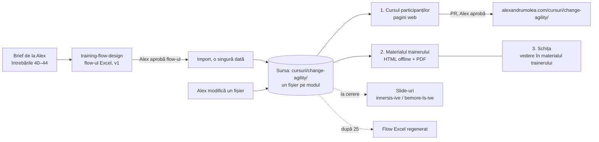

# Arhitectura unui curs: o sursă, trei ieșiri (v0)

**Autor:** Radu. **Data:** 2026-11-17. **Status:** propunere, nimic construit. Alex decide la final (4 decizii).
**Pentru:** workshop-ul Change Agility (o zi, 23 noiembrie, D-044, parte din I-018). Același model trebuie să meargă fără cod nou și pentru 25 noiembrie (Self-management în relația cu AI).
**Citit înainte:** `team/tudor/documente/echipa-workshopuri-v0.md`, `docs/procese/ce-iese-public.md`, `site/build.mjs`, `content/`, I-018, I-019, D-043–D-045, `arhitectura-v2.md`.

## Cererea lui Alex (2026-11-17)
> „Mi-ar plăcea ca acest proces să aibă 3 output-uri:
> 1. Un fel de curs online pe care participanții îl pot naviga foarte ușor, direct pe site-ul meu.
> 2. Un material al trainerului care să fie bine legat de informația de pe site, dacă modific ceva în materialul trainerului, să se modifice și în cursul online al participanților.
> 3. O schiță cu punctele cheie din curs, pe care să mă pot uita foarte ușor dacă vreau să las materialele deoparte […]. Asta ar trebui să fie tot în materialul trainerului.”

## Ideea, într-o frază
**Cursul e un folder cu câte un fișier text pe modul.** Din aceleași fișiere se generează cursul participanților, materialul trainerului și schița. Alex modifică un singur fișier, iar toate trei se schimbă la următorul build.

---

## 1. Modelul de conținut

### 1.1 Două lucruri diferite: cursul și ediția
| | **Cursul** | **Ediția** |
|---|---|---|
| Ce e | conținutul: modulele, exercițiile, notele de facilitare | o livrare anume: data, ora de start, grupul, ce module sărim |
| Se refolosește? | da, la fiecare livrare | nu, e o singură zi |
| Conține clientul? | **niciodată** | da, dar doar aici, într-un loc privat |
| Pe site | în Innovations („cursuri de încercat”) | în Latest Workshops, generic: „Change Agility, o zi, noiembrie 2026, cu o echipă dintr-o companie” |

Așa, numele clientului stă într-un singur fișier privat, iar conținutul cursului rămâne curat și poate fi refolosit.

### 1.2 Fișierele
```
cursuri/                         locul privat (vezi secțiunea 3)
  change-agility/
    curs.yml                     o dată pe curs: titlul, promisiunea, brandul, limba
    01-deschidere.md             un fișier pe modul, în ordinea din nume
    02-curba-schimbarii.md
    03-pauza.md
    ...
    materiale/                   worksheet-uri (.docx), imagini, scheme
    editii/
      2026-11-23.yml             ediția: ora de start, module sărite, numele interzise
```
**Regula 7 din CLAUDE.md:** orice schimbare de conținut înseamnă un fișier editat. Textul unui modul, timpul lui, o întrebare pentru trainer, un punct din schiță: toate stau în fișierul modulului.

### 1.3 `curs.yml`
| Câmp | Obligatoriu | Exemplu |
|---|---|---|
| `titlu` | da | „Change Agility” |
| `promisiune` | da | o propoziție: ce pleacă omul cu el (Maria o validează) |
| `brand` | da | `innersis` / `bemore-ls` (răspunsul la întrebarea 41) |
| `limba` | da | `ro` / `en` (întrebarea 42) |
| `durata_zi` | da | `9:00–18:00`, ca build-ul să verifice că modulele încap |
| `public` | da | `nu` / `link` / `da` (decizia 2, secțiunea 6) |
| `slug` | da | `change-agility`, devine adresa: `alexandrumolea.com/cursuri/change-agility/` |

### 1.4 Un modul: trei straturi în același fișier
| Stratul | Cum îl marchezi | Unde apare |
|---|---|---|
| **Pentru toți** | textul obișnuit | cursul participanților **și** materialul trainerului |
| **Doar trainerul** | între `:::trainer` și `:::` | doar materialul trainerului (ce spui, ce întrebi, timpii interni, ce faci dacă grupul tace) |
| **Doar participanții** | între `:::participant` și `:::` | doar cursul online (de exemplu „Notează-ți aici răspunsul”, linkul spre worksheet) |
| **Schița** | câmpurile `ancora` și `schita` din antet | schița din materialul trainerului |

Antetul modulului:
| Câmp | Obligatoriu | Ce e |
|---|---|---|
| `titlu` | da | titlul modulului |
| `durata` | da | minute. Ora exactă o calculează build-ul din ora de start a ediției |
| `tip` | da | `teorie` · `exercitiu` · `reflectie` · `mesaj` · `pauza`. Se potrivește cu cele trei lumi din skill-urile Ive (teorie = întunecat, exercițiu și reflecție = luminos, mesaj = accent), deci slide-urile își iau culoarea de aici |
| `ancora` | da | 1–3 cuvinte: singurul lucru pe care îl ții minte despre modul |
| `schita` | da | cel mult 3 puncte, cel mult 8 cuvinte fiecare |
| `materiale` | nu | ce trebuie în sală: flipchart, worksheet, post-it |
| `id` | da | stabil, nu se schimbă (legătura cu slide-urile și cu flow-ul) |

**De ce schița e scrisă, nu extrasă automat.** Schița e pentru memoria lui Alex, nu un rezumat. Trei cuvinte alese de el valorează mai mult decât trei propoziții tăiate de un script. Stă în același fișier, chiar deasupra conținutului, deci se schimbă în același loc.

### 1.5 Exemplu complet de modul
`cursuri/change-agility/02-curba-schimbarii.md` (conținut **[EXEMPLU]**, inventat ca să arate forma; conținutul real vine din brief și din flow-ul aprobat de Alex)

```markdown
---
id: curba
titlu: "Ce se întâmplă cu noi când se schimbă ceva"
durata: 50
tip: teorie
ancora: "Curba, nu linia"
schita:
  - "Schimbarea scade întâi performanța"
  - "Fiecare e în alt punct al curbei"
  - "Întrebarea: unde ești tu acum?"
materiale: ["flipchart cu curba desenată", "post-it-uri în 3 culori"]
---

## Întrebarea
Ce simți în prima săptămână după o schimbare pe care n-ai ales-o?

## Ideea
Orice schimbare trece printr-o scădere înainte de o creștere. Nu e un semn că
ceva merge prost. E drumul obișnuit.

:::trainer
**Deschidere (5 min).** Întreabă: „Cine a trecut anul ăsta printr-o schimbare
pe care n-a ales-o?” Lasă mâinile să se ridice. Nu cere povești încă.

**Desenul (15 min).** Desenează curba pe flipchart, fără nume de etape la început.
Cere grupului să numească etapele.

**Dacă grupul tace:** spune un exemplu personal, scurt, apoi întreabă din nou.

**Tranziția spre exercițiu:** „Acum, fiecare își pune un post-it acolo unde e azi.”
:::

## Exercițiul
Unde ești tu acum pe curbă, pentru schimbarea cea mai mare din viața ta de lucru?

:::participant
Scrie în worksheet-ul „Curba mea” (pagina 2) unde erai acum o lună și unde ești azi.
:::

## Ce iei cu tine
O schimbare nu se judecă după prima lună.
```

Ce iese din acest fișier:
- **Cursul participanților:** Întrebarea, Ideea, Exercițiul, nota despre worksheet, Ce iei cu tine. Fără nota trainerului.
- **Materialul trainerului:** tot, mai puțin nota pentru participanți, plus ora (de exemplu 10:10–11:00), materialele și ancora.
- **Schița:** „Curba, nu linia” și cele trei puncte, la ora 10:10.

### 1.6 Siguranța: notele trainerului nu scapă niciodată
Build-ul se oprește (nu publică nimic) dacă:
- un bloc `:::` nu e închis;
- apare un bloc necunoscut (de exemplu `:::traner`, scris greșit). Mai bine un build oprit decât o notă de trainer ajunsă la participanți;
- schița are peste 3 puncte sau un punct are peste 8 cuvinte;
- modulele nu încap în `durata_zi`;
- în cursul participanților apare un cuvânt din `nume_interzise` al ediției (numele clientului, al oamenilor). Lista stă doar în fișierul privat al ediției.

### 1.7 Ediția: `editii/2026-11-23.yml`
```yaml
data: 2026-11-23
ora_start: "9:00"
sari_peste: []            # id-uri de module pe care nu le facem la această livrare
nume_interzise: []        # numele clientului și al oamenilor; build-ul oprește cursul public dacă le găsește
nota_trainer: ""          # ce e special la acest grup (doar în materialul trainerului)
```

---

## 2. Cum se leagă de ce există



### 2.1 Flow-ul Excel: **output, nu sursă**
Răspunsul clar: **sursa e folderul cursului. Flow-ul Excel e o ieșire.**
- **La început,** skill-ul training-flow-design rămâne unealta de design: Daria (sau Tudor, dacă Studio nu e aprobat) face flow-ul în Excel din brief, iar Alex îl aprobă în 15 minute, cum e în procesul din `echipa-workshopuri-v0.md`.
- **Apoi, o singură dată,** flow-ul aprobat se transformă în fișierele de modul (rândurile flow-ului devin module; timpii devin `durata`).
- **De acolo,** orice schimbare se face doar în fișierele de modul. Excelul de la început rămâne ca „versiunea de design” și nu se mai editează. Dacă îl edităm în paralel, avem două surse și una minte.
- **După 25,** un script regenerează Excelul din sursă, pentru cine are nevoie de el în formatul lui Alex.

De ce nu Excelul ca sursă: un Excel nu se poate transforma curat în pagini web, nu se vede ce s-a schimbat (în git) și nu are loc bun pentru texte lungi de facilitare.

### 2.2 Slide-urile: ieșire la cerere
innersis-ive sau bemore-ls-ive citesc fișierele de modul: textul pentru toți devine slide-urile, `tip` dă lumea (întunecat, luminos, accent), iar blocurile `:::trainer` devin notele vorbitorului. **Nu se sincronizează singure.** După o schimbare, cineva îi spune lui Matei „regenerează deck-ul”. E normal: un deck se verifică vizual de un om înainte de sală.

### 2.3 Site-ul
- **`site/build.mjs` nu citește sursa.** Sursa e privată, iar build-ul site-ului rulează în repo-ul public. Primește doar **exportul pentru participanți**: un fișier `content/cursuri/change-agility.json`, fără note de trainer, fără ediții, fără client. Exportul ajunge în repo-ul public printr-un Pull Request pe care Alex îl aprobă (D-029; publicarea e nivelul 3).
- **Paginile noi:** `/cursuri/change-agility/` (cuprinsul, un ecran) și `/cursuri/change-agility/<id-modul>/` (un modul pe ecran, cu „înainte” și „înapoi”). Merge pe telefon, fără 3D, fără cont.
- **Unde apare pe site:**
  - **Innovations:** cursul, ca invenție de încercat (când `public: da`).
  - **Latest Workshops:** ediția, generic, cu link spre curs. Prima intrare reală în această cameră.
  - **Knowledge Base, mai târziu:** o idee din curs poate deveni unitate Knowledge (formatul Mariei, întrebarea, ideea, ce faci azi), cu legătura spre curs. Nu acum.
- Cu `public: link`, paginile există, dar nu apar în meniu, în sitemap sau în Google (`noindex`). Participanții ajung la ele prin QR-ul de la workshop.

---

## 3. Public sau privat

**Faptul de pornire:** GitHub Pages nu are parole. Tot ce e publicat acolo poate fi deschis de oricine are linkul. Iar repo-ul de azi e public, deci tot ce intră în el e public, chiar dacă nu apare pe site.

| Varianta | Ce e unde | Avantaje | Dezavantaje |
|---|---|---|---|
| **A. Totul în repo-ul public** | sursa în acest repo, cursul pe site | cel mai simplu; un singur loc | notele trainerului, metoda lui Alex și orice detaliu de grup devin publice pe GitHub. Încalcă spiritul `ce-iese-public.md` |
| **B. Sursa privată, cursul public generic** (recomandată) | sursa într-un repo privat de curs (D-043, aplicat acum doar pentru Studio). Spre site pleacă doar exportul pentru participanți, prin PR | notele trainerului și clientul nu ating niciodată repo-ul public; cursul devine și o vitrină pentru Alex (misiunea: învățarea ca sursă a binelui); zero costuri | cursul participanților poate fi citit de oricine are linkul. Bun pentru conținut educativ generic, nu pentru conținut confidențial al clientului |
| **C. Sursa privată, cursul cu acces doar pentru participanți** | ca B, dar cursul pe un alt găzduitor cu protecție (de exemplu Cloudflare Pages cu Cloudflare Access: cod pe email) | doar participanții intră | cere emailurile participanților (date personale ale clientului), un cont nou, timp de configurare. Nerealist până pe 23 și greu de justificat pentru conținut generic |
| **Rezervă până la D-043** | sursa într-un folder local ignorat de git (de exemplu `privat/cursuri/`), cu copie pe Drive | merge azi, fără nicio decizie | nu are istoric, nu merge din GitHub Actions, depinde de un singur calculator. Doar temporar |

**Recomandarea mea: B,** cu `public: link` pentru 23 (cursul există, dar nu e listat), iar după workshop Alex decide dacă îl pune în Innovations. Dacă D-043 nu e luată până joi, lucrăm în rezervă și mutăm folderul în repo-ul privat când apare. Formatul fișierelor e același, deci mutarea nu schimbă nimic.

Dacă un modul are nevoie de un exemplu din compania clientului, exemplul stă în blocul `:::trainer` sau în `nota_trainer` din ediție. Cursul participanților rămâne generic.

---

## 4. Materialul trainerului și schița

### 4.1 Unde trăiește
**Un singur fișier HTML, care merge fără internet,** plus un **PDF** tipărit din el. Ambele generate din aceeași sursă, la fiecare build.
- **HTML pe tabletă sau telefon:** Wi-Fi-ul din sălile de training nu e de încredere, deci fișierul are totul înăuntru (fără fonturi sau scripturi de pe net). Se deschide din Drive sau din Fișiere, merge și în modul avion.
- **PDF pe Drive și pe hârtie:** aceeași pagină, cu stil de tipar. Pentru cine vrea foaia pe masă.
- **Nu se publică pe site.** Stă pe Drive-ul lui Alex, lângă celelalte materiale de training.

Trei vederi în același fișier, cu un buton sus:
1. **Ziua:** desfășurătorul, cu ora fiecărui modul, durata, tipul și materialele. Ce e acum se vede imediat.
2. **Modulul:** tot conținutul, cu notele trainerului evidențiate.
3. **Schița:** doar ancorele și punctele cheie. Asta e vederea „las materialele deoparte”.

### 4.2 Trei direcții pentru schiță (punct de pornire pentru Ioana și Alex)
| Direcția | Cum arată | Când e bună | Ce riscă |
|---|---|---|---|
| **1. O pagină** | toată ziua pe o foaie A4 sau pe un ecran de tabletă: o linie verticală a timpului, la fiecare oră ancora mare și cele 3 puncte mici | Alex vrea să vadă toată ziua dintr-o privire, să știe unde e și ce urmează | la 10–12 module devine aglomerată |
| **2. Câte o carte** | un modul pe ecran: ancora uriașă, trei puncte, timpul rămas. Glisezi la următorul | Alex ține telefonul în mână sau tableta pe masă și vrea un singur lucru în față | nu vezi ziua întreagă |
| **3. Harta zilei** | ziua desenată ca un drum (de exemplu chiar curba schimbării), cu modulele ca opriri și o linie a energiei grupului | Alex gândește vizual; harta poate fi și pentru participanți, la început și la final | cel mai greu de făcut; cere design adevărat |

**Recomandarea mea pentru 23:** direcția 1, pentru că se face simplu și merge și pe hârtie. Pe 23 Alex o folosește, iar după aceea, cu Ioana, decidem forma finală din ce a lipsit în sală. Toate trei citesc aceleași câmpuri (`ancora`, `schita`, `durata`, `tip`), deci schimbarea designului nu schimbă conținutul.

---

## 5. Calendarul: ce e realist până pe 23

**Ce depinde de ce:**
- **Conținutul** depinde de brief (întrebările 40–44). Fără el nu avem module. Brandul (41) decide culorile și skill-ul de slide-uri; limba (42) decide textele fixe.
- **Cine scrie modulele** depinde de D-045 (Studio). Dacă nu e aprobată, Tudor coordonează și fac munca agenții CORE, mai încet.
- **Unde stă sursa** depinde de D-043. Dacă nu e luată, folosim rezerva (secțiunea 3).
- **Generatorul** (Mike) nu depinde de conținut. Poate porni imediat ce Alex aprobă direcția.

| Zi | Ce se face | Cine |
|---|---|---|
| Ma 17 | Alex aprobă direcția și răspunde la brief | Alex |
| Mi 18 | flow-ul cu training-flow-design → Alex verifică. În paralel: generatorul (sursă → cele trei ieșiri), pe modulul-exemplu | Daria / Tudor; Mike |
| Jo 19 | importul flow-ului în fișiere de modul; textele pentru participanți și notele trainerului | Daria; Maria pentru voce |
| Vi 20 | **Alex citește materialul trainerului pe tabletă** și corectează direct în fișiere. Slide-urile, din sursă | Alex; Matei |
| Sâ–Du 21–22 | corecturi, PDF-ul, lista de print, PR-ul cu cursul participanților (`public: link`), codul QR | Mike; Alex aprobă PR-ul |
| Lu 23 | **livrare** | Alex |
| Ma 24 | ce a lipsit în sală; aceleași fișiere pentru Self-management (25) | Tudor, Elena |

**v1 minim pentru 23 (ce promitem):**
- sursa în formatul de mai sus;
- materialul trainerului: HTML offline și PDF, cu vederile Ziua, Modulul și Schița (direcția 1, simplă);
- cursul participanților pe `alexandrumolea.com/cursuri/change-agility/`, nelistat, accesibil prin QR;
- slide-urile, generate o dată din sursă.

**Planul B, dacă pe joi seara conținutul nu e gata:** prioritatea e materialul trainerului (fără el nu se ține workshop-ul). Cursul participanților devine follow-up-ul de după workshop, cu linkul trimis de Alex. Generatorul e același, doar publicarea se mută.

**După 25:**
- designul schiței, cu Ioana și Alex, din ce s-a folosit în sală;
- Excelul regenerat din sursă;
- skill-ul „curs-din-sursă” (cu `skill-creator`), ca orice curs nou să fie doar un folder nou;
- pre-work, follow-up și formularul de feedback (golurile din `echipa-workshopuri-v0.md`);
- listarea în Innovations și unitățile Knowledge derivate, dacă Alex vrea;
- accesul protejat (varianta C), doar dacă apare un curs cu conținut confidențial.

---

## 6. Deciziile pentru Alex
1. **O sursă, trei ieșiri.** Cursul e un folder cu un fișier pe modul; flow-ul Excel e punctul de plecare, apoi devine o ieșire, iar modificările se fac doar în fișierele de modul. *Recomandare: da.*
2. **Cursul participanților e public, dar generic.** Fără client, fără notele trainerului, la un link nelistat pentru 23; după workshop decizi dacă intră în Innovations. *Recomandare: da (varianta B). Alternativă: doar ca follow-up după workshop.*
3. **Sursa stă privat.** Aplicăm D-043 acum, doar pentru cursuri: un repo privat pentru Studio. Până îl ai, un folder local cu copie pe Drive. *Recomandare: da.*
4. **Schița pentru 23 e simplă: toată ziua pe o pagină.** Designul final îl facem cu Ioana după ce o folosești în sală. *Recomandare: da.*

## Jurnal
| Dată | Ce s-a întâmplat |
|---|---|
| 2026-11-17 | Alex a cerut cele trei ieșiri. Radu a scris propunerea v0, fără nimic construit. |
