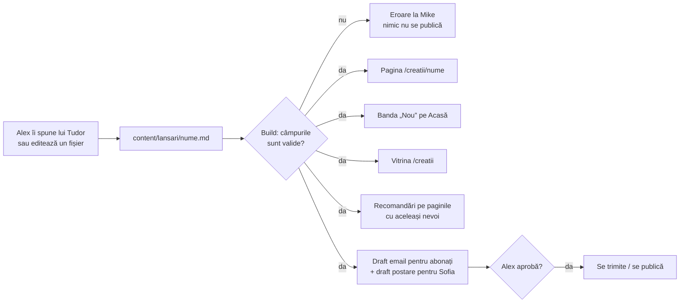
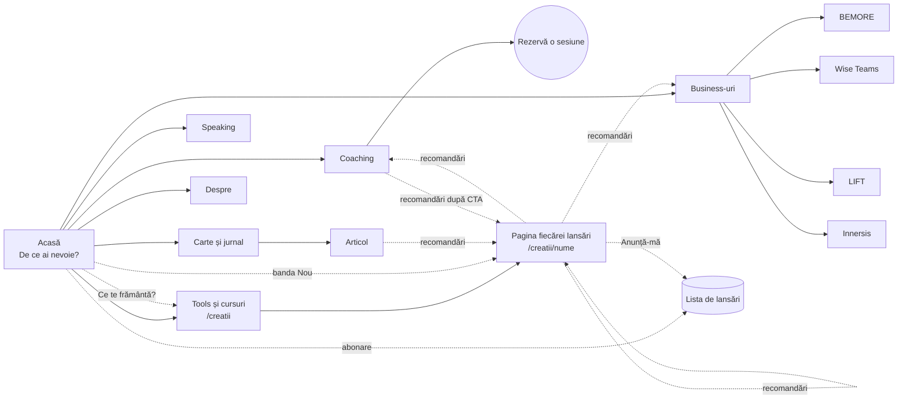

# Arhitectura site-ului — v1 (propunere)

> Autor: Radu. Dată: 2026-11-15. Status: **de aprobat de Alex**.
> Pornește de la `arhitectura-v0.md` (rămâne neschimbată, pentru istoric) și adaugă obiectivul 2 din charter: site-ul inspiră și ajută la descoperire.
> Research: `team/radu/documente/research-2026-11-descoperire.md`.

## Principiul, actualizat
v0: vizitatorul vine cu o nevoie. Prima întrebare a site-ului e **„De ce ai nevoie?”**
v1 adaugă a doua întrebare, pusă abia după ce prima a primit răspuns: **„Ce altceva te-ar ajuta?”**

Trei reguli țin descoperirea în afara drumului:
1. **Intenția întâi.** Nimic de descoperire nu stă deasupra cardurilor de intenție sau înaintea butonului principal al unei pagini.
2. **Maximum 3.** Orice bloc de descoperire arată cel mult 3 elemente.
3. **Gol înseamnă ascuns.** Un bloc fără conținut nu apare. Nu afișăm „În curând ceva nou”.

---

## 1. Mecanismele de descoperire

### Ce intră în v1 (4)

| # | Mecanism | Ce e | Unde apare | De ce funcționează | Întreținere |
|---|---|---|---|---|---|
| 1 | **Banda „Nou de la Alex”** | Max. 3 carduri cu lansările marcate `nou` sau `în curând` | Pagina principală, imediat **sub** cardurile de intenție | Cine revine vede imediat ce s-a schimbat. Cine vine prima dată află că Alex creează lucruri, nu doar oferă servicii | **Zero.** Se umple din fișierele de lansări. „Nou” expiră singur după 90 de zile |
| 2 | **Recomandări „S-ar putea să ai nevoie și de…”** | Max. 3 sugestii, calculate din etichetele de nevoie comune. Titlul spune de ce: „Pentru că te interesează: *Claritate*” | La finalul paginilor de tool, curs, lansare, coaching, business și jurnal. **După** butonul principal | Prinde omul exact când a terminat ce a venit să facă. NN/g: recomandările care își arată sursa sunt mai credibile | **Zero** pe pagină. Singura grijă: fiecare fișier are 1–3 etichete de nevoie |
| 3 | **Vitrina „Tools și cursuri”** (`/creatii`) | O pagină cu toate invențiile: cursuri, aplicații, tool-uri, carte, evenimente, experimente. Sus: „Nou și în curând”. Apoi tot ce e disponibil. Jos, pliată: arhiva | Bara de navigare (înlocuiește „Tools”), cardul de intenție „Vreau un tool…” și un rând de etichete pe pagina principală: „Ce te frământă acum?” | Un singur loc unde se vede amploarea a ce face Alex. Filtrul pe nevoie e un mini-diagnostic cu zero întrebări: omul își alege problema, nu categoria | **Zero.** Se generează din aceleași fișiere |
| 4 | **Abonare la lansări** | Un câmp de email: „Spune-mi când lansezi ceva nou.” Pe lansările `în curând`: „Anunță-mă când apare” (aceeași listă) | Pagina principală (după bandă), vitrina, lansările `în curând`, subsolul fiecărei pagini | Oamenii nu revin singuri pe site. Fără asta, banda „Nou” o văd doar cei care trec întâmplător | **Mică.** La fiecare lansare se generează un draft de email. **Alex îl aprobă** înainte să plece. Max. un email la 2 săptămâni |

Notă: „Tools” devine „Tools și cursuri” în meniu pentru că tool-urile sunt un tip de invenție, nu o secțiune separată. `/tools` rămâne ca adresă și duce la vitrina filtrată pe tool-uri și aplicații. Eticheta exactă din meniu: de confirmat cu Maria.

### Ce merge la „mai târziu”

| Mecanism | De ce nu acum | Când îl reluăm |
|---|---|---|
| **Mini-diagnostic de 3 întrebări** | Cea mai bună idee pentru „descoperă ce nu știai că-ți trebuie”, dar are nevoie de două lucruri pe care nu le avem: taxonomia validată și destule invenții între care să aleagă (cu 4–5 elemente, un quiz e un ocol). Filtrul pe nevoie din vitrină acoperă 80% din efect | Când avem ≥ 8 lansări active și taxonomia confirmată de Alex. Costul va fi mic: motorul de recomandări din v1 rămâne același, se adaugă doar un fișier cu întrebări (`content/diagnostic.yml`). Poate fi chiar o invenție a lui Alex, lansată ca atare |
| **Idee sau provocare pe săptămână** | Cere un angajament săptămânal. Un bloc „Ideea săptămânii” vechi de o lună face mai mult rău decât lipsa lui | Când calendarul social al Sofiei merge stabil. Atunci blocul poate prelua automat postarea aprobată a săptămânii, fără muncă în plus |
| **Recomandări personalizate pe comportament** | Cer cookies și tracking (GDPR), multă complexitate, puțin conținut pe care să lucreze | Probabil niciodată pe un site personal. Etichetele bat algoritmul la scara asta |

---

## 2. Modelul de conținut pentru lansări

### Principiul: un fișier, trei locuri
O invenție = un fișier în `content/lansari/<nume>.md`. Din el se construiesc automat: cardul din banda „Nou”, cardul din vitrină, pagina proprie (`/creatii/<nume>`) și prezența în recomandările altor pagini. Nimeni nu editează banda, vitrina sau recomandările de mână.

`content/tools/` din v0 dispare: tool-urile devin lansări cu `tip: tool` sau `tip: app`. Un singur model pentru tot ce inventează Alex.

### Câmpurile

| Câmp | Obligatoriu | Valori | La ce folosește |
|---|---|---|---|
| `titlu` | da | text scurt | Numele invenției |
| `tip` | da | `curs` · `app` · `tool` · `carte` · `eveniment` · `experiment` | Filtru în vitrină, eticheta cardului, textul implicit al butonului |
| `status` | da | `in-curand` · `nou` · `disponibil` · `arhivat` | Unde apare (vezi regulile de mai jos) |
| `data_lansare` | da | `AAAA-LL-ZZ` | Ordinea în bandă, expirarea lui „nou” |
| `nevoi` | da | 1–3 etichete din `content/nevoi.yml` | Recomandări, filtrul din vitrină, diagnosticul de mai târziu |
| `pe_scurt` | da | o propoziție, max. 140 de caractere | Textul de pe card |
| `pentru_cine` | da | o propoziție | „Pentru cine e”, pe pagină și pe card |
| `link` | da | URL (extern) sau cale internă | Unde duce butonul principal |
| `imagine` | da | cale relativă, în `content/lansari/imagini/` | Card și pagină |
| `imagine_alt` | da | text | Accesibilitate |
| `business` | nu | slug din `content/business/` (`bemore`, `wise-teams`, `lift`, `innersis`) | Afișează „parte din …” și leagă invenția de pagina business-ului |
| `de_ce` | nu, dar recomandat | 1–2 propoziții, **în cuvintele lui Alex** | Stratul de inspirație: povestea din spatele invenției. Nu se completează de echipă fără Alex |
| `buton` | nu | text | Suprascrie textul implicit al butonului (ex.: „Încearcă”, „Înscrie-te”) |
| `pret` | nu | `gratuit` · `platit` · `discutam` | Eticheta mică de pe card |
| `expira` | nu | `AAAA-LL-ZZ` | Pentru evenimente și oferte limitate: după data asta, lansarea e tratată ca `arhivat`, automat |
| `evidentiat` | nu | `true` | Fixează lansarea pe primul loc în bandă. Maximum una la un moment dat |

Corpul fișierului (sub câmpuri) e descrierea lungă, în Markdown.

### Ce face fiecare status

| Status | Banda „Nou” | Vitrina | Recomandări | Abonare |
|---|---|---|---|---|
| `in-curand` | da, cu eticheta „În curând” | sus, la „Nou și în curând” | da, maximum 1 din 3 | butonul „Anunță-mă când apare” |
| `nou` | da | sus, la „Nou și în curând” | da, cu prioritate | se generează draftul de email de lansare |
| `disponibil` | nu | lista principală | da | – |
| `arhivat` | nu | arhiva pliată, jos | nu | – |

Reguli automate (le implementează Mike, nu le ține minte nimeni):
- **„Nou” expiră singur.** La 90 de zile după `data_lansare`, o lansare `nou` se afișează ca `disponibil`. Fișierul nu trebuie atins.
- **`expira` arhivează singur.** După data din `expira`, lansarea e tratată ca `arhivat`.
- **„În curând” cu data trecută** nu se schimbă singur (poate lansarea a întârziat), dar apare în raportul săptămânal al lui Tudor: „X e încă «în curând», data a trecut. Lansăm sau mutăm data?”
- **Pagina unei lansări arhivate rămâne online.** Linkurile vechi nu se rup.
- **Etichetă greșită = build oprit.** Dacă `nevoi` conține ceva ce nu există în `nevoi.yml`, sau `business` nu există, site-ul nu se publică și Mike primește eroarea. Așa recomandările nu se strică în tăcere.

### Exemplu complet

> **EXEMPLU FICTIV.** Numele, datele și linkul sunt inventate ca să arate structura. Nu descriu o invenție reală a lui Alex.

`content/lansari/exemplu-fictiv-jurnal-claritate.md`
```markdown
---
titlu: "[EXEMPLU] Jurnalul de claritate"
tip: app
status: nou
data_lansare: 2026-12-01
nevoi: [claritate, obiceiuri]
pe_scurt: "[EXEMPLU] Cinci minute pe zi ca să vezi ce contează cu adevărat săptămâna asta."
pentru_cine: "[EXEMPLU] Pentru oricine simte că aleargă mult și ajunge puțin."
link: https://exemplu.invalid/jurnal
imagine: ./imagini/exemplu-fictiv-jurnal-claritate.jpg
imagine_alt: "[EXEMPLU] Ecranul principal al aplicației, cu o singură întrebare pe zi"
business: null
de_ce: "[EXEMPLU — aici scrie Alex, cu vorbele lui, de ce a creat asta.]"
buton: "Încearcă gratuit"
pret: gratuit
---

[EXEMPLU] Descrierea lungă: ce face, cum arată o zi de folosire, ce primești după o săptămână.
```

### Cum apare o lansare nouă, dintr-un singur fișier

Ținta din charter („o lansare nouă apare pe site în aceeași zi, dintr-un singur fișier”) e atinsă dacă Alex aprobă publicarea în aceeași zi.

### Ce se schimbă în restul modelului (față de v0)
```
content/
  nevoi.yml              NOU: taxonomia de nevoi (singura listă de etichete)
  lansari/<nume>.md      NOU: toate invențiile (înlocuiește tools/)
  lansari/imagini/       imaginile lansărilor
  coaching.md            + câmpul nevoi
  business/<nume>.md     + câmpul nevoi
  jurnal/<data-titlu>.md + câmpul nevoi (opțional, 0–3)
  despre.md, carte.md, speaking.md   neschimbate
```
Coaching și business-urile intră în recomandări ca orice lansare. Așa, cine citește un articol despre echipe poate ajunge la business-ul potrivit fără să-l caute.

### Cum se calculează recomandările (pentru Mike)
1. Ia toate fișierele cu `nevoi`, mai puțin pagina curentă și cele `arhivat`.
2. Scor = numărul de nevoi comune cu pagina curentă.
3. La egalitate: `nou` > `disponibil` > `in-curand`, apoi data mai recentă.
4. Diversitate: maximum 2 de același `tip` în cele 3.
5. Dacă sunt mai puțin de 3 potriviri, completează cu cele mai recente lansări `nou`.
6. Titlul blocului numește nevoia comună cea mai puternică: „Pentru că te interesează: *Echipa*”.
7. Nu apare pe: rezervare, contact, pagini de confirmare.

---

## 3. Taxonomia de nevoi

> **Toate etichetele sunt ipoteze de validat cu Alex.** Le-am formulat pe limba vizitatorului, pornind de la filtrele din v0 (focus, obiceiuri, echipă, carieră). Nu știm încă ce acoperă fiecare business sau tool al lui Alex.

Stau într-un singur fișier, `content/nevoi.yml`. Fiecare are: slug, nume scurt, fraza vizitatorului (folosită în vitrină și în diagnosticul de mai târziu).

| Slug | Nume afișat | Fraza vizitatorului | Mai ales pentru |
|---|---|---|---|
| `claritate` | Claritate | „Nu știu sigur încotro merg.” | persoane |
| `focus` | Focus și energie | „Am prea multe pe cap.” | persoane |
| `obiceiuri` | Obiceiuri | „Vreau să schimb ceva și să și rămână.” | persoane |
| `cariera` | Carieră | „Sunt la o răscruce profesională.” | persoane |
| `comunicare` | Comunicare | „Vreau să mă fac înțeles și să înțeleg.” | persoane și echipe |
| `leadership` | Leadership | „Conduc oameni și vreau s-o fac mai bine.” | lideri |
| `echipa` | Echipă | „Echipa mea nu merge cum ar trebui.” | companii |
| `dezvoltare-oameni` | Dezvoltarea oamenilor | „Vreau să-mi cresc oamenii.” | HR, L&D |

Reguli:
- Maximum 10 etichete în total. Una nouă intră doar dacă cel puțin 2 fișiere o folosesc.
- Fiecare fișier are 1–3 etichete. Mai multe ar face recomandările vagi.
- O etichetă folosită de un singur fișier nu apare ca filtru (ar duce la o listă cu un element).
- Candidat de discutat cu Alex: `sens` („Vreau mai mult sens în ce fac”). Poate fi exact stratul de inspirație, poate fi prea vag.

---

## 4. Harta site-ului și pagina principală

### Harta (v1)
Linii pline: navigare directă (drumul intenției). Linii punctate: descoperire (vine în plus).


### Pagina principală, de sus în jos

| # | Secțiune | Rol | Față de v0 |
|---|---|---|---|
| 1 | Bara de navigare: Coaching · Tools și cursuri · Business · Speaking · Carte · Despre + **Rezervă o sesiune** | drum direct | „Tools” devine „Tools și cursuri” |
| 2 | Introducere: cine e Alex, într-o propoziție, și întrebarea „De ce ai nevoie?” | orientare | neschimbat |
| 3 | **Cardurile de intenție** (cele 6 din v0) | drum direct, vizibile fără scroll | cardul de tool-uri duce la `/creatii` filtrat |
| 4 | **Banda „Nou de la Alex”**: max. 3 carduri | descoperire | NOU. Ascunsă dacă nu e nimic `nou` sau `în curând` |
| 5 | **„Ce te frământă acum?”**: rândul de etichete de nevoie, fiecare duce în vitrină filtrată | descoperire | NOU |
| 6 | **Abonare**: „Spune-mi când lansez ceva nou.” Un câmp, un buton | descoperire în timp | NOU |
| 7 | Subsol: contact, business-uri, rețele, abonare | utilitar | abonarea apare și aici |

Pe mobil: aceeași ordine, cardurile stivuite, butonul „Rezervă” fix jos (ca în v0). Cum arată: Ioana.

### Verificarea regulii de 2 click-uri

| Intenție | Drum | Click-uri | Ce adaugă v1 |
|---|---|---|---|
| Sesiune de coaching | Acasă → Rezervă (bara sau card) → calendar | 1–2 | nimic înainte; recomandări după CTA |
| Un tool | Acasă → card „Vreau un tool” → tool-ul | 2 | nimic înainte |
| Companie | Acasă → card „În compania mea” → business | 2 | nimic înainte |
| Speaking | Acasă → card → `/speaking` | 1 | nimic |
| Citit | Acasă → card → carte / articol | 1–2 | recomandări la final de articol |
| Ce e nou | Acasă → card din bandă | 1 | drum nou, nu existent în v0 |
| „Nu știu ce-mi trebuie” | Acasă → etichetă de nevoie → lansare | 2 | drum nou |

Niciun drum din v0 nu s-a lungit.

### Cum măsurăm (de confirmat cu Mike, analytics fără cookies)
- Câți vizitatori dau click pe un element de descoperire (bandă, etichete, recomandări). Ținta din charter: „vizitatorii descoperă și încearcă și alte lucruri”.
- Câți se abonează pe lună.
- Controlul: timpul până la rezervare nu crește față de lansarea fără stratul de descoperire.

---

## 5. Ce nu facem și de ce

| Nu facem | De ce |
|---|---|
| Pop-up de abonare la intrare sau la ieșire | E ocol curat: oprește omul înainte de ce a venit să facă |
| Banda „Nou” deasupra cardurilor de intenție | Mută descoperirea înaintea intenției. Încalcă regula de bază |
| Recomandări înainte de butonul principal sau pe pagina de rezervare | Distrag exact în momentul deciziei |
| Mai mult de 3 elemente într-un bloc | Fiecare opțiune în plus încetinește alegerea (legea lui Hick). 3 inspiră, 12 obosesc |
| „Nou” pentru totdeauna | Dacă totul e nou, nimic nu e. De aceea expiră singur |
| Blocuri goale sau „Revino curând” | Arată un site abandonat. Gol înseamnă ascuns |
| Urgență falsă („doar 2 locuri”, cronometre) | Nu e vocea lui Alex (superlative fără dovezi, de evitat) și strică încrederea |
| Email la fiecare schimbare mică | Abonații se dezabonează. Doar lansări, max. un email la 2 săptămâni, aprobat de Alex |
| Zeci de etichete | Recomandările devin aleatorii și filtrele duc la liste de un element |
| Notificări push, chatbot, „pe baza istoricului tău” | Complexitate și tracking pentru un site personal cu puțin conținut |
| Ideea săptămânii fără cine s-o alimenteze | Un bloc datat și vechi inspiră mai puțin decât niciun bloc |

---

## Ce am nevoie de la Alex
1. Aprobare pe direcție: cele 4 mecanisme și ce merge la „mai târziu”.
2. Taxonomia: ce etichete rămân, ce lipsește, ce se redenumește. Pentru fiecare business și tool: ce nevoi rezolvă.
3. Lista invențiilor (întrebările 20–21 din `docs/intrebari-pentru-alex.md`). Fără ea, banda „Nou” e ascunsă la lansare.
4. E OK ca „Tools” din meniu să devină „Tools și cursuri”?
