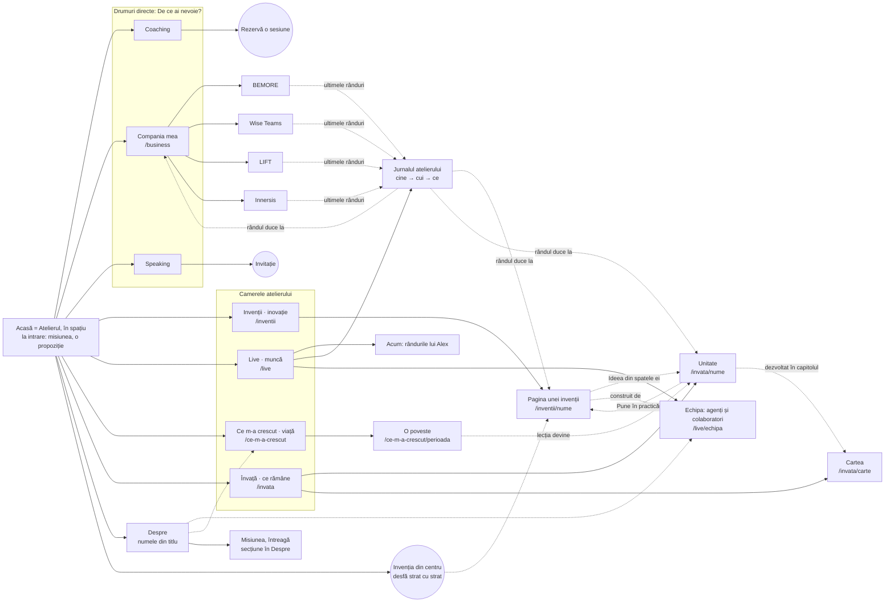
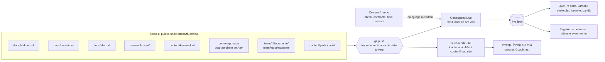

# Arhitectura site-ului — v2 (propunere)

> Autor: Radu. Dată: 2026-11-15. Status: **de confirmat de Alex** (decizia structurală D-028; numele sunt în D-025 și formulările misiunii în D-027, ale Mariei; misiunea e D-026).
> Pornește de la `arhitectura-v1.md`, care rămâne valabilă pentru descoperire, lansări și nevoi. v2 adaugă:
> - scopul extins (D-024): site-ul e **oglinda business-ului**, nu doar o vitrină;
> - direcția vizuală aprobată, **Spațiu** (D-023): un atelier 3D cu obiecte pe orbită;
> - metafora lui Alex: oamenii au acces în **atelierul lui de inovație, muncă și viață** („work & living”);
> - trei categorii noi, cerute de Alex: **Live** (I-010), **Knowledge** (I-011) și poveștile (I-012);
> - misiunea lui Alex (D-026): „Necunoscutul creează monștri. Educația creează poduri.” E firul care leagă camerele (secțiunea 1.11).
>
> **Cine deține ce.** Radu: structura, categoriile ca funcție, modelul de conținut, adresele. **Maria:** numele și textele afișate, plus formatul și ritualul poveștilor. Numele de aici sunt **propuse (D-025)**, de confirmat de Alex: Atelierul (tot site-ul), Invenții, Live, Jurnalul atelierului, Ce m-a crescut, Învață. **Ioana:** cum arată în spațiu. Aici scrie ce face fiecare obiect, nu cum arată.
> Exemplele de conținut sunt **fictive** și marcate ca atare.
> Răspunde și la T-008 (de la Maria): Live și „Acum” (I-005), locul poveștilor, revizuirea D-007. Vezi secțiunea 1.4.

## Ideea v2, într-o frază
Propoziția Mariei (propusă, D-025): **„Intră în atelierul meu: ce inventez, cum lucrez, ce trăiesc și ce am învățat din toate.”**

Structural, asta înseamnă două feluri de categorii pe același site:
- **Drumurile directe**, pentru cine vine cu o nevoie: Coaching, Compania mea, Speaking. „Ai nevoie de X? Mergi aici.”
- **Camerele atelierului**, pentru cine vrea să vadă cine e Alex: **Invenții** (inovația), **Live** (munca), **Ce m-a crescut** (viața) și **Învață** (ce rămâne din toate trei).

**Firul care le leagă e misiunea lui Alex** (D-026): educația cu scopul de a face bine, fiecărei persoane și între oameni. Fiecare cameră și fiecare business răspunde la aceeași întrebare: **cum construiește asta un pod?**

Camerele se hrănesc una pe alta: o poveste se termină cu o lecție, lecția devine o unitate în Învață, unitatea trimite la o unealtă din Invenții, iar Live arată cum se construiește totul.

Asta simplifică, nu complică. „Carte” și „Jurnal” din v0–v1 nu mai sunt secțiuni separate: tot ce te învață Alex stă într-un singur loc (Învață), iar tot ce s-a întâmplat nou stă în altul (Live). Un blog care trebuie hrănit săptămânal dispare.

---

## 1. Categoriile principale

### 1.1 Cele 8 categorii, ca intenții ale vizitatorului

| Familie | # | Cheie (stabilă, internă) | Nume propus (D-025) / de lucru | Dimensiunea (Alex) | Intenția vizitatorului | Adresa (provizorie) |
|---|---|---|---|---|---|---|
| **Drumuri directe** | 1 | `coaching` | Coaching | muncă | „Vreau să lucrez cu tine, unu la unu.” | `/coaching` |
| | 2 | `companie` | Compania mea | muncă | „Vreau ceva pentru echipa sau compania mea.” | `/business` |
| | 3 | `speaking` | Speaking | muncă | „Vreau să te invit să vorbești.” | `/speaking` |
| **Camerele atelierului** | 4 | `inventii` | **Invenții** (propus) | inovație | „Vreau o unealtă, o aplicație sau un curs de încercat.” | `/inventii` |
| | 5 | `live` | **Live** (propus) | muncă | „Vreau să văd la ce lucrezi acum.” | `/live` |
| | 6 | `povesti` | **Ce m-a crescut** (propus) | viață | „Vreau să știu prin ce ai trecut și ce ai învățat.” | `/ce-m-a-crescut` |
| | 7 | `knowledge` | **Învață** (propus; intern: Knowledge) | ce rămâne din toate | „Vreau să învăț de la tine.” | `/invata` |
| (în titlu) | 8 | `despre` | Despre mine | viață | „Vreau să te cunosc.” | `/despre` |

**În spațiu, 7 categorii sunt la o interacțiune (1–7).** Cele 4 camere sunt obiectele atelierului, pe orbită. Cele 3 drumuri directe stau mereu în bară și, dacă Ioana alege, sunt și obiecte în scenă (forma e a ei; cerința e doar: o interacțiune). „Despre” nu e obiect: e numele lui Alex din titlu și din bară (un click, de oriunde). Motivul: „cine e Alex” e răspunsul întregii pagini, nu o opțiune printre altele.

Adresele urmează numele propuse de Maria. Dacă Alex schimbă numele, se schimbă și adresele (site-ul nu e încă public, deci nu se rupe nimic). Cheile interne nu se schimbă niciodată.

### 1.2 Grupele: două familii, iar dimensiunile trăiesc în camere
Tudor a întrebat dacă împărțirea în trei (inovație, muncă, viață) e un mod mai clar de a grupa **toate** categoriile. Am verificat ambele variante.

**Varianta A: trei grupe pentru tot** (Inovație: Invenții, Învață · Muncă: Coaching, Compania mea, Speaking, Live · Viață: Ce m-a crescut, Despre).
Problema: un client de coaching nu se gândește „caut în Muncă”. Pentru Alex, coaching-ul e muncă; pentru vizitator, e un serviciu pentru el. Grupa „Muncă” ar amesteca drumul cel mai important (rezervarea) cu cel mai curios (Live). Iar „Învață” nu e doar inovație: e ce rămâne din toate trei (Maria).

**Varianta B, recomandată: două familii, iar cele trei dimensiuni sunt chiar camerele.**
- Familia 1, **drumurile directe** (Coaching, Compania mea, Speaking): „De ce ai nevoie?”
- Familia 2, **camerele atelierului** (Invenții, Live, Ce m-a crescut, Învață): „Intră în atelier.”
- Cele trei dimensiuni ale lui Alex se văd 1:1 în camere: inovație = Invenții, muncă = Live, viață = Ce m-a crescut, iar Învață e distilatul. Nu e nevoie de un strat de grupare în plus.

De ce B e mai clară:
1. **Separă cele două motive de vizită:** „am nevoie de ceva” și „vreau să văd cine e omul ăsta”. Exact principiul din v1: intenția întâi, descoperirea în plus.
2. **7 obiecte în 2 familii se citesc dintr-o privire** (3 + 4). 7 obiecte într-un singur cerc ar fi fost limita de sus.
3. **Păstrează metafora lui Alex întreagă:** tot site-ul e atelierul, iar camerele lui sunt inovația, munca și viața.

**Grupele nu se dau click, în niciuna dintre variante.** Nicio familie nu are pagina ei și niciuna nu e un meniu care trebuie deschis întâi. Fiecare din cele 7 obiecte rămâne la o interacțiune. (Un nivel „Acasă → Muncă → Coaching → rezervare” ar fi 3 interacțiuni și navigare pe organigrama lui Alex, exact ce v0 a evitat.)

Unde se folosesc familiile, ca funcție (forma: Ioana; textele: Maria):

| Loc | Ce fac familiile |
|---|---|
| Scena 3D | Camerele sunt obiectele atelierului (pe orbită). Drumurile directe sunt mereu la îndemână, separat de ele (în bară, eventual și ca obiecte în prim-plan; forma: Ioana). Alegerea familiei nu e o interacțiune; obiectul e |
| Bara de jos | Două grupuri de butoane: „De ce ai nevoie?” (direct) și „Intră în atelier” (camere). Drumurile directe primele |
| Varianta fără 3D și mobil | Două titluri de secțiune, cu cardurile sub ele. Drumurile directe primele. Nu se pliază |
| Meniul paginilor interioare | Aceeași ordine. Un separator între familii, fără titluri |
| Butonul „Rezervă o sesiune” | Fix, pe toate paginile, în afara oricărei familii |

### 1.3 Ce s-a schimbat față de v1
- **Tot site-ul e Atelierul** (D-025). Vitrina de invenții nu se mai numește „Atelier”, ci **Invenții**. Banda rămâne „Nou în atelier”.
- **„Carte și jurnal” → Învață.** Cartea devine o parte din Învață (`/invata/carte`). Articolele din `content/jurnal/` devin unități Knowledge. Ce era „noutate” în jurnal trece în Live.
- **Live e cameră nouă.** Preia ideea I-001 (echipa la vedere, `/live/echipa`) și I-005 (pagina „Acum”, vezi 1.4). Sursa principală e fluxul de taskuri dintre agenți, **Jurnalul atelierului** (cerința lui Alex, vezi 4.2).
- **Ce m-a crescut e cameră nouă** (I-012): o poveste personală pe trimestru. Vezi secțiunea 5.
- Coaching, Compania mea (cele 4 business-uri) și Speaking rămân ca în v1, ca drumuri directe.

### 1.4 Răspunsul la T-008
| Întrebarea Mariei | Decizia structurală (propunere) |
|---|---|
| **Live și pagina „Acum” (I-005) sunt aceeași?** | **Da, o singură pagină: `/live`.** Cu două viteze: sus, opțional, **„Acum”**: 3–5 rânduri scrise de Alex despre ce e important pentru el în perioada asta (varianta lentă, ca „/now”). Sub el, **„Pe banc acum”** și **Jurnalul atelierului**, generate automat (varianta rapidă). „Acum” stă într-un singur fișier, `content/acum.md`, cu data actualizării. Dacă e mai vechi de 90 de zile, se ascunde (gol înseamnă ascuns). `/acum` și `/now` duc la `/live`. Formatul textului rămâne al Mariei (I-005) |
| **Unde stau poveștile?** | **Cameră proprie, Ce m-a crescut** (`/ce-m-a-crescut`), cu obiect în spațiu: e dimensiunea „viață” a atelierului, egală cu celelalte. Pagina Despre trimite la ea, iar fiecare poveste trimite la lecția din Învață, dacă există. Rezerva, dacă Alex vrea mai puține obiecte: poveștile stau sub Despre și orbita scade la 6 (se schimbă doar `pe_orbita`) |
| **D-007 (`/atelier`, meniul „Tools și cursuri”)** | **Propun să fie înlocuită.** Pagina vitrinei: **Invenții**, la `/inventii`. „Atelier” nu mai e numele unei pagini, ci al întregului site. În meniu: eticheta „Invenții”, **mereu cu fraza vizitatorului sub ea sau lângă ea** („Tool-uri, aplicații și cursuri de încercat”), în bară, în panou și pe card, ca vizitatorul care caută „un tool” să se recunoască (preocuparea mea din v1). `/tools`, `/creatii` și `/atelier` duc la `/inventii` (cu filtrul pe tool-uri, la `/tools`). Ce rămâne din D-007: banda „Nou în atelier” |

### 1.5 Ce găsește vizitatorul, ce face obiectul, drumul

„Interacțiune” = un click, un tap sau Enter. Tragerea de spațiu (explorarea) nu se numără. **Panoul** = fereastra care se deschide când alegi un obiect (ca în prototip). Fiecare panou e o previzualizare a paginii categoriei și are deja butonul principal, deci ținta e la cel mult 2 interacțiuni.

| Categorie | Ce găsește pe pagină | Obiectul în spațiu: ce trebuie să facă | Interacțiunea 1 | Interacțiunea 2 = ținta |
|---|---|---|---|---|
| **Coaching** | Pentru cine e, cum arată o sesiune, preț sau „discutăm”, rezervare | Reprezintă „lucrăm unu la unu”. La alegere, deschide panoul cu următoarele 3 ore libere | Alege obiectul sau butonul din bară | „Alege o oră” → calendarul de rezervare. **Butonul „Rezervă” fix rămâne: 1 interacțiune** |
| **Compania mea** | Cele 4 business-uri, fiecare cu nevoia pe care o rezolvă, plus contact | Reprezintă cele 4 business-uri ca un singur obiect. Panoul le listează, fiecare cu o propoziție de nevoie | Alege obiectul | Alege business-ul → pagina lui. Sau „Scrie-mi” → contact |
| **Speaking** | Subiecte (fiecare cu un exercițiu pentru sală), formate, bio, media kit | Panoul arată 3 subiecte și butonul de invitație | Alege obiectul | „Invită-l pe Alex” → formularul de invitație |
| **Invenții** | Toate invențiile, filtrabile pe nevoie (v1) | Panoul arată cele mai noi 3 lansări („Nou în atelier”). **Invenția din centru** (cea `evidentiat`) e separată și se desface strat cu strat (D-023) | Alege obiectul, sau „Desfă invenția” pe obiectul din centru | O lansare → pagina ei, sau „Încearcă”. Sau „Toate invențiile” |
| **Live** | „Acum” (rândurile lui Alex), ce e pe banc, Jurnalul atelierului, echipa (agenți și colaboratori) | Panoul arată „Pe banc acum” (max. 3 lucruri în lucru) și ultimele 3 rânduri din Jurnalul atelierului („Ioana → Maria: …”), cu ora reală. **Luminițele agenților** sunt date reale (vezi 1.6) | Alege obiectul, sau o luminiță | Un rând → ce s-a schimbat (task, decizie, lansare, document). Sau „Tot jurnalul” |
| **Ce m-a crescut** | O poveste pe trimestru: ce a trăit Alex, ce l-a durut, ce a învățat. Arhiva poveștilor anterioare | Panoul arată povestea cea mai recentă (titlu, perioada, prima frază) și, dacă există, lecția care a ajuns în Învață | Alege obiectul | „Citește povestea” → pagina ei. Sau o poveste mai veche |
| **Învață** | Unități scurte (principii, lecții, exerciții, răspunsuri), filtrabile pe nevoie; cartea | Panoul arată „Începe de aici” (3 unități alese de Alex), rândul de nevoi „Ce te frământă?” și, fix, „Cartea” | Alege obiectul | O unitate → o citești. O nevoie → lista unităților pe nevoia aceea. „Cartea” → pagina cărții |
| **Despre** | Povestea, valorile, fațetele, legătura spre echipă și spre Ce m-a crescut | Nu e obiect. Numele lui Alex din titlu | Numele din titlu sau din bară | (ținta e atinsă la 1) |

Regulile v1 rămân: intenția întâi, maximum 3 elemente într-un bloc de descoperire, gol înseamnă ascuns.

### 1.6 Obiectele speciale din scenă (funcție, nu formă)

| Element | Ce reprezintă | Ce date îl alimentează | Ce face | Când e gol |
|---|---|---|---|---|
| **Obiectul din centru** | Invenția lunii | Lansarea cu `evidentiat: true`. Dacă nu există, cea mai recentă `nou` | „Desfă invenția”: straturile ei, din câmpul nou `straturi` (vezi 3.4) | Nu apare nicio invenție în centru. Ioana decide ce stă acolo atunci |
| **Luminițele de pe orbitele înclinate** | **Doar agenții AI** | `content/participanti/` (vezi 4.6) + Jurnalul atelierului | Luminiță aprinsă = agentul are un rând în jurnal în ultimele 24 de ore. La alegere arată ultimul task dat sau primit, cu ora. Un task nou între doi agenți poate fi arătat ca o legătură între cele două luminițe (forma: Ioana) | Luminiță stinsă, fără text inventat |
| **Banda de activitate** (ticker-ul din prototip) | Ultimul rând din Jurnalul atelierului | `live.json` | Arată un singur rând real, cu ora. Are buton de pauză (WCAG 2.2.2). Cu mișcare redusă, nu se rotește | Textul Mariei: „Liniște în atelier acum. Ultimul lucru făcut: [ce], [când].” Ascunsă dacă nu e nimic în ultimele 7 zile |

**Oamenii nu au luminițe.** Regula Mariei: fără „online acum”, fără prezență sau ritm per persoană, altfel Live devine supraveghere. Colaboratorii umani apar doar în textul rândurilor din jurnal, cu acordul lor și cu întârziere (vezi 4.6). Agenții pot apărea în timp real.

**Regula de aur pentru Live în spațiu: nimic simulat pe site-ul real.** Prototipul are texte inventate („Mike testează Busola v0.3”). Pe site, orice text de activitate vine dintr-un rând real, cu dată. Dacă nu sunt date, elementul dispare.

Agenții și oamenii trebuie să fie **distincți la prima vedere** (cerința din I-001: nu prezentăm agenții ca oameni). Cum anume: Ioana. Structural, fiecare participant are câmpul obligatoriu `tip: agent | om`.

### 1.7 Fără 3D: aceleași categorii, aceleași drumuri

**3D-ul e un strat peste o listă de linkuri, nu în locul ei.** Toate variantele se construiesc din același fișier, `content/categorii.yml`, în aceeași ordine: drumurile directe întâi, camerele după.

| Situație | Ce vede vizitatorul | Drumul |
|---|---|---|
| Desktop, WebGL merge | Scena + bara de jos cu cele două familii (accesibilă de la tastatură, ca în prototip) | obiect sau buton din bară → panou → țintă |
| Telefon | Scena mai simplă (material mai ieftin, decizia Ioanei) + aceeași bară, derulabilă. Panoul se deschide de jos | la fel, 2 interacțiuni |
| Fără WebGL, telefon slab, „mișcare redusă” dacă Ioana alege asta | Aceleași 7 categorii ca listă de carduri, sub două titluri, fiecare cu butonul principal pe card | card → pagină, sau direct butonul de pe card: 1–2 interacțiuni |
| Fără JavaScript, cititor de ecran, motor de căutare | Linkuri simple către cele 8 pagini | 1 click până la pagină, 2 până la acțiune |
| Orice pagină interioară | Bara de sus cu aceleași etichete + „Rezervă o sesiune” | 1 click până la orice categorie |

Fiecare categorie are o **pagină reală, cu adresa ei**: se poate trimite cuiva, apare în Google, merge fără scenă. Panoul din spațiu doar o previzualizează.

### 1.8 Fișierul `content/categorii.yml` (NOU)
O singură listă, citită de scenă, de bara de jos, de varianta fără 3D și de meniul paginilor interioare. Maria schimbă etichetele aici, fără cod. Ioana leagă fiecare obiect 3D de `cheie`, care nu se schimbă niciodată.

| Câmp | Obligatoriu | Ce e |
|---|---|---|
| `cheie` | da | Identificator stabil: `coaching`, `companie`, `speaking`, `inventii`, `live`, `povesti`, `knowledge`, `despre` |
| `eticheta` | da | Numele din bară și din meniu (Maria) |
| `fraza` | da | Intenția vizitatorului, „Vreau…” sau descrierea scurtă (Maria). Se afișează lângă etichetă în bară, panou și card |
| `url` | da | Adresa paginii |
| `familie` | da | `direct` sau `atelier`. Titlurile familiilor („De ce ai nevoie?”, „Intră în atelier”) stau în același fișier, într-o listă scurtă `familii`, deci Maria le schimbă fără cod |
| `dimensiune` | nu | `inovatie` · `munca` · `viata` · `distilat`. Pentru Ioana (cum așază camerele) și pentru textul paginii principale. Nu schimbă navigarea |
| `ordine` | da | Ordinea în interiorul familiei |
| `pe_orbita` | da | `true` / `false` (`despre` = `false`) |
| `buton` | da | Textul și ținta butonului principal din panou (ex.: „Alege o oră” → rezervare) |
| `pod` | da pentru camere, opțional pentru drumurile directe | O propoziție: ce pod construiește camera (misiunea, D-026). Textul: Maria |

Adăugarea unei **categorii** noi cere cod (un panou nou) și o decizie a lui Alex. E intenționat: categoriile se schimbă rar. Tot ce intră **într-o** categorie se adaugă fără cod (vezi secțiunea 7).

### 1.9 Harta (v2)
Linii pline: drumul intenției. Linii punctate: descoperire și legături automate. Familiile sunt grupe vizuale, nu pagini.


### 1.10 Adrese vechi și alternative (ca nimic să nu se rupă)
`/tools` → `/inventii` filtrat pe tool-uri · `/creatii` și `/atelier` → `/inventii` · `/carte` → `/invata/carte` · `/jurnal` și `/knowledge` → `/invata` · `/acum` și `/now` → `/live` · `/povesti` → `/ce-m-a-crescut`.

### 1.11 Misiunea: unde trăiește în structură
> Alex (2026-11-15, D-026): „Educația cu scopul de a face bine. Îi face bine fiecărei persoane. Face bine și între oameni. Umple gap-urile dintre ei. […] Necunoscutul creează monștri. Educația creează poduri.”

Am cântărit trei variante:

| Variantă | Pentru | Contra | Verdict |
|---|---|---|---|
| **O pagină proprie** („/misiune”) | Locul unde misiunea se spune întreagă | Nicio intenție de vizitator în spate: nimeni nu vine „să citească misiunea”. O pagină separată devine un manifest pe care nu-l deschide nimeni | **nu** |
| **La intrarea în atelier** | O vede oricine, în primele 5 secunde | O singură propoziție nu ajunge ca să lege tot | **da, ca început** |
| **Un fir prin toate camerele** | Misiunea se vede în ce face Alex, nu doar în ce spune. „Arată, nu spune” | Dacă e un câmp obligatoriu peste tot, devine formular | **da, ușor** |

**Recomandarea: intrarea + firul, fără pagină proprie.**
1. **La intrare (pagina principală):** inscripția propusă de Maria (D-027): „Necunoscutul creează monștri. Educația creează poduri.”, sub introducere. Nu e un pas: nu se dă click, nu ascunde nimic.
2. **În Despre:** misiunea întreagă, ordonată pentru citit (D-027), ca secțiune. Despre e deja la o interacțiune de oriunde (numele din titlu). `/misiune` duce aici.
3. **Firul prin camere:** fiecare cameră are, în antetul paginii și în panoul din spațiu, **o propoziție despre podul pe care îl construiește**. Maria le-a scris deja (`team/maria/documente/misiunea-v0.md`, secțiunea 3); ele sunt conținutul câmpului. Câmp în `categorii.yml`: `pod` (o propoziție, opțional pentru drumurile directe).
4. **Business-urile și coaching-ul:** fiecare fișier din `content/business/` (și `coaching.md`) primește câmpul `pod`. Rândurile Mariei sunt punctul de plecare, multe încă „de confirmat” de Alex: ce pod construiește business-ul (între cine și cine, ce perspectivă deschide). Se afișează pe pagina business-ului și în panoul „Compania mea”. Așa cele 4 business-uri se citesc ca un singur fir, nu ca 4 firme.

**Câmpul opțional pentru invenții, lecții și povești: `pod`.** Trece testul de simplitate doar în forma asta:
- **o singură propoziție, max. 140 de caractere, opțională**, pe lansări, unități Knowledge și povești;
- răspunde la „cum construiește asta un pod?”: ce perspectivă deschide sau între cine apropie;
- se afișează pe pagina elementului, într-un singur loc, lângă `de_ce` (la invenții) sau la final (la lecții);
- **nu filtrează, nu calculează nimic, nu oprește build-ul** dacă lipsește. Nu are categorii (nu facem „poduri între oameni” vs. „poduri în tine”: ar fi încă o taxonomie de întreținut).
- La invenții, `de_ce` (povestea, în cuvintele lui Alex) și `pod` (efectul) sunt diferite: de ce am construit-o vs. ce pod face. Dacă Alex simte că se suprapun, păstrăm doar `de_ce` și renunțăm la `pod` pe lansări (Q11).

Ce **nu** facem: citatul întreg apare în cel mult două locuri (intrarea și Despre, regula Mariei din D-027), nu punem misiunea pe fiecare card, nu o repetăm în fiecare panou și nu cerem `pod` obligatoriu. Misiunea spusă de 40 de ori devine slogan. Spusă o dată la intrare și arătată în fiecare cameră, devine fir.

---

## 2. Site-ul ca oglindă a business-ului

### Principiul
**Site-ul nu se actualizează. Se generează din ce face echipa oricum.** Tudor conduce business-ul în repo (decizii, taskuri, idei, rapoarte). Același repo hrănește site-ul. Nimeni nu „ține site-ul la zi” ca sarcină separată.

### De unde vine fiecare lucru

| Ce apare pe site | Sursa | Cine o scrie (oricum) | Când ajunge pe site | Muncă manuală pentru site |
|---|---|---|---|---|
| Invenții (banda „Nou în atelier”, centrul scenei) | `content/lansari/` | Tudor, la cererea lui Alex | la publicare | zero (un fișier per lansare, v1) |
| Învață (unitățile Knowledge), cartea | `content/knowledge/`, `content/carte.md` | Alex (cu Maria ca editor) | la publicare, după aprobarea lui Alex | doar scrisul în sine |
| Ce m-a crescut (poveștile) | `content/povesti/` | **doar Alex** (Maria pune în formă, din cuvintele lui) | o dată pe trimestru, după aprobarea lui Alex | povestea în sine, nimic altceva |
| Business-urile | `content/business/` | Maria, cu Alex | rar | zero după prima scriere |
| **Live: „Acum”** (opțional) | `content/acum.md` | Alex, când vrea | la publicare | 3–5 rânduri, rar |
| **Live: Jurnalul atelierului, taskurile** (sursa principală) | rândurile din `docs/taskuri.md`: cine → cui → ce → status | agenții și Tudor, când își dau taskuri | la câteva minute după `git push` (vezi 4.5) | zero |
| **Live: Jurnalul atelierului, restul** | git: commit-urile + schimbările de status din `docs/decizii.md`, `docs/idei.md` + fișierele noi din `content/` și `team/*/documente/` + rapoartele din `team/tudor/rapoarte/` | echipa, în munca de zi cu zi | la fel | zero |
| **Live: „Pe banc acum”** | taskurile `în lucru` din `docs/taskuri.md` + ideile `în lucru` din `docs/idei.md` | Tudor, la triere | la fel | zero |
| **Live: echipa** | `ECHIPA.md`, `team/*/profil.md`, `docs/procese/`, `docs/aor.md`, `content/participanti/` | Tudor (deja, pentru `docs/echipa.html`) | la fel | zero |
| Decizii publice | `docs/decizii.md`, rândurile cu status `activ`, `aprobată de Alex`, `respinsă de Alex` | Tudor | la fel | zero |
| Pe fiecare pagină de business | ultimele 3 rânduri din Jurnalul atelierului cu `linie` = acel business + lansările și unitățile Knowledge cu `business` = acel business | calculat | la fel | zero |



### Ce rămâne mereu privat
Regulile din `docs/procese/ce-iese-public.md` se aplică întâi. Live adaugă un filtru **pe bază de listă permisă**: un eveniment apare doar dacă vine dintr-o sursă din tabelul de mai sus. Orice altceva e exclus implicit.

| Niciodată în Live | Cum e garantat |
|---|---|
| Clienți, coachees, participanți, prețuri, contracte, bani | Nu intră în repo (regula existentă). Ce nu e în repo nu poate apărea în Live |
| Conținutul sesiunilor de coaching | Idem. Taskurile despre clienți se scriu fără nume („client Wise Teams”, fără detalii care îl identifică) |
| Memoria agenților și scorecard-urile | Excluse din generator până decide Alex D-021 |
| Note private | `.claude/agent-memory-local/` nu e în git |
| Colaboratori umani fără acord | Apar ca „un colaborator” sau deloc (vezi 4.6) |
| Orice commit sau task marcat `[intern]` | Generatorul îl sare. O ușă de ieșire simplă pentru Tudor |
| Poveștile înainte de publicare, și taskurile legate de ele | Taskurile cu I-012 sau `povesti` în text nu intră în Live. Povestea apare în Live o singură dată: când e publicată |
| Munca dinainte de push | Live citește doar ce a trecut de verificarea automată de la push (`scripts/verifica-public.sh`) |

**Limita oglinzii, spusă cinstit.** Live arată munca din repo: deciziile, lansările, documentele, munca echipei de agenți. Munca cu clienții (o sesiune de coaching, un training BEMORE) nu e în repo și nu apare. Dacă Alex vrea să se vadă și pulsul business-ului, varianta sigură sunt **semnale agregate fără nume** („3 traininguri livrate luna asta”). E o întrebare pentru Alex (Q6), nu intră în v2.

---

## 3. Modelul de conținut pentru Knowledge (afișat: Învață, propus D-025)

### 3.1 Principiul
Knowledge e **ce știe Alex, în unități mici, fiecare utilă singură**. Nu articole lungi, nu un blog. O unitate se citește în 2–10 minute și se termină cu ceva ce poți face azi (testul din `vocea-alex`: „Și ce fac cu asta azi?”).

**Knowledge e laboratorul cărții** (propunere, Victor deține strategia cărții, I-003). Alex publică idei pe rând, vede ce rezonează, iar cartea se compune din ele. După lansarea cărții, capitolele trimit înapoi la unități. Așa cartea nu e un proiect separat care așteaptă ani, ci crește public.

### 3.2 Un format comun, patru tipuri
Maria recomandă (`knowledge-si-live-v0.md`, varianta B): **fiecare piesă are același format: întrebarea, ideea, un exercițiu, unealta potrivită.** Îl iau ca schelet comun pentru toate unitățile. Așa testul „Și ce fac cu asta azi?” e în format, nu în disciplina cuiva.

Tipul spune doar **ce parte e mai mare** și cât durează. E util pentru filtru și pentru card, nu schimbă scheletul:

| Tip | Ce e | Lungime | Ce parte din schelet e mai mare | Exemplu de titlu (**fictiv**) |
|---|---|---|---|---|
| `principiu` | O idee în care crede Alex, într-o propoziție | 1–3 min | ideea e mare; exercițiul e un singur pas (plus „Când nu se aplică”) | „[EXEMPLU] Întâi întrebarea, apoi unealta” |
| `lectie` | O temă explicată de la problemă la pas concret | 5–10 min | toate patru părțile, plus un exemplu | „[EXEMPLU] Cum spui nu fără să strici relația” |
| `exercitiu` | Ceva ce faci singur, pe hârtie sau în minte | 5–20 min | exercițiul e mare: ce îți trebuie, pașii, ce observi după | „[EXEMPLU] Cele 3 întrebări de vineri” |
| `raspuns` | O întrebare reală și răspunsul lui Alex | 1–5 min | întrebarea e a cuiva; ideea e răspunsul, scurt apoi lung | „[EXEMPLU] Ce fac când echipa tace în ședințe?” |

Diferența față de Invenții: **Invenții = unelte construite** (aplicații, tool-uri, cursuri, cu buton „Încearcă”). **Knowledge = ce poți lua cu tine fără nicio unealtă.** Dacă un exercițiu devine aplicație, aplicația intră în Invenții, iar exercițiul rămâne în Knowledge și trimite la ea.

**Traseele** (container, nu tip): o listă ordonată de unități pe o temă, ca un mini-curs gratuit sau o schiță de capitol. Intră doar când există cel puțin 5 unități pe aceeași temă. Până atunci nu le construim.

### 3.3 Câmpurile unei unități
`content/knowledge/<nume>.md` (numele folderului e intern și rămâne `knowledge`, cuvântul lui Alex, chiar dacă pe site se afișează „Învață”).

| Câmp | Obligatoriu | Valori | La ce folosește |
|---|---|---|---|
| `titlu` | da | text scurt | titlul unității |
| `tip` | da | `principiu` · `lectie` · `exercitiu` · `raspuns` | filtru, eticheta cardului, structura paginii |
| `pe_scurt` | da | max. 140 de caractere. La `principiu` e chiar ideea | card, panou, distribuire |
| `nevoi` | da | 1–3 etichete din `content/nevoi.yml` | filtrul „Ce te frământă?”, recomandări (același motor ca în v1) |
| `efort` | da | „2 min”, „10 min” | același câmp ca la lansări (D-008) |
| `data` | da | `AAAA-LL-ZZ` | ordine, „nou” în Învață |
| `aprobat` | da pentru publicare | `AAAA-LL-ZZ` | **fără dată de aprobare, unitatea e ciornă și nu se publică.** Garanția mecanică pentru „nimic fără Alex” |
| `stadiu` | da | `schita` · `incercata` · `in-carte` | stadiile propuse de Maria: o idee nouă e cinstit marcată ca schiță; cele care rezistă ajung în carte. Drumul: Live → Învață → carte |
| `origine` | da | `scris` (de Alex) · `dictat` (din notițe sau înregistrări ale lui Alex, editat de echipă) · `din-poveste` · `din-curs` · `din-conferinta` · `din-postare` | transparență: e cunoașterea lui Alex, chiar dacă echipa a ajutat la formă |
| `intrebarea` | da la `raspuns` | întrebarea, **generalizată** | vezi regula de mai jos |
| `incearca` | nu | slug din `content/lansari/` | „Pune în practică cu…”. **Legătura se scrie doar aici**; pe pagina lansării apare automat „Ideea din spatele ei” |
| `din_poveste` | nu | slug din `content/povesti/` | „Povestea din spatele ei”. Legătura inversă apare singură pe pagina poveștii (vezi 5.3) |
| `vezi_si` | nu | max. 3 sluguri de unități | legături alese de Alex (au prioritate față de recomandările automate) |
| `business` | nu | slug din `content/business/` | unitatea apare și pe pagina business-ului |
| `carte_capitol` | nu | slug din lista de capitole din `content/carte.md` | „Dezvoltat în capitolul…”, și invers pe pagina cărții |
| `traseu` + `ordine` | nu | slug de traseu, număr | doar când există trasee |
| `incepe_aici` | nu | `true` | apare în „Începe de aici” din panou. Maximum 3 la un moment dat |
| `media` | nu | link audio sau video | dacă Alex preferă să vorbească în loc să scrie |
| `pod` | nu | o propoziție, max. 140 de caractere | „cum construiește asta un pod?” (misiunea, vezi 1.11). Nu filtrează și nu oprește build-ul |
| `limba` | nu | `ro` implicit, `en` | dacă Alex decide și engleză |

**Regula pentru `raspuns`.** Întrebarea se scrie generic, fără nume, companie, loc sau detalii care pot recunoaște pe cineva. Recomandarea mea: răspunsurile vin doar din contexte publice (sesiuni de întrebări la conferințe, comentarii publice, întrebări trimise anume pentru site). **Nu din sesiunile de coaching**, nici generalizate, decât dacă Alex decide altfel (Q4).

### 3.4 Legăturile cu restul
- **Nevoile** (`content/nevoi.yml`): aceeași taxonomie ca la lansări. Knowledge o va testa cel mai tare, pentru că va avea cele mai multe fișiere. Dacă apare nevoia `sens` (candidatul din v1), probabil aici. Regulile v1 rămân: max. 10 etichete, 1–3 pe fișier.
- **Invenții:** prin `incearca` (unitate → lansare), cu legătura inversă calculată. La lansări adaug câmpuri opționale: două cerute de direcția Spațiu și unul cerut de misiune (`pod`, vezi 1.11):
  - `straturi`: 3–5 elemente, fiecare `nume` + `text` (max. 80 de caractere). Din ele se construiește vederea desfăcută. Fără `straturi`, invenția nu se poate desface și apare ca obiect simplu.
  - `construit_de`: lista de participanți (sluguri din `content/participanti/`). Din ea se scrie automat ultimul strat („cine a construit-o”) și legătura spre `/live/echipa`.
  - Ioana a semnalat că un model 3D pe invenție costă la fiecare lansare. Structural, `straturi` permite un **șablon de obiect în straturi**, reutilizat: o lansare nouă nu cere model 3D. Un câmp opțional `obiect_3d` rămâne pentru invențiile care merită unul propriu.
- **Cartea (I-003):** `content/carte.md` capătă o listă `capitole`: fiecare cu `slug`, `titlu`, `status` (`idee` · `in-scriere` · `gata` · `extras-public`). Pagina cărții arată stadiul fiecărui capitol și unitățile legate de el. Un capitol nou = un rând în listă.
- **Live:** o unitate publicată devine automat eveniment („Nou în Învață: …”).

### 3.5 Exemplu complet
> **EXEMPLU FICTIV.** Nu e o idee reală a lui Alex. Arată doar structura.

`content/knowledge/exemplu-fictiv-intai-intrebarea.md`
```markdown
---
titlu: "[EXEMPLU] Întâi întrebarea, apoi unealta"
tip: principiu
pe_scurt: "[EXEMPLU] O unealtă bună răspunde la o întrebare clară. Fără întrebare, e doar zgomot."
nevoi: [claritate, focus]
efort: "2 min"
data: 2026-12-01
aprobat: null            # ciornă: nu se publică până nu pune Alex data
origine: dictat
incearca: exemplu-fictiv-jurnal-claritate
carte_capitol: null
stadiu: schita
incepe_aici: true
---

## Întrebarea
## Ideea
[EXEMPLU] ...
## Ce faci azi
## Când nu se aplică
```

---

## 4. Modelul de date pentru Live

### 4.1 Cele patru straturi ale paginii Live (o singură pagină, `/live`)
| Strat | Întrebarea vizitatorului | Din ce se construiește | Viteza |
|---|---|---|---|
| **Acum** (opțional) | „Ce e important pentru el în perioada asta?” | `content/acum.md`: 3–5 rânduri scrise de Alex, cu data. Ascuns dacă e mai vechi de 90 de zile (I-005, formatul: Maria) | lentă, de mână |
| **Pe banc acum** | „La ce lucrează acum?” | taskurile și ideile `în lucru`, max. 3, cele mai recente | automată |
| **Jurnalul atelierului** (stratul principal, cerut de Alex) | „Cine ce îi cere cui? Ce s-a mai întâmplat?” | un singur flux: rândurile din `docs/taskuri.md` (vezi 4.2) plus celelalte evenimente (vezi 4.3), cel mai nou sus, grupate pe zile, filtrabile pe `linie` | automată |
| **Echipa** | „Cine lucrează și cum?” | participanții, rolurile, procesele (I-001), la `/live/echipa` | automată |

Decizia pentru T-008: Live și „Acum” (I-005) sunt **aceeași pagină**. „Acum” e singurul lucru scris de mână din Live și e opțional.

### 4.2 Jurnalul atelierului: taskurile, sursa principală
Alex a ales asta din prototipul Sistem viu: fluxul cu ultimele taskuri pe care și le dau agenții. Pe site-ul real, fluxul vine din `docs/taskuri.md`, singurul loc unde agenții își dau taskuri (`docs/procese/initiativa.md`). Nimic nu se scrie în plus pentru site.

**Ce devine eveniment.** Fiecare rând nou și fiecare schimbare de status a unui rând, detectate prin compararea tabelului între două commit-uri, după ID (`T-001`, `T-002`…).

| Moment | Ce vede vizitatorul (**fictiv**) |
|---|---|
| rând nou (`nou`) | „[EXEMPLU] Ioana → Maria · Actualizează secțiunea de estetică · propus” |
| `de făcut` | „[EXEMPLU] Tudor a aprobat: Ioana → Maria · …” |
| `în lucru` | „[EXEMPLU] Maria lucrează la: …” |
| `gata` | „[EXEMPLU] Maria a terminat: … → rezultatul” |
| `blocat` / `la Alex` | „[EXEMPLU] Așteaptă decizia lui Alex: …” |

**Ce câmpuri din rând devin publice**

| Coloana din `taskuri.md` | Publică? | Cum apare |
|---|---|---|
| ID | da | referința evenimentului, cu link spre rând |
| Data | da | data; ora vine din commit |
| De la → Pentru | da | numele participanților, rezolvate din `content/participanti/`. Un om fără acord → „un colaborator” |
| Task | da | textul, tăiat la 120 de caractere |
| Status | da | tradus în cuvinte („propus”, „în lucru”, „gata”) |
| Rezultat | da, dacă e link spre un fișier public | „vezi rezultatul” |
| De ce | doar în pagina evenimentului, nu în flux | fluxul rămâne scurt; motivul e oricum public în repo |
| Nivel | nu | intern. E despre autonomia agenților, nu interesează vizitatorul |

**Cum se filtrează ce nu trebuie să iasă** (în ordinea în care se aplică)
1. **Doar ce a trecut de push.** Generatorul citește repo-ul după verificarea automată de date private. Ce n-a trecut nu există pentru el.
2. **`[intern]` în textul taskului** → rândul nu apare în Live deloc. Tudor îl folosește când un task e normal în repo, dar n-are sens public.
3. **Taskurile legate de povești** (I-012 sau `povesti` în text) nu apar. Conținutul personal iese doar când Alex publică povestea.
4. **Taskurile cu statusul `anulat`** nu apar în flux (zgomot). Rămân în repo.
5. **Oameni fără acord** → „un colaborator”. Agenții apar mereu, marcați ca agenți AI.
6. **Text care arată a date private** (email, telefon, sumă de bani) → rândul e oprit și Tudor primește un avertisment. E a doua plasă, după verificarea de la push.
7. **Regula de scris, nu de filtrat:** taskurile despre clienți se scriu fără nume („raport pentru un client Wise Teams”). Asta e deja regula din `ce-iese-public.md`; Live doar o face mai vizibilă.
8. **Limba vizitatorului (propunerea Mariei):** taskurile se scriu din start ca și cum le-ar citi oricine. E o schimbare mică de proces pentru Tudor și agenți, nu un filtru.
9. **Munca, nu persoana (Maria):** nu afișăm durate, întârzieri sau ritm per persoană. Rândul spune ce s-a făcut.

Cerințele de filtrare de mai sus sunt intrarea pentru T-009 (Mike, filtrul pentru Live).

Dependență: comparația după ID merge doar dacă tabelul își păstrează coloanele. Verificarea propusă de Mike (I-008) trebuie să acopere și `docs/taskuri.md`.

### 4.3 Celelalte rânduri din jurnal

| `tip` eveniment | Declanșatorul (detectat automat) | Exemplu de text (**fictiv**) |
|---|---|---|
| `task` | vezi 4.2 | „[EXEMPLU] Ioana → Maria · …” |
| `decizie` | un rând din `docs/decizii.md` trece în `activ`, `aprobată de Alex` sau `respinsă de Alex` | „[EXEMPLU] Decizie: direcția vizuală e Spațiu” |
| `idee` | o idee nouă sau o idee care își schimbă statusul | „[EXEMPLU] Idee nouă: Knowledge” |
| `lansare` | un fișier nou sau un status nou în `content/lansari/` | „[EXEMPLU] Nou în atelier: Busola” |
| `knowledge` | o unitate primește `aprobat` | „[EXEMPLU] Nou în Învață: …” |
| `poveste` | o poveste primește `aprobat` | „[EXEMPLU] Ce m-a crescut: povestea trimestrului” |
| `document` | un fișier nou în `team/*/documente/` | „[EXEMPLU] Radu a publicat arhitectura v2” |
| `raport` | un raport nou în `team/tudor/rapoarte/` | „[EXEMPLU] Raportul săptămânii” |
| `commit` | orice alt commit, dacă nu e `[intern]`. Textul = subiectul commit-ului | „[EXEMPLU] Push automat după fiecare commit” |

Prioritatea: evenimentele structurate bat commit-ul brut. Un commit care schimbă un task produce un eveniment `task`, nu două.

### 4.4 Câmpurile unui eveniment (`live.json`, generat, nimeni nu-l editează)

| Câmp | Ce e |
|---|---|
| `id` | identificator unic (commit + poziție) |
| `cand` | data și ora commit-ului (ISO, cu fus orar) |
| `tip` | vezi tabelul de mai sus |
| `linie` | `coaching` · `bemore` · `wise-teams` · `lift` · `innersis` · `inventii` · `knowledge` · `povesti` · `carte` · `echipa` · `site`. Din câmpul `business` al fișierului, din calea lui sau din ID-ul de idee pomenit în task. Implicit: `echipa` |
| `titlu` | max. 120 de caractere |
| `detaliu` | opțional, ex.: „de făcut → gata” |
| `de_la`, `pentru` | doar la `task`: sluguri de participanți |
| `cine` | la celelalte tipuri: sluguri de participanți. Numele se rezolvă **la afișare**, nu se scriu în eveniment |
| `ref` | ID-ul (D-025, T-008, I-010) sau calea fișierului |
| `link` | pagina de pe site, dacă există; altfel fișierul pe GitHub |

### 4.5 Cât de „real time” e realist

| Ritm | Cum | Realist? | Verdict |
|---|---|---|---|
| Sub un minut (vezi agenții lucrând) | flux direct din sesiunile agenților | Nu. Ar arăta muncă neverificată, înainte de verificarea de date private, și ar cere un server | **respins** |
| **La fiecare push (câteva minute)** | `live.json` regenerat la push, citit de pagină | Da. Tudor face push după fiecare commit | **recomandat** |
| La oră | build programat | Da, dar arată stătut între ore și consumă build-uri | plan B |
| La zi | rutina zilnică a lui Tudor (luni–vineri, 09:00) | Da, minimul garantat | podeaua |

Ce înseamnă concret pentru vizitator: în zilele de lucru, mai multe actualizări pe zi; în weekend, liniște. Pagina spune cinstit ora fiecărui eveniment („acum 12 minute”, „vineri”). Nu scrie „acum” dacă ultimul eveniment e de acum 3 zile.

**Cerința tehnică pentru Mike (el alege soluția): Live nu are voie să ceară un deploy al site-ului la fiecare eveniment.** Motivul: pe Netlify Free, un deploy costă 15 din cele 300 de credite lunare (`stack-tehnic-v0.md`). Chiar și un deploy pe zi lucrătoare (~22 pe lună, ~330 de credite) depășește planul. Cerințe:
1. fără deploy al site-ului per eveniment; build-ul site-ului pornește doar la schimbări în `content/` sau în codul site-ului;
2. întârziere de cel mult 15 minute după push;
3. fără server și fără bază de date;
4. dacă sursa nu răspunde, pagina arată ultima variantă inclusă la build, cu data ei;
5. de preferat fără cereri către terți din browserul vizitatorului (sau, dacă nu se poate, menționate în politica de confidențialitate).

### 4.6 Colaboratorii umani: vizibili doar cu acordul lor
`content/participanti/<slug>.md`: un fișier per participant, agent sau om. Agenții se pot genera din `team/*/profil.md`.

| Câmp | Obligatoriu | Ce e |
|---|---|---|
| `slug` | da | ales împreună cu omul (poate fi prenumele sau un pseudonim) |
| `tip` | da | `agent` sau `om`. Afișarea trebuie să le distingă |
| `nume_afisat` | da | cum vrea omul să apară: nume complet, prenume sau pseudonim |
| `rol` | da | ex.: „design”, „cercetare”, „facilitare” |
| `link` | nu | doar dacă omul vrea |
| `acord_data` | da pentru `om` | data acordului (`AAAA-LL-ZZ`). Dovada (mesajul) rămâne **în afara repo-ului** |
| `acord_pentru` | da pentru `om` | unde acceptă să apară: `live`, `echipa`, `inventii` (în `construit_de`) |
| `activ` | da | `false` = nu mai apare nicăieri, de la următoarea generare |

Reguli:
- **Înainte de acord, numele unui om nu intră în repo.** În taskuri se scrie doar rolul („un colaborator pe design”). Motivul: istoricul git e permanent și public. Ce intră o dată nu mai poate fi șters cu adevărat.
- Un eveniment cu un om fără fișier sau fără `live` în `acord_pentru` se afișează „împreună cu un colaborator”.
- **Oamenii apar cu întârziere și fără oră** (regula Mariei: agenții în timp real, oamenii cu întârziere). Un rând în care apare un om intră în jurnal abia după 24 de ore și arată doar ziua, nu ora. Fără luminiță, fără „online acum”. Acordul se dă o dată și se poate retrage oricând; nu cerem aprobare pe fiecare rând (ar fi muncă manuală fără sfârșit).
- **Retragerea acordului** (`activ: false` sau fișier șters): numele dispare din tot site-ul la următoarea generare, inclusiv din evenimentele vechi, pentru că evenimentele țin doar slugul.
- Alex însuși e participant (`alex`, `tip: om`).

---

## 5. Modelul de conținut pentru Ce m-a crescut (poveștile, I-012)

### 5.1 Ce e
În cuvintele lui Alex: poveștile care l-au crescut în ultima perioadă, **ce a trăit, ce l-a durut, ce a învățat din asta. O dată la 3 luni.**

Ce m-a crescut e singura cameră care nu se generează din munca echipei. E scrisă doar din cuvintele lui Alex și e **autonomie de nivel 3**: agenții nu scriu, nu completează și nu „îmbunătățesc” conținutul. Ritualul (interviul de 30 de minute, tonul, numele) e al Mariei (`docs/ritmuri.md`, I-012). Aici e doar structura.

### 5.2 Structura unei povești
Trei părți fixe, în cuvintele lui Alex, plus un final scurt (structura Mariei). Titlurile exacte: Maria.

| Parte | Întrebarea la care răspunde | Regula |
|---|---|---|
| **Ce am trăit** | Ce s-a întâmplat în perioada asta? | Fapte, din perspectiva lui Alex |
| **Ce m-a durut** | Ce a fost greu, ce a costat? | Doar cât vrea Alex să spună. Nicio parte nu e obligatorie ca lungime |
| **Ce am învățat** | Ce fac acum altfel? | **O singură lecție, nu o listă** (formatul Mariei). Ea e puntea spre Învață |
| **Pentru tine** (scurt) | Ce întrebare îi las cititorului? | O întrebare și, opțional, o singură legătură: o lecție din Învață sau o invenție |

`content/povesti/<AAAA>-t<N>.md` (ex.: `2027-t1.md`). Un trimestru, un fișier. Dacă un trimestru are două povești, a doua primește un sufix (`2027-t1-b.md`).

| Câmp | Obligatoriu | Valori | La ce folosește |
|---|---|---|---|
| `titlu` | da | text scurt, al lui Alex | titlul |
| `perioada` | da | `AAAA-T1` … `AAAA-T4` | ordinea, arhiva, ritmul |
| `pe_scurt` | da | max. 140 de caractere | panoul din spațiu, cardul |
| `aprobat` | da pentru publicare | `AAAA-LL-ZZ` | **fără dată, povestea nu se publică.** Doar Alex pune data |
| `origine` | da | `scris` (de Alex) sau `dictat` (din interviul cu Maria, transcris și pus în formă fără conținut adăugat) | transparență |
| `lectia` | da | o propoziție, max. 140 de caractere | rezumatul secțiunii „Ce am învățat”, folosit în panou și ca punte spre Învață |
| `nevoi` | nu | 0–3 etichete din `nevoi.yml` | recomandări. Opțional: o poveste nu trebuie forțată într-o categorie |
| `nota_continut` | nu | text scurt (ex.: „despre pierdere”) | avertisment discret înainte de text, dacă povestea atinge ceva greu |
| `imagine`, `imagine_alt` | nu | ca la lansări | doar dacă Alex vrea |
| `media` | nu | link audio sau video | dacă Alex preferă să o spună |
| `pod` | nu | o propoziție, max. 140 de caractere | ce perspectivă deschide povestea (misiunea, vezi 1.11) |

Corpul fișierului: cele patru părți, ca titluri de secțiune. Titlul poveștii e lecția sau întrebarea ei, nu drama (Maria).

**Ceilalți oameni din poveste.** O poveste a lui Alex are adesea și alți oameni în ea. Regula: fără nume, fără detalii care îi pot recunoaște (familie, clienți, parteneri), decât cu acordul lor. Alex decide ce spune despre el însuși; despre alții, doar ce nu-i expune.

### 5.3 Legătura cu Învață: lecția devine cunoaștere
- Lecția (`lectia`) poate deveni o unitate Knowledge (de obicei un `principiu`). Unitatea primește `origine: din-poveste` și câmpul `din_poveste: <slug>`.
- **Legătura se scrie o singură dată**, pe unitatea Knowledge. Pe pagina poveștii apare automat „Ce a devenit lecția asta” (textul: Maria), iar pe unitate „Povestea din spatele ei”.
- Transformarea nu e automată. Alex decide dacă o lecție devine unitate; Maria pregătește forma, Alex aprobă (câmpul `aprobat`, ca la orice unitate).
- Așa, Învață nu e teorie: fiecare principiu poate avea în spate o experiență trăită. Iar cartea (I-003) primește material din ambele: drumul Mariei, Live → Ce m-a crescut → Învață → cartea.

### 5.4 Ritmul trimestrial
| Când | Ce se întâmplă | Cine |
|---|---|---|
| prima săptămână din ian, apr, iul, oct | propunerea interviului de 30 de minute | Maria (ritm existent în `docs/ritmuri.md`) |
| după interviu | draftul, doar din cuvintele lui Alex | Maria |
| când vrea Alex | aprobarea (data în `aprobat`) | **Alex** |
| la publicare | povestea apare în Ce m-a crescut, în panoul din spațiu și o dată în Jurnalul atelierului | automat |

Reguli:
- **Un trimestru sărit nu se vede.** Fără „în curând”, fără „povestea lunii lipsește”. Gol înseamnă ascuns (v1). Ritmul e o invitație, nu o obligație.
- **Povestea nu expiră.** Rămâne în arhivă. Panoul arată mereu cea mai recentă.
- Draftul unei povești nu intră în Live și nu apare în fluxul de taskuri (filtrul 3 din 4.2). Ritmul și interviul sunt ale Mariei; structura le urmează, nu le dublează.

---

## 6. Ce se schimbă în modelul de conținut (față de v1)
```
content/
  categorii.yml            NOU: cele 8 categorii și cele 2 familii (ordine, etichete, adrese, butoane)
  acum.md                  NOU, opțional: rândurile lui Alex din Live (I-005)
  nevoi.yml                neschimbat (v1)
  lansari/<nume>.md        + straturi, construit_de, obiect_3d, pod (opționale)
  knowledge/<nume>.md      NOU: unitățile Knowledge (înlocuiește jurnal/)
  povesti/<AAAA>-t<N>.md   NOU: o poveste pe trimestru, doar din cuvintele lui Alex
  carte.md                 + capitole (listă cu status)
  participanti/<slug>.md   NOU: agenți și colaboratori, cu acord
  business/<nume>.md       + pod (ce pod construiește business-ul)
  coaching.md, speaking.md, despre.md   neschimbate
  jurnal/                  DISPARE: articolele devin unități Knowledge, noutățile trec în Live
live.json                  GENERAT la push din repo, nu se editează
```
Validarea din v1 rămâne și se extinde: un `nevoi`, `incearca`, `business`, `carte_capitol`, `din_poveste` sau `construit_de` care nu există oprește build-ul, iar Mike primește eroarea.

---

## 7. Cum adaugi ceva fără cod

| Vrei să adaugi | Ce faci | Unde apare automat |
|---|---|---|
| Un tool, o aplicație, un curs | Un fișier în `content/lansari/` (v1). Întrebarea de pus înainte: „cum construiește asta un pod?” (câmpul opțional `pod`) | Invenții, banda „Nou în atelier”, centrul scenei dacă e `evidentiat`, recomandări, Live |
| Un business nou | Un fișier în `content/business/` | panoul „Compania mea”, pagina lui, recomandări, filtrul `linie` din Live |
| O idee, o lecție, un exercițiu, un răspuns | Un fișier în `content/knowledge/` + data în `aprobat` | Învață, filtrul pe nevoi, recomandări, pagina invenției legate, Live |
| O poveste (trimestrial) | Alex o spune, Maria o pune într-un fișier în `content/povesti/`, Alex pune data în `aprobat` | Ce m-a crescut, panoul din spațiu, o dată în Live, unitățile din Învață care pornesc din ea |
| Un capitol de carte | Un rând în `capitole` din `content/carte.md` | pagina cărții, unitățile legate |
| Un colaborator | Un fișier în `content/participanti/`, **după acordul lui** | `/live/echipa`, luminițele, ultimul strat al invențiilor la care a lucrat |
| O activitate Live | Nimic. Echipa lucrează în repo ca de obicei | Live, paginile de business |

---

## 8. Verificarea regulii de 2 interacțiuni

| Intenție | Cu 3D | Fără 3D | Ce adaugă v2 |
|---|---|---|---|
| Sesiune de coaching | „Rezervă” fix: 1. Sau obiect → „Alege o oră”: 2 | „Rezervă” sau card → buton: 1–2 | nimic înainte |
| Pentru companie | obiect → business: 2 | card → business: 2 | nimic înainte |
| Un tool | obiect → lansare: 2. Invenția lunii: 1 | card → lansare: 2 | vederea desfăcută, opțională |
| Să învăț ceva | obiect → unitate: 2 | card → unitate: 2 | **drum nou** |
| Ce face Alex acum | obiect sau luminiță → eveniment: 2 | card → eveniment: 2 | **drum nou** |
| Prin ce a trecut Alex | obiect Ce m-a crescut → povestea: 2 | card → povestea: 2 | **drum nou** |
| Speaking | obiect → invitație: 2 | card → invitație: 1–2 | nimic |
| Despre | numele din titlu: 1 | la fel | nimic |
| Carte | obiect Învață → „Cartea”: 2 | card → „Cartea”: 2 | v1 avea 1–2. **Singurul drum care se poate lungi**, de aceea „Cartea” stă fix în panoul Învață. Când cartea apare, devine și lansare (`tip: carte`) și intră în „Nou în atelier”: 1 interacțiune |

Familiile (drumuri directe, camerele atelierului) nu adaugă nicio interacțiune la niciun drum.

---

## 9. Ce nu facem și de ce

| Nu facem | De ce |
|---|---|
| Activitate simulată pe site-ul real | E teatru. Strică exact încrederea pe care Live trebuie s-o construiască |
| Flux live din sesiunile agenților | Muncă neverificată, înainte de filtrul de date private |
| Câte un obiect pe orbită pentru fiecare business sau tip de conținut | 10 obiecte = labirint în spațiu. Categoriile rămân 6 + Despre |
| Blog separat de Învață | Încă un loc de hrănit. Ce e idee intră în Învață, ce e noutate apare singur în Live |
| Învață scris de agenți fără Alex | Vizitatorul vine să învețe de la Alex. Câmpul `aprobat` blochează publicarea |
| Povești scrise, completate sau „îmbunătățite” de agenți | E viața lui Alex. Nivel 3: doar cuvintele lui, doar cu aprobarea lui |
| Familiile sau dimensiunile ca pagini ori meniuri intermediare | Ar lungi orice drum la 3 interacțiuni. Familiile așază, nu filtrează |
| Luminițe sau „online acum” pentru oameni | Ar transforma Live în supraveghere (Maria). Oamenii apar doar în rânduri, cu acord și cu întârziere |
| „Povestea trimestrului vine curând” | Un trimestru sărit nu se vede. Gol înseamnă ascuns |
| Nume de colaboratori în repo înainte de acord | Istoricul git e permanent și public |
| Deploy al site-ului la fiecare commit | Consumă creditele gratuite și nu aduce nimic în plus față de `live.json` |

---

## Întrebări pentru Alex
1. **Categoriile:** ești de acord cu 7 obiecte în două familii: drumurile directe (Coaching, Compania mea, Speaking) și camerele atelierului (Invenții, Live, Ce m-a crescut, Învață), cu „Despre” în titlu? Inovația, munca și viața se văd în camere, nu ca un meniu în plus. Sau preferi 6 obiecte, cu poveștile sub „Despre mine”?
2. **Învață înghite „Carte și jurnal”:** cartea stă în Învață, iar blogul separat dispare. E OK?
3. **Învață ca laborator al cărții:** publici ideile pe rând, iar cartea se compune din ele (și din lecțiile poveștilor)? Victor deține strategia cărții (I-003).
4. **Răspunsurile din Învață:** folosim doar întrebări din contexte publice, sau și întrebări generalizate din sesiunile de coaching? Recomandarea mea: doar publice.
5. **Materia primă pentru Învață:** scrii tu, dictezi (notițe, înregistrări) sau pornim din cursuri și conferințe existente? Cât timp ai pe săptămână? Un prim set util: 5 principii care te definesc.
6. **Pulsul business-ului în Live:** vrei și semnale agregate fără nume (ex.: „3 traininguri livrate luna asta”), sau Live rămâne la munca din repo?
7. **Fluxul de taskuri în Live:** arătăm și taskurile `blocat` / `la Alex` („Așteaptă decizia lui Alex”), sau doar ce e propus, în lucru și gata? La fel pentru decizii: doar cele luate, sau și cele care te așteaptă?
8. **Colaboratorii umani:** cine sunt primii care ar apărea? Spune-mi doar rolurile aici; numele rămân în afara repo-ului până la acordul lor. Le ceri tu acordul sau îți pregătește Tudor un draft de mesaj?
9. **Ce m-a crescut:** oamenii din poveștile tale apar doar fără nume și fără detalii care îi recunosc. E regula potrivită? Și vrei un avertisment discret înainte de o poveste grea?
10. **Memoria și scorecard-urile** rămân în afara Live până decizi D-021?
11. **Misiunea în structură:** o propoziție la intrare, textul întreg în Despre, o propoziție-pod în fiecare cameră și business, fără pagină proprie. Și un câmp opțional `pod` pe invenții, lecții și povești. Îl vrei, sau ajunge `de_ce` la invenții?

## Pentru Mike (după aprobarea lui Alex)
Nimic de construit înainte de D-028 (și D-025, D-027 pentru texte). După: `categorii.yml` și varianta fără 3D întâi (drumurile trebuie să meargă fără scenă), apoi schemele noi (`knowledge`, `povesti`, `participanti`, câmpurile noi din `lansari`), apoi generatorul Live cu cerințele din 4.5.
