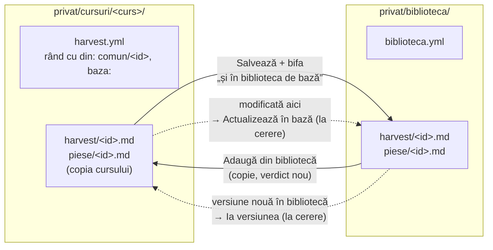

# Biblioteca de bază: piese care trăiesc peste cursuri

- **Autor:** Radu (Arhitect) · **Data:** 2026-11-20 · **Versiune:** v1 (propunere)
- **Cerere (Alex, 2026-11-20):** „Aș vrea să pot alege dacă le salvez și în părintele principal. Ar trebui să avem câteva piese care sunt într-o bibliotecă de bază, nu doar în biblioteca Change Agility.”
- **Pornește de la:** D-048–D-051 (o sursă, trei ieșiri), `arhitectura-curs-change-agility-v0.md` secțiunea 1.9 (piese locale acum, bibliotecă comună după 25, prefixul `comun/` rezervat), D-078 (formatul fișei), `curs/README.md` (Harvest, Fișa).
- **Stare:** de aprobat de Alex (3 decizii, la final). După aprobare, spec-ul merge la Mike. Fără cod până atunci.
- **Public:** aici e doar arhitectura și id-urile pieselor. Conținutul stă în `privat/` (BEMORE-STUDIO).

---

## Pe scurt

1. Biblioteca de bază e **un folder ca un curs, fără ediții**: `privat/biblioteca/`. Aceeași formă ca `privat/cursuri/<curs>/`: `biblioteca.yml` (rândurile), `harvest/<id>.md` (fișele), `piese/<id>.md` (piesele produse), `materiale/`.
2. „Salvez și în bibliotecă” = **copie cu legătură**. Cursul are mereu copia lui, completă. Rândul din `harvest.yml` ține minte de unde vine (`din: comun/<id>`) și ce versiune a luat (`baza: <amprentă>`). Editorul arată dacă piesa e la zi, modificată în curs sau dacă biblioteca are o versiune mai nouă. **Nimic nu se schimbă singur**, nici în curs, nici în bibliotecă.
3. Alegerea e o **bifă lângă „Salvează”** în dialogul Fișa: „Salvează și în biblioteca de bază”. Implicit **nebifată**, ca personalizarea pe curs să fie drumul normal.
4. În Harvest: butonul **„Adaugă din bibliotecă”** aduce o copie cu legătură, cu verdict „nou”. Pe cartonaș apare semnul **◇ bază**.

---

## 1. Unde stă și ce conține

```
privat/                         (repo-ul privat BEMORE-STUDIO)
  biblioteca/                   biblioteca de bază, una singură
    biblioteca.yml              rândurile pieselor (același format ca un rând din harvest.yml)
    harvest/<id>.md             fișa piesei (formatul D-078)
    piese/<id>.md               piesa produsă, dacă există (ecrane, nota trainerului, participant)
    materiale/                  imaginile și printabilele folosite de piesele de aici
    .editor-istoric/            copiile de siguranță, ca la cursuri
  cursuri/
    change-agility/
      harvest.yml               rândul are, opțional, din: și baza:
      harvest/<id>.md
      piese/<id>.md
```

**De ce un folder ca un curs:** același parser, aceleași cartonașe, aceeași fișă, aceleași verificări. Mike nu scrie un format nou. Biblioteca se poate și deschide în editor ca un curs (`node build.mjs ../privat/biblioteca`), ca să vezi toate piesele de bază într-un loc (Biblioteca de piese, Prezintă). Fără ediții, fără Flow, fără agendă.

**Ce intră:** ambele, cât există. Fișa (`harvest/<id>.md`) e logica piesei; piesa produsă (`piese/<id>.md`) e ce se vede în sală. O piesă poate fi în bibliotecă doar cu fișa (încă neprodusă). Materialele pe care le cere piesa (`materiale:` din antet și imaginile din corp) se copiază și ele.

**`biblioteca.yml`:**

```yaml
# Biblioteca de bază: piesele care se refolosesc între cursuri.
piese:
  - id: contract
    titlu: …
    scop: …
    durata: 20
    tip: deschidere
    etichete: [Deschidere]
    din_curs: change-agility        # de unde a plecat prima dată (informativ)
```

Fără `verdict`, `bloc`, `ordine`: astea țin de un curs, nu de bibliotecă.

**Numele:** id-ul din bibliotecă e id-ul simplu (`contract`), unic în bibliotecă, aceleași reguli ca azi (litere mici, cifre, cratimă). Când îl citezi din afara bibliotecii, se scrie **`comun/<id>`**. Asta e folosirea prefixului rezervat în 1.9. În curs, copia păstrează același id (`contract`), deci agenda, Flow-ul și Prezintă nu se schimbă deloc. Agenda unei ediții **nu** primește `comun/…`: cursul folosește mereu copia lui. Verificarea „`comun/…` în agendă oprește build-ul” rămâne.

---

## 2. Semantica: copie cu legătură

### Cele trei variante

| Varianta | Cum merge | Pentru | Contra |
|---|---|---|---|
| A. Copie independentă | „Salvează în bibliotecă” copiază și uită | cea mai simplă | după o lună nu mai știi ce piese sunt aceleași; o îmbunătățire nu mai ajunge nicăieri |
| **B. Copie cu legătură** (recomandată) | cursul are copia lui; rândul ține `din:` și `baza:`; editorul compară și spune ce s-a schimbat | cursul rămâne complet și portabil; personalizarea e liberă; vezi mereu cine e la zi; nu se strică nimic singur | două câmpuri în plus pe rând |
| C. Referință | cursul citește piesa direct din bibliotecă | o singură sursă | o schimbare pentru un curs strică altul (exemplele adaptate, timpii, limba); ca să personalizezi ai nevoie de suprascrieri, adică de un al doilea format; cursul nu mai e un folder complet |

**De ce B:** e regula din 1.9 („cursul rămâne un folder complet”) plus ce cere Alex: să aleagă. Personalizarea pe curs (exemplele adaptate pentru un client, durata, limba) e normalul, nu excepția, deci cursul trebuie să-și poată schimba copia fără să atingă biblioteca. Legătura costă două câmpuri și dă vizibilitate: știi oricând ce s-a schimbat și unde.

### Câmpurile, pe rândul din `harvest.yml`

```yaml
  - id: contract
    …
    sursa: bibliotecă
    din: comun/contract     # piesa-mamă din biblioteca de bază
    baza: 3f9a1c2b          # amprenta versiunii din bibliotecă pe care a luat-o cursul
```

- **`baza` e o amprentă, nu un număr de versiune:** primele 8 caractere din SHA-256 peste fișa și piesa produsă din bibliotecă (concatenate, în ordinea `harvest/`, `piese/`; materialele nu intră). Nimeni nu numără versiuni de mână.
- Un singur fișier se schimbă la legare/dezlegare: `harvest.yml`. Fișa și piesa nu primesc câmpuri noi.

### Cele patru stări (editorul le calculează, nu se scriu nicăieri)

Editorul calculează trei amprente: **B** = `baza` din rând, **L** = biblioteca acum, **C** = copia din curs acum.

| Stare | Când | Semnul pe cartonaș | Ce poate face Alex |
|---|---|---|---|
| La zi | C = B și L = B | ◇ bază | nimic de făcut |
| Modificată în curs | C ≠ B, L = B | ◇ bază · modificată aici | la următoarea salvare, bifa „Actualizează și în bibliotecă”; sau lasă-o personalizată |
| Versiune nouă în bibliotecă | C = B, L ≠ B | ◇ bază · nouă în bibliotecă | **„Ia versiunea din bibliotecă”** (suprascrie copia din curs, cu copie în `.editor-istoric/`) sau „Rămân la a mea” (pune `baza = L`, nu mai întreabă) |
| S-au schimbat amândouă | C ≠ B, L ≠ B | ◇ bază · diferă | dialogul arată cele două fișe alăturat și Alex alege una: „Păstrez a cursului” / „Iau din bibliotecă” / „Trimit a cursului în bibliotecă”. Fără îmbinare automată |

### Ce se întâmplă când Alex editează piesa în curs după ce a salvat-o în bibliotecă

- **Implicit (bifa nebifată):** se schimbă doar copia din curs. Biblioteca rămâne cum era. Cartonașul trece pe „modificată aici”. Asta e personalizarea: exemplele adaptate stau în curs.
- **Cu bifa:** se scrie în curs și în bibliotecă, apoi `baza` primește noua amprentă. Dacă între timp biblioteca s-a schimbat din alt curs (L ≠ B), editorul **nu suprascrie**: arată „Biblioteca s-a schimbat de când ai luat piesa” și deschide alegerea alăturată (starea „diferă"). E aceeași regulă ca detectarea de conflict pe care o face Mike acum pentru fișe.
- Celelalte cursuri care au luat piesa văd, la următoarea deschidere, „nouă în bibliotecă”. Le actualizează doar dacă Alex apasă.

### Dezlegare

„Dezleagă de bibliotecă” (în dialogul Fișa, discret) șterge `din:` și `baza:` din rând. Piesa devine a cursului, simplu. Pentru piesele pe care Alex le-a adaptat atât de mult încât nu mai sunt aceeași piesă.

---

## 3. Cum aduci o piesă din bibliotecă într-un curs

**În Harvest, sus pe coloana 1 · Harvest: butonul „Adaugă din bibliotecă”.**

1. Se deschide o listă compactă cu piesele din `biblioteca.yml` (titlu, scop, durată, tip, ◆ la challenge), cu căutare și filtre-buton după tip și etichete (ca Banca v2, care i-a plăcut lui Alex). Piesele deja în curs sunt marcate „e deja în curs”, nu se pot adăuga a doua oară.
2. „Adaugă” pe un rând face, într-un singur pas:
   - copiază `harvest/<id>.md`, `piese/<id>.md` (dacă există) și materialele lor în folderul cursului;
   - adaugă rândul în `harvest.yml` cu `verdict: nou`, `sursa: bibliotecă`, `din: comun/<id>`, `baza: <L>`.
3. Cartonașul apare în coloana 1 cu ◇ bază. Alex îi dă verdictul ca oricărei piese: în cursul ăsta, piesa de bază e tot o candidată.

**Id ocupat în curs** (există deja o piesă locală cu același id, nelegată): editorul propune `<id>-baza` și îl lasă pe Alex să-l schimbe. Nu suprascrie.

**Fișierul offline** (fără editor): nu are acces la bibliotecă, deci nu are „Adaugă din bibliotecă”. Arată doar semnul ◇ bază și starea calculată la build.

### Cum se vede că piesa vine din bază

- **Cartonaș (Harvest, Curate, Flow):** semnul **◇ bază**, plus starea, doar dacă nu e „la zi”. Tooltip: „Din biblioteca de bază (`comun/contract`)”.
- **Biblioteca de piese:** filtrul „Proveniență”: Curs / Bază.
- **Rezumatul de sus:** o cifră în plus la Biblioteca, „din bază: N” (link spre filtru), și „N cu versiune nouă în bibliotecă”, dacă există.
- **Fișa:** sub titlu, un rând: „Din biblioteca de bază · la zi / modificată aici / nouă în bibliotecă”.

---

## 4. UX în editor: unde e alegerea

**În dialogul Fișa, în modul Editează, lângă butonul „Salvează”:**

```
[ Salvează ]   ☐ Salvează și în biblioteca de bază
```

- Piesă nelegată: textul e „**Salvează și în biblioteca de bază**”. Bifată, la salvare: scrie în curs, copiază fișa (și piesa produsă, dacă există) în `privat/biblioteca/`, adaugă rândul în `biblioteca.yml`, pune `din:` și `baza:` în `harvest.yml`. Dacă biblioteca are deja o piesă cu acest id, de altă proveniență: „Există deja `comun/<id>` în bibliotecă. Dă alt id” (câmp precompletat cu `<id>-2`).
- Piesă legată: textul devine „**Actualizează și în biblioteca de bază**”. Conflictul se tratează ca în secțiunea 2.
- **Implicit nebifată, la fiecare deschidere.** Nu ține minte alegerea de data trecută. Așa personalizarea nu ajunge din greșeală în bază.
- Același lucru și la „Piesă nouă”: bifa e acolo de la început, tot nebifată.
- Fără buton separat „Trimite în bibliotecă” în Harvest. O singură ușă, în locul în care Alex oricum scrie.

**Siguranța, aceleași reguli ca azi:** același server local, același token; scrierea în bibliotecă e permisă doar în `privat/biblioteca/` (calea se află relativ la curs, `../../biblioteca`, sau cu `--biblioteca <cale>`); copie în `privat/biblioteca/.editor-istoric/` înainte de orice suprascriere; detectare de conflict pe fiecare fișier scris.

### Fluxul



---

## 5. Candidații din Change Agility (propunere pentru Alex)

Criteriul: piesa nu depinde de tema cursului; ar merge la fel într-un workshop despre AI, leadership sau echipe.

| Piesa (id) | Rolul | De ce în bază |
|---|---|---|
| `contract` | deschiderea zilei | orice zi de workshop începe cu el |
| `closing-asimilare` | închidere: pașii de după | orice zi se încheie cu un pas concret |
| `closing-apreciere` | închidere: reflecție | la fel, independent de temă |
| `closing-ciclul-invatarii` | închidere: ce am învățat azi | la fel |
| `ce-tine-de-mine` | exercițiu (cerc de influență) | merge pe orice schimbare, problemă sau stres; e un instrument, nu o temă |
| `sistemul-meu-in-schimbare` | exercițiu în perechi | de confirmat de Alex: e general sau ține de Change Agility? |
| `challenge-plan-invatare` | challenge ◆ | un plan de învățare are sens la final de orice curs |

**Rămân în curs** (țin de tema Change Agility): `toleranta-capacitate`, `mesaj-toleranta-capacitate`, `normalul-redefinit`, `de-ce-conteaza`, `trei-abilitati`, `ipoteza-cursului`, `definitia-bemore`, `agil-sau-cinic`, `mesaj-predictii`, `expunerea-nu-ajunge`, `exemplul-strategiei`, `persoana-in-incertitudine`, `schimbari-lumea-moderna`. `challenge-ai-literacy` e candidat natural pentru cursul de pe 25 (Self-management în relația cu AI), ca **piesă adusă din curs în curs**, nu neapărat în bază.

**Momentul:** prima umplere a bibliotecii o face Alex din editor, cu bifa, după 23 (ca în 1.9: abia după ce o piesă a fost folosită de două ori știm sigur că e de bază). Dacă Alex vrea piesele de deschidere și închidere și pentru 25, le putem pune înainte.

---

## 6. Spec pentru Mike (după aprobare)

1. **Biblioteca:** `privat/biblioteca/` cu `biblioteca.yml` (`piese:`, rânduri ca în harvest, fără verdict/bloc/ordine, plus `din_curs` opțional), `harvest/`, `piese/`, `materiale/`. Build-ul o poate deschide ca pe un curs fără ediții.
2. **Câmpuri noi în `harvest.yml`:** `din` (`comun/<id>`) și `baza` (8 hex). Verificări: `din` fără prefixul `comun/` sau cu id inexistent în bibliotecă = avertisment (nu oprește build-ul, ca un curs să meargă și fără biblioteca lângă el); `baza` fără `din` = eroare.
3. **Amprenta:** SHA-256 peste `harvest/<id>.md` + `piese/<id>.md` (cele care există), primele 8 caractere. Starea (la zi / modificată aici / nouă în bibliotecă / diferă) se calculează la build și în editor.
4. **Editor, dialogul Fișa:** bifa „Salvează / Actualizează și în biblioteca de bază”, implicit nebifată; scrierea în bibliotecă cu copie în `.editor-istoric/` și detectare de conflict; „Ia versiunea din bibliotecă”, „Rămân la a mea”, alegerea alăturată la „diferă”, „Dezleagă de bibliotecă”.
5. **Editor, Harvest:** „Adaugă din bibliotecă” (listă compactă, căutare, filtre-buton), copiere fișă + piesă + materiale, rând nou cu `verdict: nou`, `sursa: bibliotecă`; id ocupat → propune `<id>-baza`.
6. **Semne:** ◇ bază pe cartonaș, starea pe fișă, filtrul „Proveniență” în Biblioteca de piese, cifra „din bază” în rezumat.
7. **Calea bibliotecii:** implicit `<curs>/../../biblioteca`, opțional `--biblioteca <cale>`. Scriere permisă doar acolo.
8. **Teste:** `exemple/` primește o bibliotecă `[EXEMPLU]` cu 2 piese și un curs care folosește una (stările „la zi” și „nouă în bibliotecă”). Nimic real în repo-ul public.
9. **Documentare:** secțiune nouă în `curs/README.md` („Biblioteca de bază”), un rând în `docs/procese/curs-nou.md` la Harvest pas cu pas, rândul din `privat/README.md`.

Estimare: 1–2 zile, după editarea fișelor (lucrul în curs al lui Mike). Nu e urgent pentru 23.

---

## Ce decide Alex

1. **Direcția: copie cu legătură** (cursul are copia lui, editorul îți spune când diferă de bibliotecă, nimic nu se schimbă singur). Alternativa: referință directă (o singură sursă, dar personalizarea pe curs devine complicată).
2. **Bifa „Salvează și în biblioteca de bază” e implicit nebifată**, la fiecare salvare. Alternativa: ține minte alegerea pe piesă.
3. **Ce piese intră primele în bază:** propun `contract`, cele trei closing-uri și `ce-tine-de-mine`; de confirmat `sistemul-meu-in-schimbare` și `challenge-plan-invatare`. Și când: după 23 (recomandat) sau deja pentru 25.

## Istoric

| Data | Ce s-a schimbat |
|---|---|
| 2026-11-20 | v1: biblioteca de bază `privat/biblioteca/`, copie cu legătură (`din`, `baza`), bifa în Fișa, „Adaugă din bibliotecă”, candidații din Change Agility. De aprobat de Alex. |
