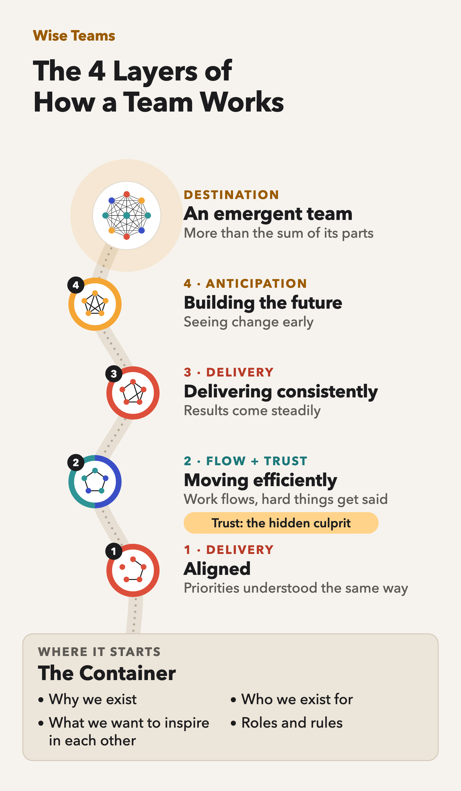

# Wise Teams, articolul 1: The 4 Layers of How a Team Works (v7, versiunea lui Alex)

> 2026-11-26: acesta e textul lui Alex, transcris din PDF-ul trimis de el (`../model-alex-articol-4-layers-2026-11-26.pdf`). Alex: „Da, a mea”, adică versiunea lui devine textul articolului. **Nepublicat.** Echipa nu-l rescrie; schimbări doar la cererea lui.
> Adăugat de Tudor: imaginea aleasă de Alex („A · Drumul”), după introducere, și linkul spre articolul *The 3 Hidden Forces* de pe Substack-ul lui.
> v6 (draftul echipei, cu un key insight pe capitol, fără emoji): `arhiva/wise-teams-articol-1-2026-11-20-v6.md`. Versiunile mai vechi sunt tot în `arhiva/`.
> LinkedIn: flux separat, după aprobarea articolului (card în Trello).

---

## Textul pentru Substack (EN)

# The 4 Layers of How a Team Works
*The path from where a team starts to what it can become.*

When a team isn't getting the results it wants, where do we look first?

At people.

Who isn't committed enough? Who doesn't communicate? Who doesn't take ownership?

It's an understandable reflex. People are what we see.

But there's another place worth looking.

In [The 3 Hidden Forces That Shape High-Performing Teams](https://alexandrumolea.substack.com/p/the-3-hidden-forces-that-shape-high), I explored how every team develops a repeatable system of working together — by design or by default.

Because results don't come only from what people do individually. They emerge from how people work together.

So, if we want to understand a team's performance, we need to look beyond individual behaviours and examine the system connecting them.

At Wise Teams, we see this as a journey. It starts with the Container, moves through four essential layers — Delivery, Flow, Trust and Anticipation — and leads towards something more: an emergent team, where the whole becomes greater than the sum of its parts.

Let's explore the journey.

### Before the journey: The Container

**Key insight: When people lose sight of what they're working towards together, they start focusing on their own goals instead.**

Every team needs a Container: a shared understanding of why it exists, who it exists for, what its members want to inspire in one another, and the roles and rules that guide their work.

The Container gives a team its boundaries, direction and sense of belonging.

Yet teams can gradually lose sight of it.

People become increasingly focused on their own responsibilities, individual targets and immediate priorities. Everyone stays busy, but the bigger picture becomes less visible.

Work continues, but the sense of working towards something together starts to fade.

What's left is often the necessary minimum, done as efficiently as possible.

Before asking a team to perform better, it's worth asking: do we still know what we're here to build together?

### 1. Delivery: Getting aligned

**Key insight: A team isn't aligned just because everyone agrees in the meeting. People can work hard in the same team and still pull in different directions.**

The first expression of Delivery is alignment.

Do people understand the priorities in the same way? Are expectations explicit? Do team members genuinely commit to the same direction?

Agreement in a meeting doesn't necessarily mean alignment.

People can leave the same conversation with different interpretations of what matters, what success looks like and what they are expected to contribute.

When this happens, individual effort can be high while collective progress remains limited.

Alignment is not about everyone thinking alike. It's about making sure different perspectives, responsibilities and contributions connect to a shared direction.

Without it, a team risks becoming a collection of individual efforts rather than a coordinated force.

### 2. Flow and Trust: Moving efficiently

**Key insight: Work moves faster when coordination is clear and people can bring difficult things into the conversation.**

This is where the quality of a team's internal dynamics becomes visible.

Two capabilities make a fundamental difference: Flow and Trust.

#### Flow: How work moves through the team

Flow is about how information, decisions, tasks and responsibilities move from one person to another.

It includes the processes, routines and coordination mechanisms that allow people to work together effectively.

But processes can become outdated. Meetings can lose their purpose. Decisions can get stuck. Information can circulate without reaching the people who need it.

A process that nobody questions anymore can stop serving the team and start blocking it.

Most teams spend considerable time working within their processes, but very little time examining how well those processes actually work.

Flow requires the ability to step back occasionally and ask:

What makes our work easier? What creates friction? Where do decisions get stuck? What needs to change so work can move forward?

Process is to a team what metacognition is to thinking: the ability to examine and improve the way we work.

#### Trust: How much truth can the team handle?

Trust is often treated as something abstract, something that develops naturally over time.

But its impact is very concrete.

Without trust, people hesitate to raise difficult issues, challenge assumptions or address disagreements directly.

Problems stay hidden longer than they should. Tensions become personal. Accountability becomes uncomfortable. Decisions get delayed or quietly undermined.

A team may appear to function well on the surface while important conversations happen elsewhere — in private exchanges, informal alliances or conversations that never reach the whole group.

Trust is not the absence of disagreement or conflict.

It's the capacity to work through differences without damaging the relationships that make collaboration possible.

And this is often one of the hardest things for a team to develop by itself. Different people bring different perspectives, expectations and interpretations. Bringing them together requires more than good intentions.

It requires deliberate work.

**Flow helps work move. Trust makes it possible for people to move through the difficult parts of working together.**

### 3. Delivery: Delivering consistently

**Key insight: Delivery is not where results are made. It's where the quality of everything underneath becomes visible.**

Once priorities are aligned and the team has developed better ways of working together, the next challenge is consistency.

Are commitments translated into action? Is progress visible? Are results monitored? Does the team learn when things don't go as planned?

When results fall short, many leaders instinctively increase pressure.

More follow-ups. More urgency. More meetings. More reminders to take ownership.

And sometimes this works, at least temporarily.

Pressure can create focus and accelerate action. But it cannot replace the underlying conditions that make consistent performance possible.

Over time, constant pressure consumes energy, increases tension and can lead to disengagement.

The more sustainable alternative is to develop the team's ability to monitor its own progress, make commitments visible, address obstacles early and hold one another accountable.

Consistent delivery is not simply about getting people to work harder.

It's about creating a system in which the team can reliably turn intentions into results.

### 4. Anticipation: Building the future

**Key insight: Always putting out fires is rarely just a speed problem. It's often a sign that anticipation has no place in how a team works.**

Once a team can deliver consistently, it has an opportunity to lift its head and look beyond immediate demands.

But many teams never quite get there.

They spend most of their energy responding to what is urgent, repeating familiar solutions and solving variations of the same problems.

The future becomes something that happens to them rather than something they actively shape.

Anticipation means developing the capacity to notice changes early, question existing assumptions, experiment with new approaches and prepare for what might come next.

It also means creating space for innovation within the team's everyday work.

Firefighters, after all, train between fires.

Teams need the same discipline: not only performing today, but continuously improving how they will perform tomorrow.

The ability to anticipate is not reserved for strategy departments or senior executives. It needs to become part of how the team itself operates.

### Beyond the four layers: An emergent team

The journey doesn't end with a perfectly aligned, efficient and consistently delivering team.

That's not the destination.

The destination is an emergent team.

A team where the interaction between people creates something that none of them could produce alone: collective intelligence, stronger coordination, creativity, adaptability and trust.

Where people don't simply contribute their individual expertise, but actively build on one another's thinking.

Where the team can navigate complexity, address its own challenges and shape its future.

This doesn't happen by accident.

It emerges when the conditions for working together are deliberately developed.

At Wise Teams, this is why we do what we do: to bring the knowledge of how a team works into the team itself, helping people understand their dynamics, identify what needs attention and make progress at each stage of their journey.

Because improving a team doesn't start with fixing people.

It starts with understanding the system they create together.

**Results are what everyone sees. How a team works is what you build.**

### A question to take back to your team:

Where are you on this journey right now?

Are you aligned around a shared direction? Moving efficiently through your work? Delivering consistently? Or making space to anticipate and shape the future?

And what would make the biggest difference to the way you work together?

At Wise Teams, we'd be happy to explore these questions with you.

---

## De decis de Alex
- Linkul spre *Your team needs two threads* (pomenit în versiunile echipei la „Firefighters… train between fires”) nu e în textul lui; nu l-am adăugat.
- Numele în engleză (T-049) sunt acum cele din textul lui.
