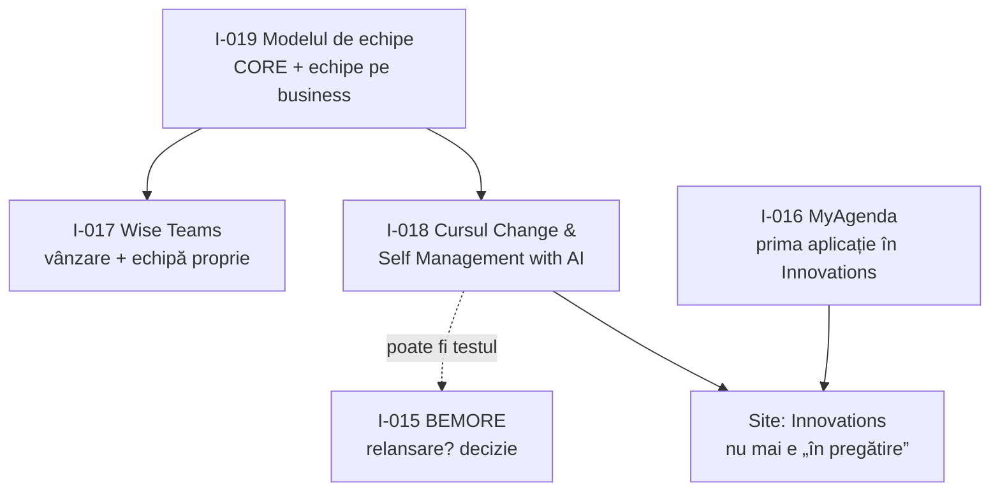

# Harta perioadei următoare (2026-11-16)

**DRI:** Tudor. **Status:** propunere, Alex alege ce pornim.
**Pornește de la:** cele patru dorințe ale lui Alex din 2026-11-16, notate în backlog ca I-015…I-018, plus I-019, de care depind două dintre ele.

## Ce vrea Alex, în cuvintele lui
1. „Mi-ar plăcea să relansăm BEMORE-ul ca și companie de training, dar nu mi-e 100% clar că vreau să fac asta.” → **I-015**
2. „Mi-ar plăcea să lansăm niște aplicații pe care să le punem pe site-ul meu la Innovations. Prima va fi MyAgenda.” → **I-016**
3. „Mi-ar plăcea să dezvoltăm procesul de vânzare pentru Wise Teams. Wise Teams mi-ar plăcea să aibă propria echipă de agenți care comunică și colaborează cu această echipă din CORE.” → **I-017**
4. „Mi-ar plăcea să dezvoltăm cursul de Change și de Self Management with AI. Asta mi-ar plăcea și să se regăsească pe site, dar și să avem o echipă separată de agenți care se ocupă de asta, la fel ca la Wise Teams.” → **I-018**

## Cum se leagă

Ce am observat:
- **Două dorințe cer același lucru.** Wise Teams și cursul vor fiecare o echipă proprie care colaborează cu CORE. Modelul îl facem o singură dată (I-019), apoi îl folosim pentru ambele și pentru orice echipă viitoare.
- **Echipele de business au nevoie de un loc privat.** Vânzarea Wise Teams înseamnă clienți, prețuri și oferte. Toate astea nu au voie în repo-ul public (`docs/procese/ce-iese-public.md`). Propunerea mea: fiecare echipă de business lucrează într-un repo privat. CORE rămâne public și primește doar ce poate fi văzut. Decizia e a lui Alex: **D-043**.
- **BEMORE e o decizie, nu un proiect.** Alex nu e sigur, deci nu construim nimic. Mai e un motiv de clarificare: BEMORE Learning Studio și Innersis fac deja training. Relansarea BEMORE trebuie să spună prin ce diferă.
- **Cursul poate fi testul pentru BEMORE.** În loc să decidem în abstract, cursul nou poate fi livrat sub marca BEMORE. Dacă merge, avem un argument. Dacă nu, am pierdut puțin.
- **MyAgenda e cel mai concret pas.** Camera Innovations există pe site, dar e goală. Prima aplicație o umple. Depinde doar de descrierea lui Alex.
- **Tudor ar fi DRI pe prea multe.** Am trecut pe mine I-017, I-018 și I-019 pentru că țin de componența echipei. Când echipele există, fiecare primește un coordonator propriu, care raportează și lui Tudor.

## Ordinea logică (propunere)
| # | Ce | De ce în ordinea asta | Depinde de |
|---|---|---|---|
| 1 | **I-019 Modelul de echipe** | deblochează două din patru dorințe | D-043 (repo privat) |
| 2 | **I-016 MyAgenda în Innovations** | cel mai mic pas cu rezultat vizibil; umple site-ul cu conținut real (prioritatea nr. 1) | descrierea lui Alex |
| 3 | **I-017 Wise Teams** | primul business cu proces de vânzare; prima echipă separată | I-019 |
| 4 | **I-018 Cursul** | a doua echipă, pe modelul deja testat la Wise Teams | I-019, cât din I-017 am învățat |
| 5 | **I-015 BEMORE** | rămâne decizie deschisă; o reluăm cu datele din curs | I-018 (opțional, ca test) |

## Ce propun să pornim acum (cel mult 2, alegi tu)
1. **I-019 Modelul de echipe.** Îl scriu eu, cu Radu, Mike și Elena. Rezultat: un document de o pagină despre structura echipelor, cum comunică între ele și ce e privat. Plus un exemplu pentru Wise Teams. Nu creez încă niciun repo și niciun agent.
2. **I-016 MyAgenda.** Pornește după ce îmi răspunzi la întrebările 28–31. Radu face fișa aplicației și pagina ei, Mike o publică, iar Maria scrie textul de lansare. Tu aprobi lansarea.

## Întrebări pentru Alex
Sunt în `docs/intrebari-pentru-alex.md`, numerele 28–39. Cele care deblochează ceva acum: 28–31 (MyAgenda) și D-043 (repo privat).

## Jurnal
| Dată | Ce s-a întâmplat |
|---|---|
| 2026-11-16 | Alex a dat cele patru dorințe. Tudor le-a notat (I-015…I-019) și a scris harta. |
| 2026-11-16 | Alex: workshop-urile din 23 și 25 (I-018) sunt prima nevoie (D-044). Ordinea de mai sus pornește după 25. Echipa Studio: `echipa-workshopuri-v0.md` (D-045). |
